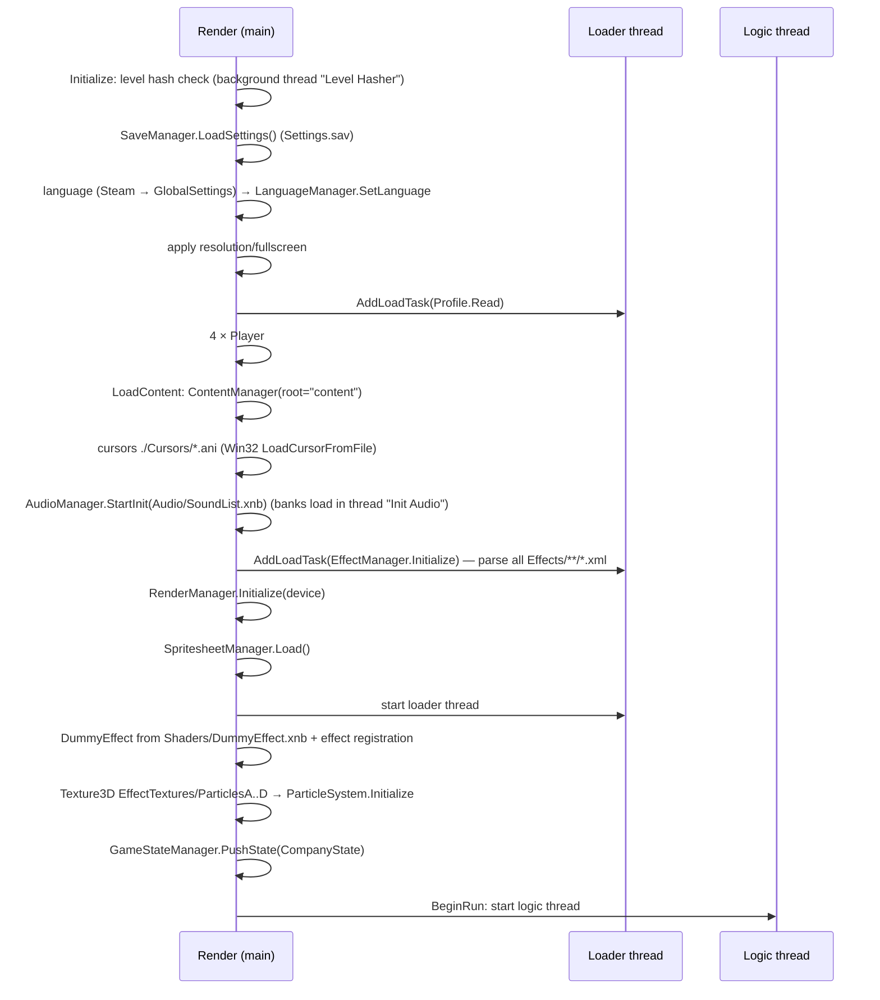

# OpenMagicka — core architecture of the original Magicka engine

> Document scope: the engine core — startup, main loop and threads, state machine,
> PolygonHead render pipeline, shaders, particles, camera, physics, audio, input,
> localization, saves. Gameplay (spells, entities, AI, triggers) and the formats of
> custom XNB readers are described in other documents.
>
> Source: `Magicka.exe` 1.10.4.2 + `PolygonHead.dll` + `JigLibX.dll` 0.0.2 +
> `XNAnimation.dll` 0.7, studied with ILSpy, and the assets of the Steam install.
>
> **Clean-room.** This document contains only descriptions of architecture and behavior:
> tables, diagrams, lists of parameters and formats. Decompiled code is not copied into
> this document or into the repository. Where an exact formula matters for compatibility
> (hashes, encryption), it is described in words.

Previous overview: [`../ENGINE_ANALYSIS.md`](../ENGINE_ANALYSIS.md).

---

## 0. Key findings

1. **Threads.** Three threads are used: render (the XNA main thread), logic (its own
   thread, variable step) and loader (a queue of load tasks). Frame data is passed
   through **triple buffering** `DataChannel` A/B/C. Each draw layer in `Scene`,
   the camera state and the GPU buffers for particles and lights exist in three instances.
2. **Rendering is classic deferred DX9.** Pass order: depth prepass into R32F →
   G-buffer of 2 MRTs (`Color` + normal `Color`) → decals → shadows → light accumulation
   (additive) → composition with fog → sky → additive objects → particles (soft) →
   post effects → color grading → GUI into a 4×MSAA buffer → transition (fade) → bloom (1/16) → backbuffer.
3. **Shaders.** The effect bytecode embedded in `PolygonHead.dll` (classes `*EffectCode`)
   **matches byte for byte** `Content/Shaders/*.xnb` for 25 of 27 effects (verified by
   script). It does not need to be extracted from the DLL: everything is in the user's assets in
   `fx_2_0` format (magic `0xFEFF0901`), SM 3.0, with preshaders. FNA/MojoShader
   can load this bytecode directly. The main obstacle: XNA 4.0/FNA has no **`EffectPool`**
   (shared parameters).
4. **Saves are not encrypted.** `Settings.sav`, `campaign.sav`, `Profile.sav` and
   `ch_*.sav` are `BinaryWriter` binaries with a version prefix. `DLCData.sav` is XML.
   "Encryption" (`Encryption`) is applied only to `pops.sav` (Paradox token) and is
   not needed for OpenMagicka. The algorithm and key derivation are described below.
5. **`col.dat`** is a text file whose first line holds the number of
   unlocked player colors (`10` in the Steam copy).
6. **Audio.** XACT content version **45** (XACT3 of the XNA 3.1 era). Wave banks contain PCM,
   MS-ADPCM and **xWMA** (`Wave Bank.xwb`, `Loc.xwb`). FAudio/FACT compatibility with v45 and
   xWMA must be checked first.
7. **Licenses.** XNAnimation is distributed under Ms-PL (according to GitHub forks), so
   the upstream sources can be ported. The JigLibX license is not confirmed: upstream JigLib
   is distributed under zlib, and JigLibX is presumably MIT or Ms-PL. The
   "port vs rewrite" decision is described in §13.

---

## 1. Startup

### 1.1 `Program.Main`

Startup sequence:

1. Marks the current thread as the main thread (the `TrackedThread` wrapper is needed for
   a crash report with the stacks of all threads) and subscribes to `UnhandledException`.
2. Sets the working directory to the exe directory. **All paths in the game are relative:**
   `content/…`, `./SaveData/…`, `./Cursors/…`.
3. Checks the SHA-256 of `steam_api.dll` against a hardcoded value, then runs
   `SteamAPI.RestartAppIfNecessary(42910)` and `SteamAPI.Init`. **Not needed in OpenMagicka.**
4. Parses command-line arguments (case-insensitive): `-window` (windowed mode),
   `+connect_lobby <id>`, `+password <pw>`, `+connect` (ignored).
5. Creates the `Game` singleton and calls `Run()`.

The crash report is written to `errorReport_yyyy.MM.dd-hh.mm.ss_(N).txt` in the game
directory: version, thread name, exception, stacks of all `TrackedThread`s.

### 1.2 `Game` constructor (subclass of `Microsoft.Xna.Framework.Game`)

| Parameter | Value |
|---|---|
| `TargetElapsedTime` | 1/60 s |
| Minimum shader profiles | VS 3.0 / PS 3.0 |
| VSync | on (later taken from settings) |
| MSAA backbuffer | off (only the GUI buffer has MSAA) |
| Initial backbuffer | 800×600, then the resolution from `Settings.sav` is applied |
| Depth/stencil | `Depth24Stencil8` |
| `BackBufferCount` | 1 |
| Render thread | name "RenderThread", priority AboveNormal |

On `DeviceResetting` the logic thread is paused and render waits until it
stops. On `DeviceReset` the pause is released.

### 1.3 `Initialize` → `LoadContent` → `BeginRun`



### 1.4 Settings and configuration

There are no configuration files (ini/xml): everything is stored in `GlobalSettings`
(a singleton) and serialized to `SaveData/Settings.sav` (format in §11.2). Defaults:

| Setting | Default | Type |
|---|---|---|
| Resolution | current display mode | W/H/Refresh (int16 on disk) |
| Fullscreen | false (Program sets true without `-window`) | bool |
| Bloom / Shadow / AO / Decal quality | Medium | `SettingOptions` {Off, On, Players_Only, Low, Medium, High} |
| Particles | (not set → Off=0) | `SettingOptions` |
| ParticleLights | false | bool |
| VolumeMusic / VolumeSound | 7 / 7 (0…10) | byte |
| BloodAndGore, DamageNumbers, HealthBars, SpellWheel | On | `SettingOptions` |
| GameName | "Magicka Game" | string |
| VSync | false | bool |

`ShadowQuality` scales the shadow map size: Low gives ½ of the base, High gives ×2.

### 1.5 Content root and `SharedContentManager`

- Root: `content` (relative to the exe). In the Steam copy the directory is named `Content`.
  On Windows case does not matter, **on Linux/macOS a case-insensitive path resolver is required**.
  Mismatches also occur in code: `Additionalmusic.xsb` vs `AdditionalMusic`,
  `loc.xwb` vs `Loc.xwb`, `Languages/{lang}/Font` vs `font`.
- `SharedContentManager` is a **reference-counted** manager on top of a single shared
  `ContentManager`:
  - the asset name is normalized: an absolute path is trimmed to the part after `content`,
    then `GetFullPath` and **lowercase**;
  - the first load reads the asset. If an asset is loaded while another one is loading
    (nested `ExternalReference`), it is registered as a "child" of the parent;
  - each `SharedContentManager` instance (for example, one per `PlayState`) keeps
    its own counters. On `Unload` the counters are decremented, and an asset that reaches zero is released together
    with its children;
  - the shared manager is destroyed when the last `SharedContentManager` is closed.
- `PackedContent` (PolygonHead) is an alternative container. It is not used in the Steam build.

---

## 2. Main loop and threading model

### 2.1 Threads

| Thread | What it does | Rate |
|---|---|---|
| **RenderThread** (main, XNA `Game.Run`) | `Update(GameTime)`: resolution/vsync/fullscreen changes, cursor clip, focus. `Draw`: polls Keyboard/Mouse, grabs the ready `DataChannel`, `RenderManager.RenderScene` | Fixed timestep 60 Hz when the load queue has tasks; otherwise variable (the loader thread switches it!) |
| **LogicThread** | Infinite loop: `AudioManager.Update` → `Game.Update(dt)` (Steam callbacks, `GameStateManager.Update`, Network, Achievements) → `Sleep(1)` | Variable step, `dt` clamped to **0.05 s** |
| **LoaderThread** | Runs `Action`s from the FIFO queue `AddLoadTask` (loading levels, profile, effects) | `Sleep(1)` between tasks |
| "Init Audio", "Level Hasher" | One-shot background tasks | — |

GPU resources are created from **any** thread under `lock(GraphicsDevice)`: loader
creates textures and buffers, logic calls `SetData` on the dynamic VBs of particles and lights. Render
holds the same lock during `RenderScene`.

### 2.2 `DataChannel` triple buffering

`DataChannel` = {None=-1, A, B, C}. The protocol is:

```mermaid
stateDiagram-v2
    [*] --> LogicPick
    LogicPick: Logic picks a channel ≠ UsedByRender and ≠ NextToRender
    LogicPick --> LogicFill: GameStateManager.Update(channel, dt)
    LogicFill: Scene.ClearObjects(channel) and filling lists, Camera.mStateBuffer[channel], SetData of particle/light buffers
    LogicFill --> Publish: NextToRender = channel
    Publish --> LogicPick
    state Render {
      Take: UsedByRender = NextToRender; NextToRender = None (wait while None)
      Draw: RenderScene(scene, channel)
      Release: UsedByRender = None
      Take --> Draw --> Release
    }
```

- All operations on the pair (`UsedByRender`, `NextToRender`) run under one lock.
- Logic is **throttled** only when a published frame has not been taken for more than
  0.2 s (render hung or minimized). The rest of the time logic runs ahead of render, and
  unrendered frames are simply overwritten.
- Render, when no frame is ready, spins in `Sleep(1)` and updates the keyboard and mouse state.
- What has a copy per channel: 6 object lists in `Scene`; `Camera.CameraState`
  (View, Projection, ViewProjection, Position, EyeOfTheBeholder, Direction, Up) and
  the frustum; the particle dynamic VB (3 × 32768 × 56 bytes); the VB of the point and particle
  light batch; `RenderData[3]` on objects (each object has three instances of its draw data).
- Render pause (`DisableRendering`) blocks logic in `PlayState.Update`
  (the frame counts as busy) until render confirms it has stopped.

**For OpenMagicka:** this model is worth keeping in a simplified form. Logic writes a
CPU snapshot of the frame, render only reads it and uploads the data to the GPU **itself**. FNA3D
does not guarantee thread safety of the GL context, and `SetData` from the logic thread must be removed.

### 2.3 `GameStateManager` and states

- A stack of `GameState`. `PushState`/`PopState` are deferred until the start of the next
  `Update` (via a queue and a flag). `ChangeState` runs immediately under a lock.
  An empty stack leads to `Game.Exit()`.
- Each `Update(channel, dt)` calls `CurrentState.Update` and
  **`PersistentGameState.Update`** (an overlay on top of all states: popup widgets, HUD,
  shop). Render calls `DrawGui` of the current scene, then of the persistent state's scene
  (except `CompanyState`).
- The `GameState` base owns a `Scene` (capacity 512 per layer) and a camera. The base
  `Update` clears the channel's lists and handles input (`ControlManager.HandleInput`).

| State | Camera | Purpose |
|---|---|---|
| `CompanyState` | default | Splashes Paradox → Arrowhead → "Pieces" → Magicka (delegate chain), then `ChangeState(MenuState)` |
| `MenuState` | — | The menu "Tome" (`Tome`), banners, dialogs, tooltips |
| `PlayState` | `MagickCamera` | Game level. Parameters: custom, level file, `GameType`, spawn point, save slot, versus settings |
| `PersistentGameState` | Camera(near 1, far 500) | GUI overlay |
| `LoadingScreen` | — | Loading screen (its own screen-sized RT) |

`GameType`: Campaign, Mythos, Challenge, Versus, etc. (see `GameType.cs`).

`PlayState.Update` order (useful for determinism):

1. If the level is not ready or render is paused, the frame is busy; exit.
2. Pause or in-game menu while offline: `dt = 0`.
3. `dt *= TimeModifier × TimeMultiplier` (TimeWarp, etc.).
4. Physics (`JigLibX Integrate(dt)`) → AI → entity quad grid → animated level
   parts → entities → boss → healthbar → removal of dead → misc (decals,
   blob shadows, credits, tutorial, inventory, players, game end) → network updates
   with a period of 1/30 s → HUD → input.

---

## 3. PolygonHead render pipeline

### 3.1 Scene object model

`Scene` keeps these lists per `DataChannel`:

| Layer | Interface | Sorting | Methods |
|---|---|---|---|
| Pre-render | `IPreRenderRenderer` | — | `PreRenderUpdate(...)` is called on the render thread before the frame (for example, the grass sway texture) |
| Opaque | `IRenderableObject` | (Effect, Technique, VerticesHash), binary insertion | `Cull`, `Draw`, `DrawShadow`; techniques Depth/Technique/Shadow (−1 = none) |
| Additive | `IRenderableAdditiveObject` | same | `Cull`, `Draw` |
| Projection (decals) | `IProjectionObject` | same | `Draw(effect, depthMap)` |
| Post | `IPostEffect` | ZIndex | `Draw(dt, pixelSize, view, proj, color, depth, normal)` |
| GUI | `IRenderableGUIObject` | ZIndex | `Draw(dt)` |
| Lights | `Light` (outside channels) | grouped by (Effect, Technique) | add/remove via queues, applied in `UpdateLights` |

An object's effect is specified by an **int ID** = `Type.GetHashCode()` of the effect class and
is registered in `RenderManager` (an ID → Effect dictionary). Within one group
(Effect+Technique), `Begin`/`Pass.Begin` runs once, and VB/IB/Decl
are switched only when they change. **For OpenMagicka:** a stable enum or ID is needed instead of the type hash.

### 3.2 Render targets

All RTs are recreated when the backbuffer size changes (the `ResulutionChanged` event).

| RT | Size | Format | Purpose |
|---|---|---|---|
| `DepthBuffer` | screen | **R32F** (`Single`) | Linear/projective depth from the depth prepass. Read by lights, decals, particles (soft), post effects |
| `MainBuffer` (MRT0) | screen | `Color` RGBA8 | Albedo and material parameters, then the composition result |
| `NormalBuffer` (MRT1) | screen | `Color` RGBA8 | Normal and parameters (cleared to (0.5, 0.75, 0.5, 0.5)) |
| `SecondaryBuffer` | screen | `Color` | Light accumulator, then a copy of the scene for post effects |
| `GUIBuffer` | screen | `Color`, **4× MSAA** when supported | Scene result after the filter + GUI + transition |
| GUI depth-stencil | screen | D24S8, MSAA same as GUI | — |
| `SixteenthA/B` | screen/16 | `Color` | Bloom |
| Half/Quarter/Eighth | — | declared but not created | (dead code) |
| `ScreenShot` | screen | `ResolveTexture2D` | Screenshot (saves, Tome) |
| Shadow map directional/spot | `ModShadowResolution(base)` | **R32F** + D24 | — |
| Shadow map point | cube, same size | **R32F cube** + D24 | 6 faces |
| Sway target (`GameScene`) | 512² | HalfVector4 (fallback Vector4) | Vegetation displacement from entities |
| Loading screen | screen | `Color` | — |

The exact G-buffer channel layout (what is in A of Main/Normal, how the
normal and spec/emissive are encoded) can only be recovered by disassembling the shaders
(§4.4). Judging by the material parameter names, it holds diffuse, spec amount and power,
emissive amount, normal power and reflectiveness.

Since OpenMagicka runs the original shaders for every pass, the channel layout stays inside
them; what the engine must reproduce is how each pass is fed (from the original's render code):

| Pass | Effect, technique | Inputs |
|---|---|---|
| Depth clear | `ClearEffect` fullscreen into Depth | — |
| Depth prepass | `RenderDeferredEffect` technique 4 (`Depth`) per opaque object | World and material, globals |
| G-buffer init | `RestoreDepthEffect` fullscreen into Main+Normal | `SourceTexture0` = Depth; `Color0` = (background RGB, 0); `Color1` = (0.5, 0.75, 0.5, 0.5); it also writes the depth back |
| G-buffer | `RenderDeferredEffect` technique by material: `ReflectionMap` set → `SingleLayerReflection` (2) or, with a second diffuse texture, `DualLayerReflection` (3); otherwise `SingleLayer` (0) or `DualLayer` (1). Depth test LessEqual | material (below) |
| Light | into Secondary cleared to 0, blend One / InvSrcColor. `DirectionalLightEffect` technique 0 with shadows, 1 without, on the fullscreen quad | `SourceTexture0` = Normal, `SourceTexture1` = Depth, `SourceTexture3` = shadow map; `LightDirection`, `DiffuseColor`/`AmbientColor`/`SpecularAmount` × intensity |
| Composition | `DeferredShadingEffect` fullscreen into Main | `SourceTexture0` = Main, `1` = Normal, `2` = Depth, `4` = Secondary (light); `FogEnable`/`FogStart`/`FogEnd`/`FogColor` |

- Material parameters of `RenderDeferredEffect`: `World`, `Alpha`, `Sharpness`, `VertexColorEnabled`,
  `UseMaterialTextureForReflectiveness`, `ReflectionMap`, and per layer *n* = 0, 1: `DiffuseColorn`,
  `SpecAmountn`, `SpecPowern`, `EmissiveAmountn`, `NormalPowern`, `Reflectivenessn`,
  `DiffuseTexturenAlphaDisabled`, `AlphaMasknEnabled`, `DiffuseTexturen`, `MaterialTexturen`,
  `NormalTexturen`. Setting a texture also sets its flag (`DiffuseTexturenEnabled`,
  `MaterialTexturenEnabled`, `NormalMapnEnabled`) to whether it is non-null.
- Characters (models with a `SkinnedModelBasicEffect` material) are drawn with `SkinnedModelDeferredEffect`,
  technique 0 (`Default`) in the G-buffer and 3 (`Depth`) in the prepass. The model's material is copied
  over as the game does: `EmissiveAmount`, `SpecularAmount`, `SpecularPower`, `UseSoftLightBlend`,
  `OverlayAlpha` = the material's `Diffuse1Alpha`, `DiffuseMap0` (details) and `DiffuseMap1` (base) with
  their flags, the specular map as `MaterialMap` (flag `SpecularMapEnabled`), `NormalMap`. A character is
  then drawn with `DiffuseColor` = 1, `FresnelPower` = 4, `Colorize` = 0 (non-zero only while frozen),
  no damage maps, and `Bones` = the skin transforms (identity in the bind pose); there is no `World`.
  Using only one of the diffuse maps leaves holes: the detail map is transparent where the base shows.
- Fullscreen quad: a 4-vertex triangle strip of `VertexPositionTexture`, positions (±1.5, ±1.5, 1) with
  texture coordinates −0.25…1.25 (so (±1, ±1) maps to 0…1), and `DestinationDimensions` = target size.
- A level's directional light comes from its light list (intensity 1 unless it varies); the
  original composes into Main while reading it; OpenMagicka renders the composition into a separate
  target, since sampling and writing one texture is undefined on modern APIs.

### 3.3 `RenderManager.RenderScene` pass order

```mermaid
flowchart TD
    A[PreRender update of objects] --> B[RT0=Depth R32F: Clear effect fullscreen]
    B --> C[Scene.DrawDepth: Depth technique of all opaque, cull CCW]
    C --> D["MRT: Main+Normal. RestoreDepth fullscreen:<br/>Main=(BG,0), Normal=(0.5,0.75,0.5,0.5), restores z from Depth"]
    D --> E[Scene.Draw: G-buffer, stencil Always/Replace ref 0*]
    E --> F[Scene.DrawProjection: decals, alpha blend, no alpha write, stencil Keep]
    F --> G[UpdateLights: apply queues, Light.Update]
    G --> H[DrawLightShadows: shadow maps of lights with CastShadows]
    H --> I["RT=Secondary clear 0. Blend One/InvSrcColor (screen-like add)<br/>Scene.DrawLights(normal, depth)"]
    I --> J["RT=Main: DeferredShading fullscreen<br/>(Main, Normal, Depth, Secondary=light) + linear fog"]
    J --> K[SkyMap fullscreen, if a 2D skymap is set]
    K --> L[DrawAdditive: Blend InvDestColor/One, depth test without write]
    L --> M[ParticleSystem.Draw: instancing, soft by Depth]
    M --> N[RT=Secondary: copy of Main]
    N --> O[Scene.DrawPost: IPostEffect by ZIndex, source Main/Depth/Normal]
    O --> P["RT=GUI(MSAA): Filter (brightness/contrast/saturation) from Secondary"]
    P --> Q[DrawGui of current scene + persistent]
    Q --> R[Transition: fade/crossfade over the GUI buffer]
    R --> S["Bloom: Downsample+threshold → 1/16, H-blur, V-blur → Combine into backbuffer"]
    S --> T[opt. ResolveBackBuffer → screenshot]
```



\* Stencil values are set by the objects themselves: level 0, avatars 1, animated physics objects 2
(used for silhouettes behind walls). Some of the states apparently live in the state blocks
of FX passes.

Important details:

- **Bloom is applied after the GUI**, so a bright GUI glows too. Default
  parameters: threshold 0.8, multiplier 1.0, sigma 2.5. A scene can override them.
- **Global parameters** (View, Projection, ViewProjection, InverseViewProjection,
  CameraPosition, EyeOfTheBeholder, Time ∈ [0,1) modulo 1) are passed through
  `DummyEffect` and a **shared `EffectPool`**. All effects created with this pool see them
  as `shared`. In the shadow pass, `ViewProjection` in the pool is temporarily replaced with the light's
  matrix.
- `TextureLODBias` = −0.5 on samplers 0…7.
- Light is accumulated in `Color` RGBA8, so there is no HDR. There is a GUI parameter `ScaleToHDR`.
- `GUIScale` = screen height / 720.
- Transitions (`Transitions`): None, Fade, CrossFade. Color and time are configurable,
  `TransitionEnd` is called when the In direction completes.
- The "pixels → clip" matrix for the GUI accounts for the DX9 half-pixel offset (−1−1/W, +1+1/H).

### 3.4 Light sources

| Type | Geometry | Techniques | Shadows |
|---|---|---|---|
| `DirectionalLight` | fullscreen quad | WithShadows / WithoutShadows | 2D R32F, orthographic projection anchored to the "snapped ground position". Can project a texture (clouds): ProjectedTexture, Offset, Scale, Intensity |
| `PointLight` | icosphere 42 vertices / 80 triangles, scale = radius; cull CW from inside | WithShadows / WithoutShadows | Cube R32F, 6 passes |
| `SpotLight` | cone | 4 techniques (± shadows, ± attenuation) | 2D R32F |
| `PointLightBatcher` | sphere instancing, up to **128** lights, 48 bytes per instance | one | no |
| `ParticleLightBatcher` | same, up to **256** lights, light from particles with its own TTL, gravity, drag | one | no |
| `CapsuleLight`, `DynamicLight` (Magicka) | capsule | own effects | — |

Common `Light` properties: DiffuseColor, AmbientColor, SpecularAmount, Intensity,
`LightVariationType` (flicker: Speed, Amount), `LightTransitionType` (fade in and fade out
over a given time), Enabled, CastShadows.

### 3.5 PolygonHead materials and effects

| Effect | Techniques | Key parameters / notes |
|---|---|---|
| `RenderDeferredEffect` (static geometry, 710 materials in XNB) | SingleLayer, DualLayer, SingleLayerReflection, DualLayerReflection, Depth, Shadow, AdditiveFresnel | 2 layers: DiffuseColor, Spec Amount/Power, Emissive, NormalPower, Reflectiveness, Diffuse/Material/Normal textures, AlphaMask, ReflectionMap (cube), FresnelPower, VertexColor, Sway and EntityInfluence (grass), Bloat. Variant **WVT** (vertex texture fetch of the sway texture) or **WOVT**: the choice depends on support for VTF of the Vector4 format |
| `RenderDeferredLiquidEffect` (water/ice) | Default, Reflection, Depth, Shadow | WaveHeight, WaveSpeed0/1, BottomColor, DeepBottomColor, Water Spec/Emissive, WaterNormalMap, ReflectionMap; ice: IceColor, IceDiffuse/Normal/EdgeMap. The second vertex stream is a **per-vertex "freeze" float** (dynamic VB), ice at ≥ 0.5 |
| `LavaEffect` | Default, Depth, Shadow | MaskDistortion, Speed0/1, Hot/Cold emissive, TempFrequency, ToneMap, TempMap, MaskMap, Rock* (rock that appears when it cools) |
| `SkinnedModelDeferredEffect` | Default, AlphaBlended, Additive, Depth, Shadow, NonDeffered, AdditiveFresnel | Characters. RimLight, Bloat, Colorize |
| `SkinnedModelDeferredNormalMapped` | — | Skinning + normal map |
| `AdditiveEffect` | Technique1 | Additive objects |
| `HardwareInstancedProjectionEffect` | — | Decals: up to 30 instances per draw via **constant arrays** (World, InvWorld, Args, Colors), cube of 8 vertices / 12 triangles |
| `ProjectionEffect` | — | Single projection (circles under avatars) |
| `DeferredShadingEffect` | — | Composition: Main × light + fog (FogEnable, Start, End, Color) |
| `FogEffect` | Exponential, ExponentialSquare, Linear | Separate fog post effect |
| `SkyMapEffect` | — | Fullscreen 2D skymap × Color |
| `BloomEffect` | DownSample, HorizontalBlur, VerticalBlur, Combine | Threshold, Multiplier, Sigma |
| `FilterEffect` | — | Brightness, Contrast, Saturation |
| `RestoreDepthEffect`, `ClearEffect`, `BasicPostProcessingEffect` | — | Utility fullscreen |
| `Fade/CrossFadeTransitionEffect` | — | Transitions |
| `GUIBasicEffect` | Texture2D, Texture3D | Transform, Color, Texture, OverlayTexture and Tint, TextureOffset and Scale, ScaleToHDR, Saturation |
| `ParticleEffect` | Default | §5 |
| Magicka effects (`Content/Shaders`) | — | Arcane, Buff, Chasm, Entangle, ForceField, Shield, Invisibility, Mist, NormalDistortion, RadialBlur, RainSplash, Saturation, Sway, Vortex, SpellWheel, TextBox, NotifierButton, Pie, Flash, CapsuleLight, DecalHardwareInstancing, GUIHardwareInstancing, SkinnedModelSkeleton, SkinnedShield |

Materials (`IMaterial<T>`: Fetch, AssignToEffect, AssignOpacity) are lightweight
parameter structures. One effect instance is shared; the material is uploaded before
each object's `Draw` and committed via `CommitChanges`.

### 3.6 Sky, fog, per-scene color grading

`GameScene` (scene XML) sets `Fog` (Enabled, Start, End, Color RGBA), SkyMap (a 2D texture),
Brightness, Contrast, Saturation, bloom parameters and `RoomType` (§8). On leaving
`PlayState` everything is reset to defaults: fog off, 1/1/1, no skymap, sigma 2.5.

### 3.7 Decals

- `DecalManager`: atlas `EffectTextures/decals` of **8×8 cells** (enum `Decal`:
  five kinds of blood × 4 variants, Scorched, Crater, Cold, Water, LifeGround, ArcaneGround,
  Buff/Aura × 3, Grease, MagickCircle, MagickBurn, Cracks, reserved, TestPattern).
- Decals are projected boxes (deferred decals). A pixel is taken from the depth buffer and
  transformed into the box's local space via InvWorld. They are drawn in batches of 30,
  stencil Equal ref 1, no depth write. They have TTL and fade and can be attached to an animated
  level part. The limit is set by `DecalLimit`.

### 3.8 GUI and text

- `BitmapFont` (XNB `BitmapFontReader`): lineHeight, baseLine, defaultChar, texture,
  glyphs (char, origin XY, size XY, advance, LSB, ForceWhite), kerning (char pairs → int).
- `Text`: VB of 128 bytes per character (4 vertices × 32 bytes: pos2, uv2, color4), static
  or dynamic, alignment. **Inline markup:** `[c=r,g,b(,a)]…[/c]` sets the color.
  Localization inserts it when expanding `#key;` references.
- Fonts: `Languages/<lang>/Font/{Maiandra14/16/18, Stonecross28/36/50, Versustext,
  MenuDefault, MenuOption, MenuTitle, PDXUI*…}`. Each language has its own set; if
  missing, the English one is used.
- The GUI is drawn into `GUIBuffer` with alpha blend (SrcAlpha/InvSrcAlpha) after
  scene color grading.

---

## 4. Shaders: storage and loading

### 4.1 Embedded bytecode

Each `XxxEffectCode` class contains a static `byte[] CODE` (a FieldRVA in IL) —
a compiled **D3D9 Effect** (`fx_2_0`: first bytes `01 09 FF FE`). The effect
constructor passes the bytecode to `Effect(GraphicsDevice, byte[], CompilerOptions, EffectPool)`.
PolygonHead contains 27 such blobs.

### 4.2 Match with `Content/Shaders/*.xnb`

Verified by a script (`xnb.py` + comparison):

- **25 effects match byte for byte** the corresponding `.xnb`: Additive,
  BasicPostProcessing, BatchedPointLight, Bloom, Clear, CrossFade, DeferredShading,
  DirectionalLight, FadeTransition, Filter, Fog, GUIBasic, HardwareInstancedProjection,
  Lava, Particle, PointLight, Projection, RenderDeferredWOVT/WVT, RenderDeferredLiquid,
  RestoreDepth, SkinnedModelDeferredNormalMapped, SkyMap, SpotLight.
- **Differ:** `DummyEffect` (embedded 1236 bytes, xnb 1156; the game loads
  the xnb version anyway as the "local dummy") and `SkinnedModelDeferredEffect` (same
  size, 77720 bytes, different content, apparently a different build). Which variant
  is correct must be checked.
- Another 25 Magicka effects exist **only** as `.xnb`.

XNB effect wrapper (XNA 3.1): reader `Microsoft.Xna.Framework.Content.EffectReader`,
followed by an int32 length and the bytecode (offset 56 after LZX decompression). Profiles: almost everything is
**vs_3_0 / ps_3_0**. Arcane, Flash, NormalDistortion, Pie and Saturation are built for SM 2.0.
Many effects contain **preshaders** (`FXLC`) and state blocks in passes.

### 4.3 Suitability for FNA / MojoShader

- FNA creates an `Effect` from "raw" D3D9 effect bytecode and translates it through
  MojoShader (GLSL, SPIR-V, Metal, DXBC via SDL_GPU). fx_2_0, SM1–3,
  preshaders and pass state blocks are supported. **So the original shaders can be taken directly
  from the user's `Content/Shaders`**, without extracting them from the DLL and without copying them into the repository.
- Obstacles and how to work around them:
  1. **`EffectPool` and `shared` parameters do not exist in XNA 4.0/FNA.** Global
     parameters (`View`, `Projection`, `ViewProjection`, `InverseViewProjection`,
     `CameraPosition`, `EyeOfTheBeholder`, `Time`) must be set explicitly on each
     effect before `Apply`. It needs checking how MojoShader handles parameters with
     the shared flag: most likely as ordinary ones.
  2. The XNA 3.1 API had `Begin`/`Pass.Begin`/`CommitChanges`; FNA has `Pass.Apply()` instead.
     Changing parameters after `Apply` requires another `Apply`.
  3. FNA applies render state in FX passes (blend, stencil, cull). It needs checking that
     states set by code do not overwrite the required values: in XNA 3.1 code set
     state before `Begin`.
  4. Instancing via stream frequency (`SetFrequencyOfIndexData`) is replaced with
     `VertexBufferBinding(…, instanceFrequency:1)` + `DrawInstancedPrimitives`.
     Semantics and vertex layout stay the same.
  5. The WVT variant requires vertex texture fetch of the Vector4 format. It is safer to start with WOVT.
  6. DX9 half-pixel: FNA emulates DX9 rasterization rules, and shaders receive
     `HalfPixel` explicitly. Correct behavior is expected, but it must be checked on point lights.

### 4.4 Disassembly

To understand the G-buffer exactly, a shader dump is needed: `fxc /dumpbin` (Windows SDK) or
`MOJOSHADER_parseEffect` → GLSL. The dump should be made **only locally from the user's
assets** and not committed to the repository. The goal is to document the channel
layout, not to port code. In the long run, our own HLSL shaders with the same
layout remove the dependency on the original blobs (and enable mods).

---

## 5. Particles

### 5.1 `ParticleSystem` (GPU part)

- A global pool of **32768** particles; free indices are kept in a min-heap. Update runs on the
  CPU in the logic thread:
  - `TTL -= dt`;
  - normalized lifetime = 1 − TTL/maxTTL;
  - `vel.y += gravity·dt`;
  - `vel *= drag^dt` (drag is the fraction of velocity kept per second);
  - `pos += vel·dt`, `rot += rotSpeed·dt`;
  - size is linearly interpolated between start and end over the lifetime.
- Per-instance data is 56 bytes: Position(3f), Rotation, Radius, NormalizedLifetime,
  Color(4f), Sprite(byte), AlphaBlended(byte), HSV/Colorize(byte: HSV adds +50, Colorize
  +5), RotationAligned(byte), Velocity(3f). A quad of 4 vertices (corner id + uv), 6 indices,
  hardware instancing.
- Sprites are stored in four **Texture3D**s (`EffectTextures/ParticlesA…D`); the `Sprite` byte
  selects the slice. The shader receives Depth for soft particles.
- Blending **Src=One, Dst=SrcAlpha**, depth test off. One state gives both additive
  (the shader outputs α=1) and alpha blend (premultiplied color, α = 1−a), depending on the
  particle flag.
- `RotationAligned` orients the particle along its velocity.

### 5.2 `VisualEffect` and the `Effects/**/*.xml` format (904 files)

```text
<Effect type="Single|Looping|Infinite" duration="seconds" keyFramesPerSecond="N" [version="2"]>
  <ContinuousEmitter name="…"> …parameters… </ContinuousEmitter>
  <PulseEmitter name="…"> … <NrOfParticles …/> </PulseEmitter>
  <Light> <PositionX Value=…/> … DiffuseR/G/B, AmbientR/G/B, Specular, Radius,
          VariationType/Speed/Amount, Spawn/DespawnTransitionType/Time </Light>
</Effect>
```

- The shipped content has **904** effects with 2725 emitters (1381 continuous, 1344 pulse)
  and 31 lights; 703 files are version 1. Every top-level node except the `Effect` element is a
  copyright comment. `ItemAbilities/Tron_disc.xml` contains the character reference `&#x1F;` in an
  attribute; the original's XML reader does not check characters, so a strict parser must not
  either.
- **Root.** Every top-level node named `Effect` (ignoring case) is read into the same effect: the
  root element, and a processing instruction `<?Effect?>`, which has no attributes and makes the
  original fail. A file without one gives an empty effect (Single, duration 0, no emitters). Attributes, names
  ignoring case: `type` (enum parse ignoring case: Single/Looping/Infinite, default Single),
  `duration` (float, default 0), `keyFramesPerSecond` (int, default 10), `version` (int,
  default 1; ≥ 2 selects the version 2 reader). Enum parsing also accepts numbers and
  comma lists, so `type="7"` loads as an undefined value 7: the runtime must cope with it.
- **Children.** A child whose name is exactly `ContinuousEmitter` or `PulseEmitter` (case
  matters: it is a type name) is an emitter; one named `Light` (ignoring case) is the effect's
  light; everything else, comments included, is ignored.
- **Emitter parameters.** A child whose name exactly matches (case matters) a parameter of
  that emitter type is a parameter:
  - continuous emitters have the animatable parameters listed below; with child nodes the
    parameter is a key list, one key per child node: `time` attribute = frame (int) divided by
    `keyFramesPerSecond` as floats (default 0; a 0 or negative rate gives infinite, NaN or
    negative times, no error), `value` = float (default 0); the child's own name does not
    matter (the content uses `Key`), and a text or comment child makes the original fail.
    Without child nodes it is a constant from its `value` attribute (default 0). Keys keep file
    order; evaluation scans them in that order and stops at the first key with time > t; that
    key and the last key with time ≤ t seen before it are blended linearly; with only one of them
    its value is used; a single key is a constant; a parameter that is absent evaluates to **1**;
  - pulse emitters have the same names minus `ParticlesPerSecond`, plus `TriggerTime`, all plain
    floats from the `value` attribute (default 0, children ignored); an absent one is **0**.
- **Flags** (any other child; for each attribute named `value` ignoring case, child name
  compared ignoring case): `BlendMode` (Alpha blended if the value is `Alpha`, ignoring case,
  otherwise additive), `SpreadType` (cone if `Cone`, otherwise arc), `RotationAligned`, `HSV`,
  `ColorControlAlpha` (HSV = not the value), `Colorize` (booleans, .NET `bool.Parse`),
  `Particle` (byte, sprite index), `RelativeVelocity`, and in pulse emitters `NrOfParticles`
  (int). Version 2 adds `SpawnLights` and `LightSizeRelative`. Pulse emitters of version 1
  ignore `RelativeVelocity`. A value that does not parse makes the original fail, and so does a
  text, comment or processing-instruction node directly inside an emitter (it has no attributes).
  Defaults: additive, arc spread, all booleans false, `Particle` 0, `NrOfParticles` 0. A repeated
  parameter or flag: the last one wins (degrees are converted afterwards, once).
- **Version 1 colours.** After reading: ColorAMin/Max/Distribution = AlphaMin/Max/Distribution
  as read (absent stays absent), then ColorR/G/B, ValueMin/Max/Distribution and
  AlphaMin/Max/Distribution = constant 1.
- **Degrees.** RotationY, HueMin/Max, RotationMin/Max, RotationSpeedMin/Max, SpreadConeAngle,
  SpreadArcHorizontalAngle and SpreadArcVerticalMin/Max are converted from degrees to radians
  (every key). In a continuous emitter these 11 parameters must be present, or the original
  fails (every shipped continuous emitter has them).
- **Light** children (comments skipped; other non-element nodes make the original fail), for each
  attribute named `Value` ignoring case, child name ignoring case: PositionX/Y/Z (offset in the effect's space), DiffuseR/G/B,
  AmbientR/G/B, Specular, Radius, VariationSpeed, VariationAmount, SpawnTransitionTime,
  DespawnTransitionTime (floats); VariationType (None, Sine, Flicker, Candle, Strobe) and
  Spawn/DespawnTransitionType (None, Linear, Flicker), enum parse ignoring case. All start at 0 /
  None; a second `<Light>` element changes only the properties it sets.
- Numbers: floats with the invariant culture (thousands separators allowed; a number outside the
  float range, such as `1e40`, overflows in .NET Framework, while the `Infinity` and `NaN`
  symbols are accepted), integers with leading and trailing whitespace and a sign allowed.
- Animatable parameters, full list: ParticlesPerSecond, PositionX/Y/Z, Position{X,Y,Z}Offset,
  RotationY, Gravity, Drag, ColorR/G/B, ColorAMin/Max/Distribution, Hue/Sat/Value/Alpha
  Min/Max/Distribution, LifeTimeMin/Max/Distribution, SizeStart/SizeEnd Min/Max/Distribution,
  VelocityMin/Max/Distribution, RotationMin/Max, RotationSpeedMin/Max, RotationPCCW
  (percentage of particles rotating counterclockwise), SpreadConeAngle/Distribution,
  SpreadArcHorizontalAngle/Distribution, SpreadArcVerticalMin/Max/Distribution, LightRadius,
  LightDiffuseR/G/B, LightAmbientR/G/B, LightSpecular.
- The `*Distribution` parameter is an exponent: a random u∈[0,1) is raised to the
  power d, then mapped onto [min,max]. d>1 biases values toward min.
- Random numbers come from a **precomputed table** of 65536 floats and 65536 bytes
  (0…99), built by the standard .NET Framework `System.Random(seed=0)`. Each
  emitter keeps a 16-bit cursor initialized from `DateTime.Now.Ticks`.
  `new Random(0)` in modern .NET (with an explicit seed) reproduces the same legacy algorithm, so the table can be
  produced identically.
- Emission in `ContinuousEmitter`: the rate is the mean of the PPS values at the start and end of the frame,
  multiplied by the global `SpawnModifier` (the Particles setting). The particle count equals the difference
  of floor(totalTime·rate) between frames. Positions and transforms are interpolated between the previous
  and current frame so that fast emitters leave a continuous trail. Direction: Cone
  (around the Z axis of the local matrix) or Arc (horizontal angle ± and vertical range,
  axis −Z).
- `VisualEffect.Update`: Single stops when duration expires, Looping
  wraps time modulo duration, Infinite holds the last frame. A `<Light>` source
  follows the effect transform via `PointLightBatcher`.
- `EffectManager` (Magicka) reads `content/Effects` recursively at startup (a directory's files,
  then its subdirectories). The key is the **hash of the lowercase file name without
  extension** (§12.1); two files with the same name anywhere in the tree make the original fail
  (the shipped names are unique; OpenMagicka reports which two files clash). Up to
  **256** instances are active at once. An instance reference (`VisualEffectReference`) = index + unique ID.

---

## 6. Camera (`MagickCamera`)

- Perspective with a **very narrow FOV of 5°** (an almost orthographic view).
- Camera offset from the target: (0, 144, 171), which is ≈224 units at an angle of ≈40° to the horizon.
  Near 105, Far 500. Aspect in PlayState is 16:9 (a constant; 4:3 exists separately).
- Behavior (`CameraBehaviour`): FollowPlayers, FollowEntity, Locked, MoveToTarget.
  Interpolation: Linear (100 units/s divided by time) or Interpolated (a spring with
  velocity).
- FollowPlayers:
  - target = mean of the positions of living local players (if there are none, network players);
  - Y = mean "floor" level of standing players;
  - an "influence vector" from hostile characters and a bias are added to the target (`SetBias`,
    exponential smoothing with base 0.02).
- Constraints:
  - the target is snapped to the **camera mesh** (triangles from `LevelModel`) or to the camera box:
    the closest point is taken;
  - 4 frustum planes with a margin of 0.5 block movement in a direction where players would leave
    the frame (`mCanMoveUp/Right/Down/Left`, `mCanZoomIn`). Entities reset and set
    them.
- Magnification (zoom) = FOV_default / FOV, with exponential smoothing. Dynamic
  magnification picks the zoom so that the farthest player fits within half the FOV
  (min/max set by script). There is a temporary player magnification with a TTL.
- Camera shake: a sine of TTL×60, the amplitude decays linearly.
- The audio listener is placed 20 units above the ground point under the camera. Forward = Down,
  Up = Forward (top-down view).
- Visual effects attached to the camera follow its position.
- The base `PolygonHead.Camera` writes `CameraState` into the channel buffer and builds the frustum.

---

## 7. Physics (JigLibX)

### 7.1 World setup (`PhysicsManager`)

| Parameter | Value |
|---|---|
| Gravity | (0, −19.64, 0), i.e. 2 × 9.82 |
| Broadphase | `CollisionSystemSAP` (sweep and prune) |
| Solver | Normal |
| Freezing (body sleep) | on |
| AllowedPenetration | 0.001 |
| Sweep tests | on |
| Shock step | off |
| Step | `Integrate(dt)` once per logic tick, `dt` ≤ 0.05 |
| Freeze/UnFreeze | global physics pause |

### 7.2 Custom primitives and detectors

- `HollowSphere` is a custom primitive type with ID = `PrimitiveType.NumTypes` (8), i.e. the
  first free one. Wall thickness 0.5; an angle limit (`MaxAngle`, π by default)
  gives an arc or a dome. Used for shields (a sphere you can walk into).
- Detectors are registered that replace or extend the standard JigLibX pairs
  (key = type0<<16 | type1): HollowSphere × {Capsule, Sphere, Box, TriangleMesh};
  **CustomCapsule** × {StaticMesh, Plane, Capsule} (the character capsule).
- `CharacterBody` is a capsule-based character body. It detects ground contact (a normal with
  y < −0.7 in DirToBody0), the **ground material** (primitive index in the collision skin),
  leaving the ground, fall damage, touching `Water`.
- `IceMesh` and `WaterMesh` are subclasses of `TriangleMesh` with a per-vertex freeze
  coefficient. They filter triangles in AABB queries (water is passable, ice is solid)
  and switch into each other. `Lava` works the same way (solidified lava).
- `PhysicsObjectBody` is a body with a `ReactToCharacters` flag. `PointJoint` is a hinge joint.

### 7.3 Collision materials

`CollisionMaterials` (byte): Generic, Gravel, Grass, Wood, Snow, Stone, Mud,
Reflect, Water, Lava (10 in total). `LevelModel` contains **10 TriangleMesh primitives,
one per material**: the primitive index in the skin = the material. The material selects the footstep
sound, effects, railgun reflection off `Reflect`, etc. Friction parameters
(`MaterialProperties`): level (1, 1, 1), water and lava (0, 10, 10), animated parts
(0.1, 1, 1). `CollisionSkinReader` (XNB): Vector3 vertices, int32 indices in triples in
the order I2, I1, I0 (winding order inverted).

---

## 8. Audio (XACT)

- `AudioEngine("content/Audio/magicka.xgs")`. On failure, an
  Abort/Retry/Ignore dialog is shown.
- Banks are loaded in a background thread. The bank index = the bit number in the `Banks` enum:

| Bit | Bank | .xsb/.xwb | Mode | Formats |
|---|---|---|---|---|
| 0 | WaveBank | `Sound Bank.xsb` / `Wave Bank.xwb` | in-memory | **xWMA** 44.1/22 kHz |
| 1 | Music | `Music` | **streaming** (packet 64) | MS-ADPCM stereo |
| 2 | Ambience | `Ambience` | streaming | MS-ADPCM |
| 3–9 | UI, Spells, Characters, Footsteps, Weapons, Misc, Additional | same names | in-memory | PCM 16/44.1 (Additional — ADPCM) |
| 10 | AdditionalMusic | file `Additionalmusic.*` (case!) | streaming | ADPCM |
| 11 | (localized speech) | `Languages/<lang>/Loc.xwb`, fallback `eng` | in-memory | **xWMA** |

- File versions: XGS `XGSF` tool 45 / format 42, XSB `SDBK` 45/43, XWB `WBND` 45/43,
  i.e. **XACT content version 45**.
- Cue names: `Audio/SoundList.xnb` (`List<string>`) is turned into a dictionary
  "hash of lowercase name → name". Code and XML refer to sounds by hash (§12.1).
- Volume categories: Music, plus Sfx, Ambient, Default, UI, VO, VOloc under the common
  sound volume (0…10 → ×0.1).
- XACT global variables:
  - `RoomType` — the scene's reverb preset: None 0, Generic 10, SmallRoom 20, StoneRoom 30,
    Cave 40, Forest 50. Reverb is implemented with RPC/DSP presets in `.xgs`;
    the scene sets the `RoomType` attribute;
  - `ReverbMix` — smoothly, up to 50 units per second;
  - `MusicFocus` = distance of the nearest player to the focus point / radius, clamped to
    [0,1], or the default value;
  - `MusicThreat` — rises by 5/s up to 10 in combat, falls by 2/s.
- Music: one current cue. On change, the old one is stopped with `AsAuthored`
  (authored crossfade). Restarting the same cue is ignored.
- 3D: `Cue.Apply3D(listener, emitter)`; the camera updates the listener (§6). Active cues
  are kept in a list; stopped ones are removed in `Update`. There is group pause and
  resume.
- `AudioManager.Update` is called from the logic thread, `engine.Update()` every tick.

---

## 9. Input

- **Keyboard and mouse** (`KeyboardMouseController`): 17 `KeyboardBindings` bindings.
  Each is stored as {IsMouse, Button(byte)}, Button = an XNA `Keys` code or `MouseButton`
  {Invalid, Left, Middle, Right, X1, X2, ScrollUp, ScrollDown}. Defaults:

| Action | Key | Action | Key |
|---|---|---|---|
| Water | Q | Cast (beam/projectile) | RMB |
| Life | W | CastSelf | MMB |
| Shield | E | Boost | Space |
| Cold | R | Move | LMB |
| Lightning | A | Block (Cast Area modifier) | LCtrl |
| Arcane | S | Shift | LShift |
| Earth | D | Inventory | Tab |
| Fire | F | Prev / Next Magick | wheel up / down |

  Escape, Win and Apps cannot be bound. Text input (chat, names) goes through
  WinForms `IMessageFilter` (WM_CHAR, KEYDOWN, SYSKEY…), `TranslateMessage` and `MapVirtualKey`.
- **XInput** (`XInputController`, 4 pads): XNA `GamePad.GetState`. 24
  `ControllerFunction` bindings (Move ×4, Menu Select/Back, Spell ×4, Magick Next/Prev, Attack,
  Special, Block, Interact, Boost, Cast Force/Area/Self/Magick, Pause, Inventory,
  Spell_Wheel). Types: Button (an XNA `Buttons` flag), Trigger, Positive/NegativeStick
  (axis index 0…3). By default the left stick moves, the right one selects items
  (spell wheel), A selects, B goes back…
- **DirectInput** (`DirectInputController`, Managed DirectX): non-XInput gamepads and
  joysticks (filtered via `XInputHelper.IsXInputDevice`). Button, POV, ±Axis bindings are stored
  by the **device InstanceGuid**. A pad counts as "configured" only if it has
  saved bindings.
- `ControlManager`: the menu controller (keyboard), the list of XInput and DInput pads,
  `FindNewGamePads`, `LimitInput` (temporary lock with a cooldown), per-player input
  lock. `PersistentGameState` receives events first if a popup is open.
- Cursors: `./Cursors/*.ani` (Default, Talk, Examine, PickUp, Attack, Interact + Gray
  variants, Invisible). Loaded via Win32 `LoadCursorFromFile`, switched via
  `Form.Cursor`. In PlayState the cursor is confined to the window (`Cursor.Clip`).

---

## 10. Localization

- Languages = subdirectories of `content/Languages/` with ISO 639-2 names, recognized
  via the `Language` enum (values are LCIDs: eng=9, deu=7, fra=12, rus=25, …). The
  Steam copy has deu, eng, fra, hun, ita, pol, rus, spa.
- Language selection: Steam language → enum. If the language is unavailable, `eng` is used.
  It is saved in `Settings.sav`.
- Loading: all `*.loctable.xml` files in the language directory (Excel 2003 SpreadsheetML:
  `Workbook/Worksheet/Table/Row`; element names compared ignoring case). In a row with at
  least two child nodes, the text of the first node is the key and the text of the second
  is the string; cells are taken by position (`ss:Index` is ignored) and the text includes
  nested markup. Only keys starting with `#` count (this skips the header row). ID = **hash of
  the lowercase key, `#` included** (§12.1). Empty texts are skipped; later files override
  earlier ones. The order is the directory enumeration order, but in the shipped content no
  key has two different texts, so the order changes nothing. OpenMagicka uses name order
  ignoring case. Shipped table sizes: eng 3250, rus 3250, deu 3244, ita 3264, pol 3254,
  spa 3228, fra 3227, hun 3224 strings.
- `GetString` replaces the two characters `\n` with a line break and does not expand references.
- Reference expansion (`#key;`): find the first `#`, then the first `;` after it; the text
  between them (with the `#`) is a key, replaced by that string expanded the same way, and
  the scan restarts at the start of the text. With no `;` after the first `#`, expansion stops
  (so `50# off` stays as is). The coloured variant wraps every replacement in `[c=r,g,b]…[/c]`
  (numbers in invariant culture, 7 significant digits). `ParseReferences` on free text wraps
  each replacement in `[c=1,1,1]…[/c]` and uses `GetString`. The original has no limit and
  loops or overflows the stack on a cyclic reference; OpenMagicka stops at nesting depth 16,
  1024 replacements per call and a result length of 65536 chars.
- `#players` always returns the list of player names ("A", "A & B", "A, B & C"), even if a table
  defines that key.
- A string that is not found is returned as `NOT FOUND: <id>`. 84 item name and description keys
  (`#item_staff27` and others) have no string in any shipped language (85 in French).
- Changing the language reloads fonts (`FontManager.LoadFonts`) and `Loc.xwb`.

---

## 11. Saves (`SaveData/`)

All files are in `./SaveData/` next to the exe. Strings are written in .NET
`BinaryWriter` format: 7-bit varint length + UTF-8. Numbers are little-endian. A bool takes 1 byte.

### 11.1 Version

The version is stored as a string `"a.b.c.d"` (for example, `"1.10.4.2"`) and compared as
uint64 = a<<48 | b<<32 | c<<16 | d. Readers pick the layout by version threshold.

### 11.2 `Settings.sav`

Field order (variant ≥ 1.4.3.0):

1. string version;
2. byte BloodAndGore, DamageNumbers, HealthBars, SpellWheel;
3. VersusSettings: byte Mode + 5 × {byte ruleset, byte N, N bytes of values}
   (DeathMatch, Brawl, Kreitor, KingOfTheHill, PyriteSnitch);
4. int16 Width, Height, Refresh; bool Fullscreen;
5. byte Bloom, Shadow, DecalLimit, Particles; bool ParticleLights;
6. byte VolumeMusic, VolumeSound; string GameName;
7. FilterData: byte FreeSlots, Scope, GameType; int16 MaxLatency; bool VACOnly,
   FilterPlaying, FilterPassword;
8. 17 × {bool IsMouse, byte Button};
9. 4 pads × 24 × {byte Type, int32 Index} — XInput;
10. int32 N + N × {16 bytes GUID, 24 × {byte, int32}} — DirectInput;
11. string SteamLanguage; int32 Language; bool VSync; byte LobbyVisibility;
    string LastUsedHUD.

Older versions (1.2.9…1.4.1) differ in the presence and format of individual fields. On
a read error, the language is set to `eng` and the other settings stay at defaults.

### 11.3 `campaign.sav` / `starscampaign.sav` (Mythos)

- Optional marker: byte 0xFF + string version. Without the marker it is a version 1.0 file
  (version = 0).
- 3 slots × {bool present; if true — SaveData}.
- SaveData (≥ 1.4.1.0):
  - byte Level, byte MaxAllowedLevel, bool Looped;
  - int32 TotalPlayTime, CurrentPlayTime;
  - int32 N players × {string key(gamertag), string Staff, string Weapon};
  - uint64 UnlockedMagicks (bit mask);
  - int32 N tips × {string tipName, int32 count};
  - int32 checkpoint size + checkpoint bytes.

  Version 1.0 has no MaxAllowedLevel and no checkpoint.
- **Checkpoint blob**: 32 bytes SHA-256 of the scene/level file + 32 bytes SHA-256 of the
  dialog file + checkpoint state (spawn points, disabled triggers, entity
  state; the format is outside this document). If the hashes do not match,
  the checkpoint is ignored. **So checkpoint compatibility requires the same level files.**
- Writing is atomic: first `.tmp`, then delete and move.

### 11.4 Other files

| File | Format |
|---|---|
| `Profile.sav` | string version; int32 N × Gamer {string tag (≤15), byte color, string avatarName, uint32 Kills, Deaths, OverKilled, OverKills, uint64 HealingDone, HealingReceived, DamageDone, DamageReceived, uint32 Suicides, TeamKills, TeamKilled, VersusWins, WinStreak, Defeats}; dictionaries FoundMoose (string→bool), PlayerUsedElements (string→int32 Elements), FoundSecretAreas (string→bool); float TotalHealed; int32 OverKills, FrozenOverKills, LedFarmerKills; string lastGamer; int32 CruiseCount; int64 LastCruiseDate (`DateTime.ToBinary`); int32 BanisherOfHorrors; (≥1.4.7.1) KilledPony (string→bool) |
| `ch_<challenge>.sav` | int32 N + N leaderboard entries (local challenge records) |
| `DLCData.sav` | XML UTF-8 with BOM: `<root><LatestSave>…</LatestSave><DLC_ContentNewStatuses>…` — "new" statuses for DLC |
| `pops.sav` | Paradox account, see below. **Not needed** |

### 11.5 `Magicka.Storage.Encryption`

In this build it is applied only to `pops.sav`. The description is given for completeness.

- **Salt** = Base64(UTF-8(decimal SteamID64 + decimal AppID "42910")).
- **Vigenère** operates on UTF-16 code units: the code of the key character at a cyclic index
  is added to each character (subtracted when decoding), with
  16-bit overflow.
- `pops.sav` contains two BinaryWriter strings:
  1. Base64(UTF-8(uppercase MD5 hex of `text + salt`)) — a check hash
     (`FormsAuthentication.HashPasswordForStoringInConfigFile`, MD5);
  2. Base64(UTF-8(Vigenère(`text`, salt))), where `text` = `shadowUniqueId|authToken`.
- **AES variant** (`CITRUS_V1`; the functions exist, no calls were found in this build):
  - container: int32 = (length of the label "CITRUS_V1" = 9) << 14 = 147456, then 9 bytes of ASCII
    label, 16 bytes IV, int32 ciphertext length, ciphertext. Labels longer than 20 are rejected;
  - cipher: AES (CryptoServiceProvider: **CBC, PKCS7**), 256-bit key = SHA-256 of the
    concatenation of two .NET `BinaryFormatter` serializations: boxed `UInt64` SteamID and
    boxed `UInt32` AppID. Each serialization is a separate .NET Remoting Binary
    Format (MS-NRBF) stream, verified on .NET Framework:
    - 17-byte header: `00`, int32 1, int32 −1, int32 1, int32 0;
    - a `SystemClassWithMembersAndTypes` record (0x04) with objectId 1, class name
      `System.UInt64`/`System.UInt32` (a length-prefixed string), 1 field `m_value`,
      BinaryType Primitive (0x00), PrimitiveType UInt64 (0x10) or UInt32 (0x0F);
    - the little-endian value and `MessageEnd` (0x0B).
    
    Total 59 + 55 = 114 bytes. The plaintext is UTF-8 without BOM.
- Conclusion: the key depends only on SteamID and AppID. Campaign saves do **not
  depend** on SteamID and are portable between users.

### 11.6 `col.dat`

`content/Data/col.dat` is text. The first line is an int: the number of available player colors
(`Defines.PLAYERCOLORS_UNLOCKED`). If the value is ≤ 0 or does not parse, 10 is used.
The value is clamped to the palette size. The Steam copy contains `10`.

---

## 12. Cross-cutting mechanisms

### 12.1 String hash (`GetHashCodeCustom`)

Almost all by-name references (localization strings, cues, effects, animations, triggers)
are stored as an int32 hash. The algorithm matches the 32-bit `String.GetHashCode` of
.NET Framework 2.0–3.5 (x86):

- two 32-bit accumulators, both initialized to `(5381<<16)+5381` = 352654597;
- the string is read as a sequence of 32-bit little-endian words, each of two
  UTF-16 characters. For an odd length, the last character is padded with the null terminator;
- words are mixed alternately into the first and second accumulator:
  `h = ((h<<5) + h + (h>>27)) ^ word` (arithmetic right shift, int32);
- result = h1 + h2 × 1566083941 (with overflow).

Before hashing, the string is almost always converted to lowercase invariant.
**In modern .NET `string.GetHashCode` is randomized, so a custom implementation is required.**
Hashes stored in binary assets are compared against it.

### 12.2 Singletons and locks

All managers are lazy singletons with a double-checked lock. Scene lists are protected
by a lock on the list itself. Render runs under `lock(GraphicsDevice)`.

---

## 13. JigLibX and XNAnimation: licenses and decision

| Library | Version in the game | Upstream license | Verification status |
|---|---|---|---|
| **XNAnimation** (Bruno Evangelista, CodePlex) | 0.7.0.0 (copyright 2008) | **Ms-PL** | Confirmed via GitHub forks (echads/XNAnimation — port of 0.7 BETA3 to XNA 4.0; bosoni/XNAnimationMG — MonoGame) |
| **JigLibX** (CodePlex) | 0.0.2.0 (copyright 2008) | Not confirmed. The original JigLib (Danny Chapman) is **zlib**. The derivative JigLibSDX is Ms-PL | Need to find the CodePlex archive and `License.txt` in the distribution |

Recommendation:

- **XNAnimation — port upstream** (Ms-PL is compatible with any permissive project
  license; the notice must be kept). Take the sources from upstream or the XNA 4.0 fork,
  **not from decompilation**. The scope is small: skinning, `AnimationClip`, controllers and
  `SkinnedModel*` readers. The SkinnedModel v0.7 XNB format must be checked against the upstream reader.
- **JigLibX:**
  - if the license is confirmed as MIT, zlib or Ms-PL — **port upstream** (there are ports
    to XNA 4.0/MonoGame). The Magicka build is probably modified: virtual triangle
    queries for `IceMesh`/`WaterMesh`, registration of custom detectors,
    a primitive with ID = NumTypes. These places must be found by **comparing behavior**, not by copying;
  - if the license is not found — rewrite a minimal subset from scratch. Required: a character
    capsule against a static mesh and a plane, spheres and boxes for physics objects, a hollow
    sphere, raycast/segment, SAP broadphase, a simple impulse solver with sleeping. Or take
    BepuPhysics v2 (Apache-2.0) and tune the parameters to the feel of the original. An exact
    physics match is not critical for Magicka gameplay, except for the feel of character movement.

---

## 14. Open questions

1. The exact G-buffer channel layout (A channels of Main/Normal, normal encoding,
   where spec, emissive and reflection are stored) and the R32F depth format (linear or z/w).
   A local FX dump is needed.
2. Which render states and stencil refs are set in the state blocks of FX passes. How FNA/MojoShader
   applies them and whether they conflict with the code.
3. Why the embedded `DummyEffect`/`SkinnedModelDeferredEffect` differ from the xnb, and
   which of them are actually used for characters.
4. Whether FAudio/FACT supports XACT content version **45** (xgs 42 / xsb 43 / xwb 43) and
   **xWMA** in wave banks (`Wave Bank.xwb`, `Loc.xwb`). If not, our own
   xsb/xwb parser and decoder are needed (xWMA via FFmpeg or another WMA decoder).
5. The JigLibX license (§13) and the list of modifications made by Arrowhead.
6. The checkpoint state format (`CheckpointState.Write`) — for importing mid-level saves.
7. The `LeaderBoardData` format in `ch_*.sav`.
8. ~~The override order of `*.loctable.xml` with duplicate keys.~~ Resolved: no key has two
   different texts in the shipped tables (§10).
9. Behavior of `FilterEffect`, `DeferredShading` and `Bloom` in gamma space
   (sRGB is not used). On modern APIs, sRGB RTs must not be enabled.
10. `.ani` cursors: whether they are animated and whether our own RIFF/ACON parser is needed.

## 15. Recommendations for the FNA implementation

1. **Threads.** Keep logic in a separate thread (variable step, 0.05 s clamp),
   but **the render thread is the only one that touches the GPU**. Logic fills a
   CPU snapshot of the frame: draw command lists, camera, particle and light arrays. Port the
   `DataChannel` triple buffer as is. The loader thread parses and decodes data, and
   passes GPU resource creation to the render thread's queue.
   *Implemented (OM-19, `OpenMagicka.Engine.Threading`):* `LogicLoop` runs the simulation on
   the "Logic" thread at the fixed 60 Hz tick of ADR-0001 (not the original's variable step)
   and writes a frame after the ticks that were due; `FrameExchange` is the three-slot
   exchange (the writer never waits, the reader keeps the newest frame); `FrameTiming.Alpha`
   gives the render thread its interpolation factor; `RenderQueue` holds GPU work from other
   threads, run by the render thread with a per-frame budget; input is polled on the render
   thread and read by logic through `LatestValue`. `ThreadedGame` ties them to FNA.
2. **Content.** Our own `ContentManager` for XNB v4 (LZX already exists in `tools/research/xnb.py`)
   with a case-insensitive path resolver and reference counters as in `SharedContentManager`.
   The root is `Content` of the user's install.
3. **Effects.** Load `Content/Shaders/*.xnb` → FNA `new Effect(device, bytecode)`.
   Add a `GlobalEffectParams` layer that sets View,
   Projection, ViewProjection, InvViewProjection, CameraPosition, EyeOfTheBeholder and Time
   on each effect before every `Apply` (a replacement for `EffectPool`). Effect wrappers repeat the parameter
   names from §3.5. Effect IDs are a stable enum. Start with WOVT. In parallel,
   keep our own HLSL shaders with the same G-buffer layout in the plan.
4. **Render targets.** `RenderTarget2D` with `DepthFormat.Depth24Stencil8` and
   `RenderTargetUsage.DiscardContents`. MRT via `SetRenderTargets(main, normal)`.
   Depth in `SurfaceFormat.Single`. GUI buffer with `multiSampleCount: 4`. Keep the
   pass order of §3.3 and the blending: lights `One/InvSrcColor`, additive `InvDestColor/One`,
   particles `One/SrcAlpha`.
5. **Instancing** of particles and batched lights via `DrawInstancedPrimitives`. Decals via
   constant arrays (up to 30), as in the original. Particle VB for 32768 instances, 56 bytes.
6. **Particles.** Implement the XML format of §5.2 (both versions). Random numbers: a table
   from `new Random(0)` (matches in .NET with an explicit seed). Connect emitters via a name registry
   without reflection.
7. **Hashes.** Implement `GetHashCodeCustom` (§12.1) and cover it with tests on known
   "string → hash" pairs from the assets (for example, `.loctable.xml` keys against hashes in XNB).
8. **Audio.** First check FACT on v45 banks. Abstract an `IAudioBackend` right away
   (cue by name hash, categories, global variables RoomType, ReverbMix,
   MusicFocus, MusicThreat, 3D emitter and listener), so that in case of incompatibility
   it can be replaced with our own XACT parser + FAudio voices.
9. **Input.** FNA Keyboard/Mouse/GamePad (SDL GameController instead of XInput and DirectInput).
   Text via `TextInputEXT`. Store bindings in our own format, but **be able to
   import** `Settings.sav` (layout in §11.2). Ignore DirectInput GUIDs on
   import. Parse `.ani` cursors ourselves (RIFF ACON → first frame or animation) and
   pass them to SDL.
10. **Saves.** Our own format (for example, JSON or versioned binary) plus an
    **importer** for the original `campaign.sav`, `starscampaign.sav`, `Profile.sav`,
    `Settings.sav`, `ch_*.sav` from `<Magicka>/SaveData`. There is no encryption; ignore
    `pops.sav`. Import a checkpoint only if the SHA-256 of the level and
    dialogs match (otherwise start from the beginning of the chapter).
11. **Remove** Steam checks, Paradox, GameSparks, DRM and the campaign license hash
    check. Take the language from settings and the OS. Read `col.dat` for compatibility.
12. **Camera.** Port the constants of §6 as data (FOV 5°, offset (0, 144, 171),
    near 105, far 500). The follow, magnification and confine logic is described in §6.
13. **Physics.** First check the JigLibX license (§13). If unclear, a minimal
    custom solver or BepuPhysics with an adapter for `CharacterBody` (capsule,
    ground materials by primitive index, water and ice by per-vertex freeze).
