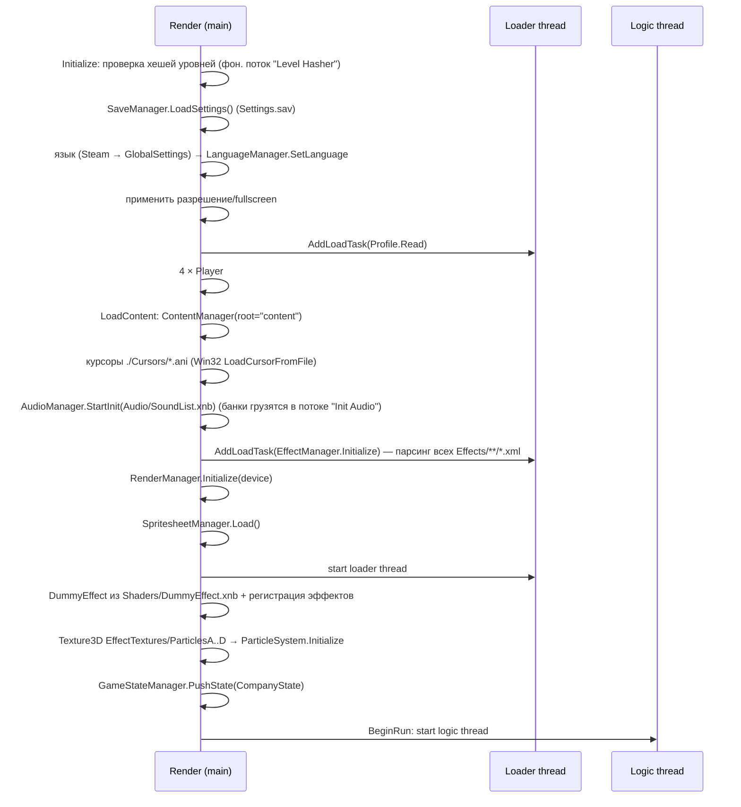

# OpenMagicka — архитектура ядра оригинального движка Magicka

> Область документа: ядро движка — запуск, главный цикл и потоки, стейт-машина,
> рендер-пайплайн PolygonHead, шейдеры, частицы, камера, физика, звук, ввод,
> локализация, сохранения. Геймплей (заклинания, сущности, AI, триггеры) и форматы
> кастомных XNB-reader'ов описываются в других документах.
>
> Источник: `Magicka.exe` 1.10.4.2 + `PolygonHead.dll` + `JigLibX.dll` 0.0.2 +
> `XNAnimation.dll` 0.7, изученные через ILSpy, и ассеты Steam-установки.
>
> **Clean-room.** Здесь только описание архитектуры и поведения: таблицы, схемы,
> перечни параметров и форматов. Декомпилированный код в этот документ и в
> репозиторий не копируется. Если для совместимости важна точная формула
> (хеши, шифрование), она описана словами.

Предыдущий обзор: [`../ENGINE_ANALYSIS.md`](../ENGINE_ANALYSIS.md).

---

## 0. Краткие выводы

1. **Потоки.** Используются три потока: render (главный поток XNA), logic (свой
   поток, переменный шаг) и loader (очередь задач загрузки). Данные кадра передаются
   через **тройную буферизацию** `DataChannel` A/B/C. Каждый слой отрисовки в `Scene`,
   состояние камеры и GPU-буферы частиц и света существуют в трёх экземплярах.
2. **Рендер — классический deferred DX9.** Порядок проходов: depth-препасс в R32F →
   G-buffer из 2 MRT (`Color` + normal `Color`) → декали → тени → накопление света
   (additive) → композиция с туманом → небо → additive-объекты → частицы (soft) →
   пост-эффекты → цветокоррекция → GUI в 4×MSAA-буфер → переход (fade) → bloom (1/16) → backbuffer.
3. **Шейдеры.** Байткод эффектов, встроенный в `PolygonHead.dll` (классы `*EffectCode`),
   **побайтно совпадает** с `Content/Shaders/*.xnb` для 25 из 27 эффектов (проверено
   скриптом). Его не нужно извлекать из DLL: всё лежит в ассетах пользователя в
   формате `fx_2_0` (magic `0xFEFF0901`), SM 3.0, с preshader'ами. FNA/MojoShader
   умеет загружать такой байткод напрямую. Главное препятствие: в XNA 4.0/FNA нет **`EffectPool`**
   (общих параметров).
4. **Сейвы не зашифрованы.** `Settings.sav`, `campaign.sav`, `Profile.sav` и
   `ch_*.sav` — это `BinaryWriter`-бинарники с префиксом версии. `DLCData.sav` — это XML.
   «Шифрование» (`Encryption`) применяется только к `pops.sav` (токен Paradox) и для
   OpenMagicka не нужно. Ниже описан алгоритм и вывод ключа.
5. **`col.dat`** — текстовый файл, в первой строке которого записано число
   разблокированных цветов игрока (в Steam-копии там `10`).
6. **Звук.** XACT content version **45** (XACT3 эпохи XNA 3.1). Wave bank'и содержат PCM,
   MS-ADPCM и **xWMA** (`Wave Bank.xwb`, `Loc.xwb`). Совместимость FAudio/FACT с v45 и
   xWMA нужно проверить в первую очередь.
7. **Лицензии.** XNAnimation распространяется по Ms-PL (по форкам на GitHub), поэтому
   можно портировать upstream-исходники. Лицензия JigLibX не подтверждена: upstream JigLib
   распространяется под zlib, а у JigLibX предположительно MIT или Ms-PL. Решение
   «port vs rewrite» описано в §13.

---

## 1. Запуск

### 1.1 `Program.Main`

Последовательность при старте:

1. Помечает текущий поток как главный (обёртка `TrackedThread` нужна для
   crash-репорта со стеками всех потоков) и подписывается на `UnhandledException`.
2. Делает рабочим каталогом каталог exe. **Все пути в игре относительные:**
   `content/…`, `./SaveData/…`, `./Cursors/…`.
3. Сверяет SHA-256 файла `steam_api.dll` с зашитым значением, затем выполняет
   `SteamAPI.RestartAppIfNecessary(42910)` и `SteamAPI.Init`. **В OpenMagicka не нужно.**
4. Разбирает аргументы командной строки (без учёта регистра): `-window` (оконный режим),
   `+connect_lobby <id>`, `+password <pw>`, `+connect` (игнорируется).
5. Создаёт singleton `Game` и вызывает `Run()`.

Crash-репорт пишется в файл `errorReport_yyyy.MM.dd-hh.mm.ss_(N).txt` в каталоге
игры: версия, имя потока, исключение, стеки всех `TrackedThread`.

### 1.2 Конструктор `Game` (наследник `Microsoft.Xna.Framework.Game`)

| Параметр | Значение |
|---|---|
| `TargetElapsedTime` | 1/60 с |
| Минимальные профили шейдеров | VS 3.0 / PS 3.0 |
| VSync | вкл. (потом берётся из настроек) |
| MSAA backbuffer | выкл. (MSAA есть только у GUI-буфера) |
| Стартовый backbuffer | 800×600, затем применяется разрешение из `Settings.sav` |
| Depth/stencil | `Depth24Stencil8` |
| `BackBufferCount` | 1 |
| Поток рендера | имя «RenderThread», приоритет AboveNormal |

На `DeviceResetting` logic-поток ставится на паузу и рендер ждёт, пока он
остановится. На `DeviceReset` пауза снимается.

### 1.3 `Initialize` → `LoadContent` → `BeginRun`



### 1.4 Настройки и конфигурация

Конфигурационных файлов (ini/xml) нет: всё хранится в `GlobalSettings`
(синглтон) и сериализуется в `SaveData/Settings.sav` (формат в §11.2). Значения по умолчанию:

| Настройка | По умолчанию | Тип |
|---|---|---|
| Resolution | текущий display mode | W/H/Refresh (int16 на диске) |
| Fullscreen | false (Program ставит true без `-window`) | bool |
| Bloom / Shadow / AO / Decal quality | Medium | `SettingOptions` {Off, On, Players_Only, Low, Medium, High} |
| Particles | (не задано → Off=0) | `SettingOptions` |
| ParticleLights | false | bool |
| VolumeMusic / VolumeSound | 7 / 7 (0…10) | byte |
| BloodAndGore, DamageNumbers, HealthBars, SpellWheel | On | `SettingOptions` |
| GameName | "Magicka Game" | string |
| VSync | false | bool |

`ShadowQuality` масштабирует размер shadow map: Low даёт ½ от базового, High — ×2.

### 1.5 Корень контента и `SharedContentManager`

- Корень: `content` (относительно exe). В Steam-копии каталог называется `Content`.
  На Windows регистр не важен, **на Linux/macOS нужен case-insensitive резолвер путей**.
  Расхождения встречаются и в коде: `Additionalmusic.xsb` против `AdditionalMusic`,
  `loc.xwb` против `Loc.xwb`, `Languages/{lang}/Font` против `font`.
- `SharedContentManager` — менеджер со **счётчиком ссылок** поверх одного общего
  `ContentManager`:
  - имя ассета нормализуется: абсолютный путь обрезается до части после `content`,
    затем `GetFullPath` и **lowercase**;
  - первая загрузка читает ассет. Если ассет загружается во время загрузки другого
    (вложенные `ExternalReference`), он регистрируется как «ребёнок» родителя;
  - каждый экземпляр `SharedContentManager` (например, один на `PlayState`) хранит
    свои счётчики. При `Unload` счётчики уменьшаются, а ассет, дошедший до нуля, освобождается вместе
    с детьми;
  - общий менеджер уничтожается, когда закрыт последний `SharedContentManager`.
- `PackedContent` (PolygonHead) — альтернативный контейнер. В Steam-сборке он не используется.

---

## 2. Главный цикл и модель потоков

### 2.1 Потоки

| Поток | Что делает | Частота |
|---|---|---|
| **RenderThread** (главный, XNA `Game.Run`) | `Update(GameTime)`: смена разрешения/vsync/fullscreen, clip курсора, focus. `Draw`: опрос Keyboard/Mouse, захват готового `DataChannel`, `RenderManager.RenderScene` | Fixed timestep 60 Гц, когда в очереди загрузки есть задачи; иначе variable (переключает loader-поток!) |
| **LogicThread** | Бесконечный цикл: `AudioManager.Update` → `Game.Update(dt)` (Steam callbacks, `GameStateManager.Update`, Network, Achievements) → `Sleep(1)` | Переменный шаг, `dt` ограничен **0.05 с** |
| **LoaderThread** | Выполняет `Action` из FIFO-очереди `AddLoadTask` (загрузка уровней, профиля, эффектов) | `Sleep(1)` между задачами |
| «Init Audio», «Level Hasher» | Одноразовые фоновые задачи | — |

GPU-ресурсы создаются из **любого** потока под `lock(GraphicsDevice)`: loader
создаёт текстуры и буферы, logic вызывает `SetData` на dynamic VB частиц и света. Рендер
держит тот же lock во время `RenderScene`.

### 2.2 Тройная буферизация `DataChannel`

`DataChannel` = {None=-1, A, B, C}. Протокол такой:

```mermaid
stateDiagram-v2
    [*] --> LogicPick
    LogicPick: Logic выбирает канал ≠ UsedByRender и ≠ NextToRender
    LogicPick --> LogicFill: GameStateManager.Update(channel, dt)
    LogicFill: Scene.ClearObjects(channel) и заполнение списков, Camera.mStateBuffer[channel], SetData буферов частиц/света
    LogicFill --> Publish: NextToRender = channel
    Publish --> LogicPick
    state Render {
      Take: UsedByRender = NextToRender; NextToRender = None (ждать, пока None)
      Draw: RenderScene(scene, channel)
      Release: UsedByRender = None
      Take --> Draw --> Release
    }
```

- Все операции над парой (`UsedByRender`, `NextToRender`) выполняются под одним lock.
- Logic **ограничивается** только тогда, когда опубликованный кадр не забран больше
  0.2 с (рендер завис или свёрнут). В остальное время logic обгоняет рендер, и
  неотрисованные кадры просто перезаписываются.
- Render, не найдя готового кадра, крутится в `Sleep(1)`, обновляя состояние клавиатуры и мыши.
- Что имеет копию на канал: 6 списков объектов в `Scene`; `Camera.CameraState`
  (View, Projection, ViewProjection, Position, EyeOfTheBeholder, Direction, Up) и
  frustum; dynamic VB частиц (3 × 32768 × 56 байт); VB батча точечных и частичных
  источников света; `RenderData[3]` у объектов (у каждого объекта три экземпляра данных отрисовки).
- Пауза рендера (`DisableRendering`) блокирует logic в `PlayState.Update`
  (кадр считается busy), пока рендер не подтвердит остановку.

**Для OpenMagicka:** модель стоит сохранить в упрощённом виде. Logic пишет
CPU-снапшот кадра, render только читает его и **сам** загружает данные в GPU. FNA3D
не гарантирует потокобезопасность GL-контекста, а `SetData` из logic-потока надо убрать.

### 2.3 `GameStateManager` и состояния

- Стек `GameState`. `PushState`/`PopState` откладываются до начала следующего
  `Update` (через очередь и флаг). `ChangeState` выполняется сразу под lock.
  Опустевший стек приводит к `Game.Exit()`.
- Каждый `Update(channel, dt)` вызывает `CurrentState.Update` и
  **`PersistentGameState.Update`** (оверлей поверх всех состояний: popup-виджеты, HUD,
  магазин). Рендер вызывает `DrawGui` текущей сцены, затем сцены persistent-состояния
  (кроме `CompanyState`).
- База `GameState` владеет `Scene` (вместимость 512 на слой) и камерой. Базовый
  `Update` очищает списки канала и обрабатывает ввод (`ControlManager.HandleInput`).

| Состояние | Камера | Назначение |
|---|---|---|
| `CompanyState` | default | Сплэши Paradox → Arrowhead → «Pieces» → Magicka (цепочка делегатов), затем `ChangeState(MenuState)` |
| `MenuState` | — | Меню-«Том» (`Tome`), баннеры, диалоги, тултипы |
| `PlayState` | `MagickCamera` | Игровой уровень. Параметры: custom, файл уровня, `GameType`, spawn point, слот сейва, настройки versus |
| `PersistentGameState` | Camera(near 1, far 500) | Оверлей GUI |
| `LoadingScreen` | — | Экран загрузки (свой RT размера экрана) |

`GameType`: Campaign, Mythos, Challenge, Versus и др. (см. `GameType.cs`).

Порядок `PlayState.Update` (полезен для детерминизма):

1. Если уровень не готов или рендер на паузе — кадр busy, выход.
2. Пауза или in-game меню в оффлайне: `dt = 0`.
3. `dt *= TimeModifier × TimeMultiplier` (TimeWarp и т.п.).
4. Physics (`JigLibX Integrate(dt)`) → AI → quad-grid сущностей → анимированные части
   уровня → сущности → босс → healthbar → удаление мёртвых → misc (декали,
   blob-тени, титры, туториал, инвентарь, игроки, конец игры) → сетевые апдейты
   с периодом 1/30 с → HUD → ввод.

---

## 3. Рендер-пайплайн PolygonHead

### 3.1 Модель объектов сцены

`Scene` хранит на каждый `DataChannel` списки:

| Слой | Интерфейс | Сортировка | Методы |
|---|---|---|---|
| Pre-render | `IPreRenderRenderer` | — | `PreRenderUpdate(...)` вызывается на рендер-потоке перед кадром (например, sway-текстура травы) |
| Opaque | `IRenderableObject` | (Effect, Technique, VerticesHash), бинарная вставка | `Cull`, `Draw`, `DrawShadow`; техники Depth/Technique/Shadow (−1 = нет) |
| Additive | `IRenderableAdditiveObject` | то же | `Cull`, `Draw` |
| Projection (декали) | `IProjectionObject` | то же | `Draw(effect, depthMap)` |
| Post | `IPostEffect` | ZIndex | `Draw(dt, pixelSize, view, proj, color, depth, normal)` |
| GUI | `IRenderableGUIObject` | ZIndex | `Draw(dt)` |
| Lights | `Light` (вне каналов) | группировка по (Effect, Technique) | add/remove через очереди, применяются в `UpdateLights` |

Эффект объекта задаётся **int-ID** = `Type.GetHashCode()` класса эффекта и
регистрируется в `RenderManager` (словарь ID → Effect). Внутри одной группы
(Effect+Technique) один раз выполняется `Begin`/`Pass.Begin`, а VB/IB/Decl
переключаются только при изменении. **Для OpenMagicka:** вместо хеша типа нужен стабильный enum или ID.

### 3.2 Render targets

Все RT пересоздаются при смене размера backbuffer (событие `ResulutionChanged`).

| RT | Размер | Формат | Назначение |
|---|---|---|---|
| `DepthBuffer` | экран | **R32F** (`Single`) | Линейная/проективная глубина из depth-препасса. Читается светом, декалями, частицами (soft), пост-эффектами |
| `MainBuffer` (MRT0) | экран | `Color` RGBA8 | Альбедо и параметры материала, затем результат композиции |
| `NormalBuffer` (MRT1) | экран | `Color` RGBA8 | Нормаль и параметры (очищается в (0.5, 0.75, 0.5, 0.5)) |
| `SecondaryBuffer` | экран | `Color` | Аккумулятор света, затем копия сцены для пост-эффектов |
| `GUIBuffer` | экран | `Color`, **4× MSAA** при поддержке | Итог сцены после фильтра + GUI + переход |
| GUI depth-stencil | экран | D24S8, MSAA как у GUI | — |
| `SixteenthA/B` | экран/16 | `Color` | Bloom |
| Half/Quarter/Eighth | — | объявлены, но не создаются | (мёртвый код) |
| `ScreenShot` | экран | `ResolveTexture2D` | Скриншот (сейвы, Tome) |
| Shadow map directional/spot | `ModShadowResolution(base)` | **R32F** + D24 | — |
| Shadow map point | cube, тот же размер | **R32F cube** + D24 | 6 граней |
| Sway target (`GameScene`) | 512² | HalfVector4 (fallback Vector4) | Отклонение растительности от сущностей |
| Loading screen | экран | `Color` | — |

Точную раскладку каналов G-buffer (что лежит в A у Main/Normal, как кодируется
нормаль и spec/emissive) можно восстановить только дизассемблированием шейдеров
(§4.4). По именам параметров материала в нём есть diffuse, spec amount и power,
emissive amount, normal power и reflectiveness.

### 3.3 Порядок проходов `RenderManager.RenderScene`

```mermaid
flowchart TD
    A[PreRender update объектов] --> B[RT0=Depth R32F: Clear-эффект fullscreen]
    B --> C[Scene.DrawDepth: техника Depth всех opaque, cull CCW]
    C --> D["MRT: Main+Normal. RestoreDepth fullscreen:<br/>Main=(BG,0), Normal=(0.5,0.75,0.5,0.5), восстанавливает z из Depth"]
    D --> E[Scene.Draw: G-buffer, stencil Always/Replace ref 0*]
    E --> F[Scene.DrawProjection: декали, alpha-blend, без записи альфы, stencil Keep]
    F --> G[UpdateLights: применение очередей, Light.Update]
    G --> H[DrawLightShadows: shadow maps источников с CastShadows]
    H --> I["RT=Secondary clear 0. Blend One/InvSrcColor (screen-like add)<br/>Scene.DrawLights(normal, depth)"]
    I --> J["RT=Main: DeferredShading fullscreen<br/>(Main, Normal, Depth, Secondary=свет) + линейный туман"]
    J --> K[SkyMap fullscreen, если задан 2D-skymap]
    K --> L[DrawAdditive: Blend InvDestColor/One, depth test без записи]
    L --> M[ParticleSystem.Draw: instancing, soft по Depth]
    M --> N[RT=Secondary: копия Main]
    N --> O[Scene.DrawPost: IPostEffect по ZIndex, источник Main/Depth/Normal]
    O --> P["RT=GUI(MSAA): Filter (brightness/contrast/saturation) из Secondary"]
    P --> Q[DrawGui текущей сцены + persistent]
    Q --> R[Transition: fade/crossfade поверх GUI-буфера]
    R --> S["Bloom: Downsample+threshold → 1/16, H-blur, V-blur → Combine в backbuffer"]
    S --> T[опц. ResolveBackBuffer → скриншот]
```



\* Значения stencil задают сами объекты: уровень 0, аватары 1, анимированные физобъекты 2
(используется для силуэтов за стенами). Часть состояний, видимо, сидит в state-блоках
FX-пассов.

Важные детали:

- **Bloom применяется после GUI**, поэтому яркий GUI тоже светится. Параметры по
  умолчанию: threshold 0.8, multiplier 1.0, sigma 2.5. Сцена может их переопределить.
- **Глобальные параметры** (View, Projection, ViewProjection, InverseViewProjection,
  CameraPosition, EyeOfTheBeholder, Time ∈ [0,1) по модулю 1) передаются через
  `DummyEffect` и **общий `EffectPool`**. Все эффекты, созданные с этим пулом, видят их
  как `shared`. В проходе теней `ViewProjection` в пуле временно подменяется матрицей
  источника.
- `TextureLODBias` = −0.5 на сэмплерах 0…7.
- Свет накапливается в `Color` RGBA8, то есть HDR нет. Есть параметр GUI `ScaleToHDR`.
- `GUIScale` = высота экрана / 720.
- Переходы (`Transitions`): None, Fade, CrossFade. Цвет и время задаются,
  `TransitionEnd` вызывается по завершении направления In.
- Матрица «пиксели → clip» для GUI учитывает DX9 half-pixel offset (−1−1/W, +1+1/H).

### 3.4 Источники света

| Тип | Геометрия | Техники | Тени |
|---|---|---|---|
| `DirectionalLight` | fullscreen quad | WithShadows / WithoutShadows | 2D R32F, ортопроекция привязана к «snapped ground position». Может проецировать текстуру (облака): ProjectedTexture, Offset, Scale, Intensity |
| `PointLight` | икосфера 42 вершины / 80 треугольников, масштаб = радиус; cull CW изнутри | WithShadows / WithoutShadows | Cube R32F, 6 проходов |
| `SpotLight` | конус | 4 техники (± тени, ± затухание) | 2D R32F |
| `PointLightBatcher` | instancing сферы, до **128** источников, per-instance 48 байт | одна | нет |
| `ParticleLightBatcher` | то же, до **256** источников, свет от частиц со своим TTL, гравитацией, drag | одна | нет |
| `CapsuleLight`, `DynamicLight` (Magicka) | капсула | свои эффекты | — |

Общие свойства `Light`: DiffuseColor, AmbientColor, SpecularAmount, Intensity,
`LightVariationType` (мерцание: Speed, Amount), `LightTransitionType` (появление и исчезание
за заданное время), Enabled, CastShadows.

### 3.5 Материалы и эффекты PolygonHead

| Эффект | Техники | Ключевые параметры / заметки |
|---|---|---|
| `RenderDeferredEffect` (статическая геометрия, 710 материалов в XNB) | SingleLayer, DualLayer, SingleLayerReflection, DualLayerReflection, Depth, Shadow, AdditiveFresnel | 2 слоя: DiffuseColor, Spec Amount/Power, Emissive, NormalPower, Reflectiveness, Diffuse/Material/Normal-текстуры, AlphaMask, ReflectionMap (cube), FresnelPower, VertexColor, Sway и EntityInfluence (трава), Bloat. Вариант **WVT** (vertex texture fetch sway-текстуры) или **WOVT**: выбор зависит от поддержки VTF формата Vector4 |
| `RenderDeferredLiquidEffect` (вода/лёд) | Default, Reflection, Depth, Shadow | WaveHeight, WaveSpeed0/1, BottomColor, DeepBottomColor, Water Spec/Emissive, WaterNormalMap, ReflectionMap; лёд: IceColor, IceDiffuse/Normal/EdgeMap. Второй vertex-поток — **float «заморозки» на вершину** (динамический VB), лёд при ≥ 0.5 |
| `LavaEffect` | Default, Depth, Shadow | MaskDistortion, Speed0/1, Hot/Cold emissive, TempFrequency, ToneMap, TempMap, MaskMap, Rock* (камень, который появляется при охлаждении) |
| `SkinnedModelDeferredEffect` | Default, AlphaBlended, Additive, Depth, Shadow, NonDeffered, AdditiveFresnel | Персонажи. RimLight, Bloat, Colorize |
| `SkinnedModelDeferredNormalMapped` | — | Скиннинг + normal map |
| `AdditiveEffect` | Technique1 | Additive-объекты |
| `HardwareInstancedProjectionEffect` | — | Декали: до 30 инстансов на draw через **массивы констант** (World, InvWorld, Args, Colors), куб 8 вершин / 12 треугольников |
| `ProjectionEffect` | — | Одиночная проекция (круги под аватарами) |
| `DeferredShadingEffect` | — | Композиция: Main × свет + туман (FogEnable, Start, End, Color) |
| `FogEffect` | Exponential, ExponentialSquare, Linear | Отдельный пост-эффект тумана |
| `SkyMapEffect` | — | Fullscreen 2D-skymap × Color |
| `BloomEffect` | DownSample, HorizontalBlur, VerticalBlur, Combine | Threshold, Multiplier, Sigma |
| `FilterEffect` | — | Brightness, Contrast, Saturation |
| `RestoreDepthEffect`, `ClearEffect`, `BasicPostProcessingEffect` | — | Служебные fullscreen |
| `Fade/CrossFadeTransitionEffect` | — | Переходы |
| `GUIBasicEffect` | Texture2D, Texture3D | Transform, Color, Texture, OverlayTexture и Tint, TextureOffset и Scale, ScaleToHDR, Saturation |
| `ParticleEffect` | Default | §5 |
| Magicka-эффекты (`Content/Shaders`) | — | Arcane, Buff, Chasm, Entangle, ForceField, Shield, Invisibility, Mist, NormalDistortion, RadialBlur, RainSplash, Saturation, Sway, Vortex, SpellWheel, TextBox, NotifierButton, Pie, Flash, CapsuleLight, DecalHardwareInstancing, GUIHardwareInstancing, SkinnedModelSkeleton, SkinnedShield |

Материалы (`IMaterial<T>`: Fetch, AssignToEffect, AssignOpacity) — это лёгкие
структуры параметров. Один экземпляр эффекта общий, материал заливается перед
`Draw` каждого объекта и подтверждается через `CommitChanges`.

### 3.6 Небо, туман, цветокоррекция по сцене

`GameScene` (XML сцены) задаёт `Fog` (Enabled, Start, End, Color RGBA), SkyMap (2D-текстуру),
Brightness, Contrast, Saturation, параметры bloom и `RoomType` (§8). При выходе
из `PlayState` всё сбрасывается к дефолтам: туман выкл., 1/1/1, без skymap, sigma 2.5.

### 3.7 Декали

- `DecalManager`: атлас `EffectTextures/decals` из **8×8 ячеек** (enum `Decal`:
  кровь пяти видов × 4 варианта, Scorched, Crater, Cold, Water, LifeGround, ArcaneGround,
  Buff/Aura × 3, Grease, MagickCircle, MagickBurn, Cracks, резерв, TestPattern).
- Декали — это проецируемые боксы (deferred decals). Пиксель берётся из depth-буфера и
  переводится в локальное пространство бокса через InvWorld. Рисуются батчами по 30,
  stencil Equal ref 1, без записи глубины. Есть TTL и fade, можно привязать к анимированной
  части уровня. Лимит задаёт `DecalLimit`.

### 3.8 GUI и текст

- `BitmapFont` (XNB `BitmapFontReader`): lineHeight, baseLine, defaultChar, текстура,
  глифы (char, origin XY, size XY, advance, LSB, ForceWhite), кернинг (пары char → int).
- `Text`: VB по 128 байт на символ (4 вершины × 32 байта: pos2, uv2, color4), статический
  или динамический, выравнивание. **Встроенная разметка:** `[c=r,g,b(,a)]…[/c]` задаёт цвет.
  Локализация вставляет её при раскрытии ссылок `#key;`.
- Шрифты: `Languages/<lang>/Font/{Maiandra14/16/18, Stonecross28/36/50, Versustext,
  MenuDefault, MenuOption, MenuTitle, PDXUI*…}`. Набор свой для каждого языка, при
  отсутствии берётся английский.
- GUI рисуется в `GUIBuffer` с alpha-blend (SrcAlpha/InvSrcAlpha) после
  цветокоррекции сцены.

---

## 4. Шейдеры: хранение и загрузка

### 4.1 Встроенный байткод

Каждый класс `XxxEffectCode` содержит статический `byte[] CODE` (в IL это FieldRVA) —
скомпилированный **D3D9 Effect** (`fx_2_0`: первые байты `01 09 FF FE`). Конструктор
эффекта передаёт байткод в `Effect(GraphicsDevice, byte[], CompilerOptions, EffectPool)`.
PolygonHead содержит 27 таких блобов.

### 4.2 Совпадение с `Content/Shaders/*.xnb`

Скриптом (`xnb.py` + сравнение) проверено:

- **25 эффектов побайтно совпадают** с соответствующим `.xnb`: Additive,
  BasicPostProcessing, BatchedPointLight, Bloom, Clear, CrossFade, DeferredShading,
  DirectionalLight, FadeTransition, Filter, Fog, GUIBasic, HardwareInstancedProjection,
  Lava, Particle, PointLight, Projection, RenderDeferredWOVT/WVT, RenderDeferredLiquid,
  RestoreDepth, SkinnedModelDeferredNormalMapped, SkyMap, SpotLight.
- **Отличаются:** `DummyEffect` (встроенный 1236 байт, в xnb 1156; игра всё равно
  грузит xnb-версию как «local dummy») и `SkinnedModelDeferredEffect` (размер
  одинаковый, 77720 байт, содержимое разное, видимо, другая сборка). Какой вариант
  правильный, нужно проверить.
- Ещё 25 эффектов Magicka существуют **только** как `.xnb`.

XNB-обёртка эффекта (XNA 3.1): reader `Microsoft.Xna.Framework.Content.EffectReader`,
за ним int32 длина и байткод (смещение 56 после LZX-распаковки). Профили: почти всё
**vs_3_0 / ps_3_0**. Arcane, Flash, NormalDistortion, Pie и Saturation собраны под SM 2.0.
Многие эффекты содержат **preshader'ы** (`FXLC`) и state-блоки в пассах.

### 4.3 Пригодность для FNA / MojoShader

- FNA создаёт `Effect` из «сырого» D3D9 effect-байткода и транслирует его через
  MojoShader (GLSL, SPIR-V, Metal, DXBC через SDL_GPU). Поддерживаются fx_2_0, SM1–3,
  preshader'ы и state-блоки пассов. **Поэтому оригинальные шейдеры можно брать прямо
  из `Content/Shaders` пользователя** без извлечения из DLL и без копирования их в репозиторий.
- Препятствия и как их обойти:
  1. **`EffectPool` и `shared`-параметры в XNA 4.0/FNA отсутствуют.** Глобальные
     параметры (`View`, `Projection`, `ViewProjection`, `InverseViewProjection`,
     `CameraPosition`, `EyeOfTheBeholder`, `Time`) нужно явно выставлять на каждом
     эффекте перед `Apply`. Надо проверить, как MojoShader обрабатывает параметры с
     флагом shared: скорее всего, как обычные.
  2. В XNA 3.1 API были `Begin`/`Pass.Begin`/`CommitChanges`, в FNA вместо них `Pass.Apply()`.
     Изменение параметров после `Apply` требует повторного `Apply`.
  3. Render state в FX-пассах (blend, stencil, cull) FNA применяет. Надо проверить, что
     state'ы, выставленные кодом, не перетирают нужные значения: в XNA 3.1 код ставил
     state до `Begin`.
  4. Инстансинг через stream frequency (`SetFrequencyOfIndexData`) заменяется на
     `VertexBufferBinding(…, instanceFrequency:1)` + `DrawInstancedPrimitives`.
     Семантики и раскладка вершин те же.
  5. Вариант WVT требует vertex texture fetch формата Vector4. Безопаснее начать с WOVT.
  6. DX9 half-pixel: FNA эмулирует DX9-правила растеризации, а шейдеры получают
     `HalfPixel` явно. Ожидается корректная работа, но это надо проверить на точечных источниках света.

### 4.4 Дизассемблирование

Чтобы точно понять G-buffer, нужен дамп шейдеров: `fxc /dumpbin` (Windows SDK) или
`MOJOSHADER_parseEffect` → GLSL. Делать дамп стоит **только у себя локально из ассетов
пользователя**, в репозиторий его не класть. Цель — документировать раскладку
каналов, а не переносить код. В долгосрочной перспективе свои HLSL-шейдеры с той же
раскладкой снимают зависимость от оригинальных блобов (и позволяют моды).

---

## 5. Частицы

### 5.1 `ParticleSystem` (GPU-часть)

- Глобальный пул **32768** частиц, свободные индексы хранятся в min-heap. Обновление на
  CPU в logic-потоке:
  - `TTL -= dt`;
  - нормализованное время жизни = 1 − TTL/maxTTL;
  - `vel.y += gravity·dt`;
  - `vel *= drag^dt` (drag — доля скорости, сохраняемая за секунду);
  - `pos += vel·dt`, `rot += rotSpeed·dt`;
  - размер линейно интерполируется между start и end по времени жизни.
- Per-instance данные 56 байт: Position(3f), Rotation, Radius, NormalizedLifetime,
  Color(4f), Sprite(byte), AlphaBlended(byte), HSV/Colorize(byte: HSV даёт +50, Colorize
  +5), RotationAligned(byte), Velocity(3f). Квад из 4 вершин (corner id + uv), 6 индексов,
  hardware instancing.
- Спрайты лежат в четырёх **Texture3D** (`EffectTextures/ParticlesA…D`), байт `Sprite`
  выбирает срез. Шейдер получает Depth для soft-частиц.
- Блендинг **Src=One, Dst=SrcAlpha**, depth test выкл. Один state даёт и additive
  (шейдер выдаёт α=1), и alpha-blend (premultiplied цвет, α = 1−a), в зависимости от
  флага частицы.
- `RotationAligned` ориентирует частицу по скорости.

### 5.2 `VisualEffect` и формат `Effects/**/*.xml` (~904 файла)

```text
<Effect type="Single|Looping|Infinite" duration="сек" keyFramesPerSecond="N" [version="2"]>
  <ContinuousEmitter name="…"> …параметры… </ContinuousEmitter>
  <PulseEmitter name="…"> … <NrOfParticles …/> </PulseEmitter>
  <Light> <PositionX Value=…/> … DiffuseR/G/B, AmbientR/G/B, Specular, Radius,
          VariationType/Speed/Amount, Spawn/DespawnTransitionType/Time </Light>
</Effect>
```

- Имя дочернего узла задаёт тип эмиттера: в коде ищется класс с этим именем,
  реализующий `IParticleEmitter`. Сейчас их два: `ContinuousEmitter` и `PulseEmitter`.
- Регистр имён тегов и атрибутов не учитывается. Числа записаны в InvariantCulture.
- Флаговые параметры имеют атрибут `Value`: `BlendMode` (Alpha/Additive),
  `SpreadType` (Arc/Cone), `RotationAligned`, `ColorControlAlpha`, `HSV`, `Colorize`,
  `RelativeVelocity` (добавить скорость эмиттера), `Particle` (индекс спрайта),
  `SpawnLights`, `LightSizeRelative`.
- Анимируемые параметры записываются либо как `<Name value="x"/>` (константа), либо
  как `<Name><key time="кадр" value="x"/>…</Name>`. Время задаётся в кадрах и делится на
  `keyFramesPerSecond`. Между ключами значения интерпролируются линейно, за краями
  берётся крайнее значение. Отсутствующий параметр равен 1.
  Полный список: ParticlesPerSecond, PositionX/Y/Z, Position{X,Y,Z}Offset, RotationY,
  Gravity, Drag, ColorR/G/B, ColorAMin/Max/Distribution, Hue/Sat/Value/Alpha
  Min/Max/Distribution, LifeTimeMin/Max/Distribution, SizeStart/SizeEnd Min/Max/
  Distribution, VelocityMin/Max/Distribution, RotationMin/Max, RotationSpeedMin/Max,
  RotationPCCW (процент частиц, вращающихся против часовой), SpreadConeAngle/
  Distribution, SpreadArcHorizontalAngle/Distribution, SpreadArcVerticalMin/Max/
  Distribution, LightRadius, LightDiffuseR/G/B, LightAmbientR/G/B, LightSpecular.
- Углы (Hue, Rotation, RotationSpeed, Spread*) в файле задаются **в градусах** и
  переводятся в радианы.
- **Version 1** (атрибут отсутствует): цвет берётся из `Alpha*` как ColorA,
  ColorR/G/B/Value равны 1, источников света нет. **Version 2** добавляет
  SpawnLights и LightSizeRelative.
- Параметр `*Distribution` — это показатель степени: случайное u∈[0,1) возводится в
  степень d, затем отображается на [min,max]. d>1 смещает значения к min.
- Случайные числа берутся из **предвычисленной таблицы** на 65536 float и 65536 байт
  (0…99), построенной стандартным `System.Random(seed=0)` .NET Framework. Каждый
  эмиттер хранит 16-битный курсор с начальным значением из `DateTime.Now.Ticks`.
  `new Random(0)` в современном .NET (с явным seed) воспроизводит тот же legacy-алгоритм, так что таблицу можно
  получить идентичной.
- Emission в `ContinuousEmitter`: темп — среднее значений PPS в начале и конце кадра,
  умноженное на глобальный `SpawnModifier` (настройка Particles). Число частиц равно разности
  floor(totalTime·rate) между кадрами. Позиции и трансформы интерполируются между прошлым
  и текущим кадром, чтобы быстрые эмиттеры оставляли непрерывный след. Направление: Cone
  (вокруг оси Z локальной матрицы) или Arc (горизонтальный угол ± и вертикальный диапазон,
  ось −Z).
- `VisualEffect.Update`: Single останавливается по истечении duration, Looping
  оборачивает время по модулю, Infinite держит последний кадр. Источник `<Light>`
  через `PointLightBatcher` следует за трансформом эффекта.
- `EffectManager` (Magicka) при старте рекурсивно читает `content/Effects`. Ключ —
  **хеш имени файла без расширения в lowercase** (§12.1). Одновременно активно до
  **256** экземпляров. Ссылка на экземпляр (`VisualEffectReference`) = индекс + уникальный ID.

---

## 6. Камера (`MagickCamera`)

- Перспектива с **очень узким FOV 5°** (почти ортографический вид).
- Смещение камеры от цели: (0, 144, 171), это ≈224 ед. под углом ≈40° к горизонту.
  Near 105, Far 500. Аспект в PlayState 16:9 (константа, отдельно есть 4:3).
- Поведение (`CameraBehaviour`): FollowPlayers, FollowEntity, Locked, MoveToTarget.
  Интерполяция: Linear (100 ед/с, делённые на время) или Interpolated (пружина со
  скоростью).
- FollowPlayers:
  - цель = среднее позиций живых локальных игроков (если их нет — сетевых);
  - Y = средний уровень «пола» стоящих игроков;
  - к цели добавляется «вектор влияния» от враждебных персонажей и bias (`SetBias`,
    экспоненциальное сглаживание с основанием 0.02).
- Ограничения:
  - цель привязывается к **camera mesh** (треугольники из `LevelModel`) или к camera box:
    берётся ближайшая точка;
  - 4 плоскости frustum с отступом 0.5 блокируют движение в сторону, где игроки выйдут
    из кадра (`mCanMoveUp/Right/Down/Left`, `mCanZoomIn`). Их сбрасывают и выставляют
    сущности.
- Magnification (зум) = FOV_default / FOV, сглаживание экспоненциальное. Dynamic
  magnification подбирает зум так, чтобы самый дальний игрок помещался в половину FOV
  (min/max задаёт скрипт). Есть временное player magnification с TTL.
- Camera shake: синус от TTL×60, амплитуда затухает линейно.
- Аудио-listener ставится на 20 ед. выше точки земли под камерой. Forward = Down,
  Up = Forward (вид сверху).
- Визуальные эффекты, привязанные к камере, следуют за её позицией.
- Базовый `PolygonHead.Camera` пишет `CameraState` в буфер канала и строит frustum.

---

## 7. Физика (JigLibX)

### 7.1 Настройка мира (`PhysicsManager`)

| Параметр | Значение |
|---|---|
| Гравитация | (0, −19.64, 0), то есть 2 × 9.82 |
| Broadphase | `CollisionSystemSAP` (sweep and prune) |
| Solver | Normal |
| Freezing (сон тел) | вкл. |
| AllowedPenetration | 0.001 |
| Sweep tests | вкл. |
| Shock step | выкл. |
| Шаг | `Integrate(dt)` один раз за logic-тик, `dt` ≤ 0.05 |
| Freeze/UnFreeze | глобальная пауза физики |

### 7.2 Кастомные примитивы и детекторы

- `HollowSphere` — свой тип примитива с ID = `PrimitiveType.NumTypes` (8), то есть
  первый свободный. Толщина стенки 0.5, ограничение по углу (`MaxAngle`, π по умолчанию)
  даёт дугу или купол. Используется для щитов (сфера, внутрь которой можно войти).
- Регистрируются детекторы, которые заменяют или дополняют стандартные пары JigLibX
  (ключ = type0<<16 | type1): HollowSphere × {Capsule, Sphere, Box, TriangleMesh};
  **CustomCapsule** × {StaticMesh, Plane, Capsule} (капсула персонажа).
- `CharacterBody` — тело персонажа на капсуле. Определяет контакт с землёй (нормаль с
  y < −0.7 в DirToBody0), **материал земли** (индекс примитива в collision skin),
  отрыв от земли, урон от падения, касание `Water`.
- `IceMesh` и `WaterMesh` — наследники `TriangleMesh` с per-vertex коэффициентом
  заморозки. Они фильтруют треугольники в запросах AABB (вода проходима, лёд твёрдый)
  и переключаются друг в друга. `Lava` устроена так же (застывшая лава).
- `PhysicsObjectBody` — тело с флагом `ReactToCharacters`. `PointJoint` — шарнир.

### 7.3 Материалы коллизий

`CollisionMaterials` (byte): Generic, Gravel, Grass, Wood, Snow, Stone, Mud,
Reflect, Water, Lava (всего 10). `LevelModel` содержит **10 TriangleMesh-примитивов
по одному на материал**: индекс примитива в skin = материал. Материал выбирает звук
шагов, эффекты, отражение railgun от `Reflect` и т.п. Параметры трения
(`MaterialProperties`): уровень (1, 1, 1), вода и лава (0, 10, 10), анимированные части
(0.1, 1, 1). `CollisionSkinReader` (XNB): вершины Vector3, индексы int32 тройками в
порядке I2, I1, I0 (порядок обхода инвертирован).

---

## 8. Звук (XACT)

- `AudioEngine("content/Audio/magicka.xgs")`. Если не удалось, показывается диалог
  Abort/Retry/Ignore.
- Банки загружаются в фоновом потоке. Индекс банка = номер бита в enum `Banks`:

| Бит | Bank | .xsb/.xwb | Режим | Форматы |
|---|---|---|---|---|
| 0 | WaveBank | `Sound Bank.xsb` / `Wave Bank.xwb` | in-memory | **xWMA** 44.1/22 кГц |
| 1 | Music | `Music` | **streaming** (packet 64) | MS-ADPCM stereo |
| 2 | Ambience | `Ambience` | streaming | MS-ADPCM |
| 3–9 | UI, Spells, Characters, Footsteps, Weapons, Misc, Additional | одноимённые | in-memory | PCM 16/44.1 (Additional — ADPCM) |
| 10 | AdditionalMusic | файл `Additionalmusic.*` (регистр!) | streaming | ADPCM |
| 11 | (локализованная речь) | `Languages/<lang>/Loc.xwb`, fallback `eng` | in-memory | **xWMA** |

- Версии файлов: XGS `XGSF` tool 45 / format 42, XSB `SDBK` 45/43, XWB `WBND` 45/43,
  то есть **XACT content version 45**.
- Имена cue: `Audio/SoundList.xnb` (`List<string>`) превращается в словарь
  «хеш lowercase-имени → имя». Код и XML ссылаются на звуки по хешу (§12.1).
- Категории громкости: Music, а также Sfx, Ambient, Default, UI, VO, VOloc под общей
  громкостью звука (0…10 → ×0.1).
- Глобальные переменные XACT:
  - `RoomType` — reverb-пресет сцены: None 0, Generic 10, SmallRoom 20, StoneRoom 30,
    Cave 40, Forest 50. Реверберация сделана RPC/DSP-пресетами в `.xgs`,
    сцена задаёт атрибут `RoomType`;
  - `ReverbMix` — плавно, до 50 единиц в секунду;
  - `MusicFocus` = расстояние ближайшего игрока до точки фокуса / радиус, ограничено
    [0,1], либо значение по умолчанию;
  - `MusicThreat` — растёт на 5/с до 10 в бою, падает на 2/с.
- Музыка: одна текущая cue. При смене старая останавливается `AsAuthored`
  (кроссфейд авторский). Повторный запуск той же cue игнорируется.
- 3D: `Cue.Apply3D(listener, emitter)`, listener обновляет камера (§6). Активные cue
  хранятся в списке, остановленные удаляются в `Update`. Есть групповая пауза и
  возобновление.
- `AudioManager.Update` вызывается из logic-потока, `engine.Update()` — каждый тик.

---

## 9. Ввод

- **Клавиатура и мышь** (`KeyboardMouseController`): 17 привязок `KeyboardBindings`.
  Каждая хранится как {IsMouse, Button(byte)}, Button = код XNA `Keys` или `MouseButton`
  {Invalid, Left, Middle, Right, X1, X2, ScrollUp, ScrollDown}. По умолчанию:

| Действие | Клавиша | Действие | Клавиша |
|---|---|---|---|
| Water | Q | Cast (луч/снаряд) | ПКМ |
| Life | W | CastSelf | СКМ |
| Shield | E | Boost | Space |
| Cold | R | Move | ЛКМ |
| Lightning | A | Block (Cast Area-модификатор) | LCtrl |
| Arcane | S | Shift | LShift |
| Earth | D | Inventory | Tab |
| Fire | F | Prev / Next Magick | колесо вверх / вниз |

  Нельзя назначить Escape, Win и Apps. Текстовый ввод (чат, имена) идёт через
  WinForms `IMessageFilter` (WM_CHAR, KEYDOWN, SYSKEY…), `TranslateMessage` и `MapVirtualKey`.
- **XInput** (`XInputController`, 4 пада): XNA `GamePad.GetState`. 24 привязки
  `ControllerFunction` (Move ×4, Menu Select/Back, Spell ×4, Magick Next/Prev, Attack,
  Special, Block, Interact, Boost, Cast Force/Area/Self/Magick, Pause, Inventory,
  Spell_Wheel). Типы: Button (флаг XNA `Buttons`), Trigger, Positive/NegativeStick
  (индекс оси 0…3). По умолчанию левый стик двигает, правый выбирает элементы
  (spell wheel), A выбирает, B — назад…
- **DirectInput** (`DirectInputController`, Managed DirectX): не-XInput геймпады и
  джойстики (фильтр через `XInputHelper.IsXInputDevice`). Привязки Button, POV, ±Axis хранятся
  по **InstanceGuid устройства**. Пад считается «настроенным», только если у него есть
  сохранённые привязки.
- `ControlManager`: меню-контроллер (клавиатура), список XInput- и DInput-падов,
  `FindNewGamePads`, `LimitInput` (временная блокировка с cooldown), блокировка ввода
  по игроку. `PersistentGameState` первым получает события, если открыт popup.
- Курсоры: `./Cursors/*.ani` (Default, Talk, Examine, PickUp, Attack, Interact + Gray-
  варианты, Invisible). Загружаются через Win32 `LoadCursorFromFile`, переключаются через
  `Form.Cursor`. В PlayState курсор ограничен окном (`Cursor.Clip`).

---

## 10. Локализация

- Языки = подкаталоги `content/Languages/` с именами ISO 639-2, которые распознаются
  через enum `Language` (значения — LCID: eng=9, deu=7, fra=12, rus=25, …). В
  Steam-копии есть deu, eng, fra, hun, ita, pol, rus, spa.
- Выбор языка: Steam language → enum. Если язык недоступен, используется `eng`.
  Сохраняется в `Settings.sav`.
- Загрузка: все `*.loctable.xml` каталога языка (Excel 2003 SpreadsheetML:
  `Workbook/Worksheet/Table/Row`). Колонка 1 — ключ, начинающийся с `#`; колонка 2 —
  текст. Ключ = **хеш lowercase-строки ключа** (§12.1). Пустые тексты пропускаются,
  более поздние файлы перекрывают ранние (порядок перечисления каталога, не определён!).
- При выдаче строки `\n` заменяется на перевод строки. Ссылки `#ключ;` внутри строк
  раскрываются рекурсивно, опционально с цветом `[c=…]…[/c]`. `#players` возвращает
  список имён игроков («A, B & C»).
- Не найденная строка возвращается как `NOT FOUND: <hash>`.
- Смена языка перезагружает шрифты (`FontManager.LoadFonts`) и `Loc.xwb`.

---

## 11. Сохранения (`SaveData/`)

Все файлы лежат в `./SaveData/` рядом с exe. Строки записаны в формате .NET
`BinaryWriter`: 7-bit varint длины + UTF-8. Числа little-endian. bool занимает 1 байт.

### 11.1 Версия

Версия хранится строкой `"a.b.c.d"` (например, `"1.10.4.2"`) и сравнивается как
uint64 = a<<48 | b<<32 | c<<16 | d. Читатели выбирают раскладку по порогу версии.

### 11.2 `Settings.sav`

Порядок полей (вариант ≥ 1.4.3.0):

1. string version;
2. byte BloodAndGore, DamageNumbers, HealthBars, SpellWheel;
3. VersusSettings: byte Mode + 5 × {byte ruleset, byte N, N байт значений}
   (DeathMatch, Brawl, Kreitor, KingOfTheHill, PyriteSnitch);
4. int16 Width, Height, Refresh; bool Fullscreen;
5. byte Bloom, Shadow, DecalLimit, Particles; bool ParticleLights;
6. byte VolumeMusic, VolumeSound; string GameName;
7. FilterData: byte FreeSlots, Scope, GameType; int16 MaxLatency; bool VACOnly,
   FilterPlaying, FilterPassword;
8. 17 × {bool IsMouse, byte Button};
9. 4 пада × 24 × {byte Type, int32 Index} — XInput;
10. int32 N + N × {16 байт GUID, 24 × {byte, int32}} — DirectInput;
11. string SteamLanguage; int32 Language; bool VSync; byte LobbyVisibility;
    string LastUsedHUD.

Старые версии (1.2.9…1.4.1) отличаются наличием и форматом отдельных полей. При
ошибке чтения выставляется язык `eng`, остальные настройки остаются по умолчанию.

### 11.3 `campaign.sav` / `starscampaign.sav` (Mythos)

- Опциональный маркер: байт 0xFF + string version. Без маркера это файл версии 1.0
  (версия = 0).
- 3 слота × {bool present; если true — SaveData}.
- SaveData (≥ 1.4.1.0):
  - byte Level, byte MaxAllowedLevel, bool Looped;
  - int32 TotalPlayTime, CurrentPlayTime;
  - int32 N игроков × {string ключ(gamertag), string Staff, string Weapon};
  - uint64 UnlockedMagicks (битовая маска);
  - int32 N подсказок × {string tipName, int32 count};
  - int32 размер checkpoint + байты checkpoint.

  В версии 1.0 нет MaxAllowedLevel и checkpoint.
- **Checkpoint-блоб**: 32 байта SHA-256 файла сцены/уровня + 32 байта SHA-256 файла
  диалогов + состояние checkpoint (точки спавна, отключённые триггеры, состояние
  сущностей; формат за пределами этого документа). При несовпадении хешей
  checkpoint игнорируется. **Значит, совместимость checkpoint'ов требует тех же файлов уровней.**
- Запись атомарная: сначала `.tmp`, затем delete и move.

### 11.4 Прочие

| Файл | Формат |
|---|---|
| `Profile.sav` | string version; int32 N × Gamer {string tag (≤15), byte color, string avatarName, uint32 Kills, Deaths, OverKilled, OverKills, uint64 HealingDone, HealingReceived, DamageDone, DamageReceived, uint32 Suicides, TeamKills, TeamKilled, VersusWins, WinStreak, Defeats}; словари FoundMoose (string→bool), PlayerUsedElements (string→int32 Elements), FoundSecretAreas (string→bool); float TotalHealed; int32 OverKills, FrozenOverKills, LedFarmerKills; string lastGamer; int32 CruiseCount; int64 LastCruiseDate (`DateTime.ToBinary`); int32 BanisherOfHorrors; (≥1.4.7.1) KilledPony (string→bool) |
| `ch_<challenge>.sav` | int32 N + N записей leaderboard (локальные рекорды испытаний) |
| `DLCData.sav` | XML UTF-8 с BOM: `<root><LatestSave>…</LatestSave><DLC_ContentNewStatuses>…` — статусы «новое» для DLC |
| `pops.sav` | Аккаунт Paradox, см. ниже. **Не нужен** |

### 11.5 `Magicka.Storage.Encryption`

В этой сборке применяется только к `pops.sav`. Описание приводится для полноты.

- **Salt** = Base64(UTF-8(десятичный SteamID64 + десятичный AppID «42910»)).
- **Vigenère** работает по UTF-16 code unit'ам: к каждому символу прибавляется
  (при декодировании вычитается) код символа ключа с циклическим индексом, с
  переполнением 16 бит.
- `pops.sav` содержит две BinaryWriter-строки:
  1. Base64(UTF-8(MD5-hex в верхнем регистре от `text + salt`)) — проверочный хеш
     (`FormsAuthentication.HashPasswordForStoringInConfigFile`, MD5);
  2. Base64(UTF-8(Vigenère(`text`, salt))), где `text` = `shadowUniqueId|authToken`.
- **AES-вариант** (`CITRUS_V1`; функции есть, вызовов в этой сборке не найдено):
  - контейнер: int32 = (длина метки «CITRUS_V1» = 9) << 14 = 147456, затем 9 байт ASCII
    метки, 16 байт IV, int32 длина шифротекста, шифротекст. Метки длиной > 20 отвергаются;
  - шифр: AES (CryptoServiceProvider: **CBC, PKCS7**), ключ 256 бит = SHA-256 от
    конкатенации двух сериализаций .NET `BinaryFormatter`: boxed `UInt64` SteamID и
    boxed `UInt32` AppID. Каждая сериализация — это отдельный поток .NET Remoting Binary
    Format (MS-NRBF), проверено на .NET Framework:
    - заголовок 17 байт: `00`, int32 1, int32 −1, int32 1, int32 0;
    - запись `SystemClassWithMembersAndTypes` (0x04) с objectId 1, именем класса
      `System.UInt64`/`System.UInt32` (строка с префиксом длины), 1 полем `m_value`,
      BinaryType Primitive (0x00), PrimitiveType UInt64 (0x10) или UInt32 (0x0F);
    - значение little-endian и `MessageEnd` (0x0B).
    
    Итого 59 + 55 = 114 байт. Открытый текст — UTF-8 без BOM.
- Вывод: ключ зависит только от SteamID и AppID. Сейвы кампании от SteamID **не
  зависят** и переносимы между пользователями.

### 11.6 `col.dat`

`content/Data/col.dat` — текст. Первая строка — int: число доступных цветов игрока
(`Defines.PLAYERCOLORS_UNLOCKED`). Если значение ≤ 0 или не парсится, берётся 10.
Значение ограничено размером палитры. В Steam-копии записано `10`.

---

## 12. Сквозные механизмы

### 12.1 Хеш строк (`GetHashCodeCustom`)

Почти все ссылки по имени (строки локализации, cue, эффекты, анимации, триггеры)
хранятся как int32-хеш. Алгоритм совпадает с 32-битным `String.GetHashCode` из
.NET Framework 2.0–3.5 (x86):

- два 32-битных аккумулятора, оба инициализированы `(5381<<16)+5381` = 352654597;
- строка читается как последовательность 32-битных little-endian слов, каждое из двух
  UTF-16 символов. Для нечётной длины последний символ дополняется нулевым терминатором;
- слова поочерёдно подмешиваются в первый и второй аккумулятор:
  `h = ((h<<5) + h + (h>>27)) ^ word` (сдвиг вправо арифметический, int32);
- результат = h1 + h2 × 1566083941 (с переполнением).

Перед хешированием строку почти всегда переводят в lowercase invariant.
**В современном .NET `string.GetHashCode` рандомизирован, поэтому нужна своя реализация.**
Хеши, сохранённые в бинарных ассетах, сравниваются с ней.

### 12.2 Синглтоны и блокировки

Все менеджеры — ленивые синглтоны с double-checked lock. Списки сцены защищены
lock на сам список. Рендер работает под `lock(GraphicsDevice)`.

---

## 13. JigLibX и XNAnimation: лицензии и решение

| Библиотека | Версия в игре | Лицензия upstream | Статус проверки |
|---|---|---|---|
| **XNAnimation** (Bruno Evangelista, CodePlex) | 0.7.0.0 (copyright 2008) | **Ms-PL** | Подтверждено по форкам на GitHub (echads/XNAnimation — порт 0.7 BETA3 на XNA 4.0; bosoni/XNAnimationMG — MonoGame) |
| **JigLibX** (CodePlex) | 0.0.2.0 (copyright 2008) | Не подтверждено. Оригинальный JigLib (Danny Chapman) — **zlib**. Производный JigLibSDX — Ms-PL | Нужно найти архив CodePlex и `License.txt` в дистрибутиве |

Рекомендация:

- **XNAnimation — портировать upstream** (Ms-PL совместима с любой permissive-лицензией
  проекта, нужно сохранить notice). Брать исходники из upstream или форка XNA 4.0,
  **не из декомпиляции**. Объём небольшой: скиннинг, `AnimationClip`, контроллеры и
  reader'ы `SkinnedModel*`. XNB-формат SkinnedModel v0.7 нужно сверить с upstream reader'ом.
- **JigLibX:**
  - если лицензия подтвердится как MIT, zlib или Ms-PL — **портировать upstream** (есть порты
    на XNA 4.0/MonoGame). Сборка Magicka, вероятно, модифицирована: виртуальные запросы
    треугольников для `IceMesh`/`WaterMesh`, регистрация пользовательских детекторов,
    примитив с ID = NumTypes. Эти места нужно найти **сравнением поведения**, не копированием;
  - если лицензия не найдётся — переписать минимальное подмножество с нуля. Нужны: капсула
    персонажа против статического меша и плоскости, сферы и боксы физобъектов, hollow
    sphere, raycast/segment, SAP broadphase, простой импульсный solver со сном. Либо взять
    BepuPhysics v2 (Apache-2.0) и подстроить параметры под ощущения оригинала. Точное
    совпадение физики для геймплея Magicka не критично, кроме ощущения движения персонажа.

---

## 14. Открытые вопросы

1. Точная раскладка каналов G-buffer (A-каналы Main/Normal, кодирование нормали,
   где хранятся spec, emissive и reflection) и формат R32F-глубины (линейная или z/w).
   Нужен локальный дамп FX.
2. Какие render state и stencil ref заданы в state-блоках FX-пассов. Как FNA/MojoShader
   их применяет и не конфликтуют ли они с кодом.
3. Почему встроенные `DummyEffect`/`SkinnedModelDeferredEffect` отличаются от xnb, и
   какие из них реально используются для персонажей.
4. Поддерживает ли FAudio/FACT XACT content version **45** (xgs 42 / xsb 43 / xwb 43) и
   **xWMA** в wave bank'ах (`Wave Bank.xwb`, `Loc.xwb`). Если нет — нужен свой
   парсер xsb/xwb и декодер (xWMA через FFmpeg или другой декодер WMA).
5. Лицензия JigLibX (§13) и список модификаций, внесённых Arrowhead.
6. Формат checkpoint-состояния (`CheckpointState.Write`) — для импорта сейвов в середине уровня.
7. Формат `LeaderBoardData` в `ch_*.sav`.
8. Порядок перекрытия `*.loctable.xml` при дублирующихся ключах (порядок `GetFiles`).
9. Поведение `FilterEffect`, `DeferredShading` и `Bloom` в гамма-пространстве
   (sRGB не используется). На современных API нужно не включать sRGB-RT.
10. `.ani`-курсоры: анимированы ли они и нужен ли собственный парсер RIFF/ACON.

## 15. Рекомендации для реализации на FNA

1. **Потоки.** Logic оставить в отдельном потоке (переменный шаг, ограничение 0.05 с),
   но **рендер-поток — единственный, кто трогает GPU**. Logic заполняет
   CPU-снапшот кадра: списки draw-команд, камеру, массивы частиц и света. Тройной буфер
   `DataChannel` перенести как есть. Loader-поток парсит и декодирует данные, а
   создание GPU-ресурсов передаёт в очередь render-потока.
2. **Контент.** Свой `ContentManager` для XNB v4 (LZX уже есть в `tools/research/xnb.py`)
   с case-insensitive резолвером путей и счётчиками ссылок как в `SharedContentManager`.
   Корень — `Content` пользовательской установки.
3. **Эффекты.** Грузить `Content/Shaders/*.xnb` → `new Effect(device, bytecode)` FNA.
   Сделать слой `GlobalEffectParams`, который перед каждым `Apply` выставляет View,
   Projection, ViewProjection, InvViewProjection, CameraPosition, EyeOfTheBeholder и Time
   на каждом эффекте (замена `EffectPool`). Обёртки над эффектами повторяют имена
   параметров из §3.5. ID эффектов — стабильный enum. Начать с WOVT. Параллельно
   держать в плане свои HLSL-шейдеры с той же раскладкой G-buffer.
4. **RenderTarget'ы.** `RenderTarget2D` с `DepthFormat.Depth24Stencil8` и
   `RenderTargetUsage.DiscardContents`. MRT через `SetRenderTargets(main, normal)`.
   Глубина в `SurfaceFormat.Single`. GUI-буфер с `multiSampleCount: 4`. Сохранить
   порядок проходов §3.3 и блендинг: свет `One/InvSrcColor`, additive `InvDestColor/One`,
   частицы `One/SrcAlpha`.
5. **Инстансинг** частиц и batched-света через `DrawInstancedPrimitives`. Декали — через
   массивы констант (до 30), как в оригинале. VB частиц на 32768 инстансов, 56 байт.
6. **Частицы.** Реализовать формат XML §5.2 (оба version). Случайные числа — таблица
   из `new Random(0)` (в .NET с явным seed совпадает). Эмиттеры подключать через реестр имён
   без reflection.
7. **Хеши.** Реализовать `GetHashCodeCustom` (§12.1) и покрыть тестами на известных
   парах «строка → хеш» из ассетов (например, ключи `.loctable.xml` против хешей в XNB).
8. **Звук.** Сначала проверить FACT на банках v45. Сразу абстрагировать `IAudioBackend`
   (cue по хешу имени, категории, глобальные переменные RoomType, ReverbMix,
   MusicFocus, MusicThreat, 3D-emitter и listener), чтобы в случае несовместимости
   заменить его на собственный парсер XACT + FAudio voices.
9. **Ввод.** FNA Keyboard/Mouse/GamePad (SDL GameController вместо XInput и DirectInput).
   Текст через `TextInputEXT`. Привязки хранить в своём формате, но **уметь
   импортировать** `Settings.sav` (раскладка §11.2). DirectInput-GUID при импорте
   игнорировать. Курсоры `.ani` распарсить сами (RIFF ACON → первый кадр или анимация) и
   передать в SDL.
10. **Сейвы.** Свой формат (например, JSON или версионированный binary) плюс
    **импортёр** оригинальных `campaign.sav`, `starscampaign.sav`, `Profile.sav`,
    `Settings.sav`, `ch_*.sav` из `<Magicka>/SaveData`. Шифрования нет, `pops.sav`
    игнорировать. Checkpoint импортировать только при совпадении SHA-256 уровня и
    диалогов (иначе начинать с начала главы).
11. **Убрать** Steam-проверки, Paradox, GameSparks, DRM и hash-проверку лицензий
    кампаний. Язык брать из настроек и ОС. `col.dat` читать для совместимости.
12. **Камера.** Перенести константы §6 как данные (FOV 5°, offset (0, 144, 171),
    near 105, far 500). Логика follow, magnification, confine описана в §6.
13. **Физика.** Сначала проверить лицензию JigLibX (§13). Если неясно — минимальный
    собственный солвер или BepuPhysics с адаптером под `CharacterBody` (капсула,
    материалы земли по индексу примитива, вода и лёд по per-vertex freeze).
