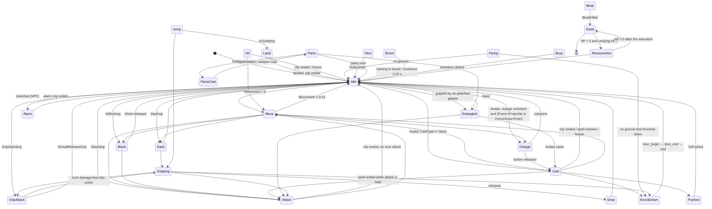
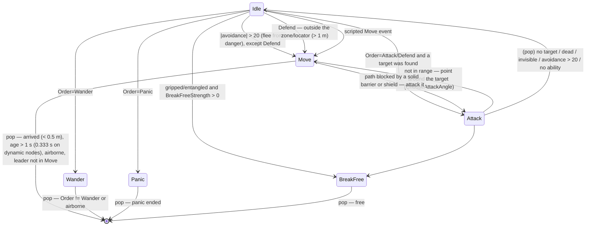

# Entities, AI, navigation, network and players

Scope: `Magicka.GameLogic.Entities` (+ `Abilities`, `SpecialAbilities`, `AnimationActions`,
`CharacterStates`, `Items`, `Buffs`, `Bosses`, `MoveAbilities`), `Magicka.AI` (+ `AgentStates`,
`Arithmetics`, `Messaging`), `Magicka.PathFinding`, `Magicka.Network`, `Magicka.Gamers`,
the player–controller binding (`Magicka.GameLogic.Player`, `Controls`).

Source: decompilation of `Magicka.exe` 1.10.4.2 and the `Content/Data` data. Context: [`../ENGINE_ANALYSIS.md`](../ENGINE_ANALYSIS.md).

> **Clean-room.** Below is only a description of behavior: tables, diagrams, constants and the field order
> of formats (this is needed for asset compatibility). There is no original code here. The OpenMagicka
> implementation is written from scratch based on this description.

---

## 1. Entity hierarchy

### 1.1 Base model

`Entity` is the abstract base of everything that lives in the world: it has a JigLibX physics body (`Body` + `CollisionSkin`),
a radius, an audio emitter, and a reference to `PlayState`.

Identification (this matters for the network):

| Identifier | Type | Origin | Purpose |
|---|---|---|---|
| `Handle` | `ushort` | Sequence number of the object in the **global** static list of all `Entity` objects ever created. Assigned in the constructor | Network addressing. Works because all pools are created up front and in the same order on all machines (see §1.4) |
| `UniqueID` | `int` | Hash of the string name from the level script (`id="#Her_King"` → `GetHashCodeCustom`), 0 = unnamed | References from triggers (`giveOrder id=…`, priority target, face target) |

The instance list is cleared only when `PlayState` changes (`ClearHandles`). Therefore entities **are not created
during gameplay**: they are taken from pools (`GetFromCache`/`GetInstance`) and re-initialized (`Initialize` / `Deinitialize`).

Common contract:
- `Update(dataChannel, dt)`: in the base it only syncs the audio emitter with the orientation.
- `Dead` / `Removable`: `EntityManager` removes `Removable` at the end of the frame (on the server it also broadcasts `EntityRemove`).
- `Kill()`.
- Network hooks: `SendsNetworkUpdate(state)` (default "server only"), `IGetNetworkUpdate` / `INetworkUpdate`, `SyncWithClient`.
- `GetDanger()`: how "dangerous" the entity is for AI avoidance (0 by default; greater than 0 for missiles, mines, puddles, etc.).
- Ballistics: `CalcImpulseVelocity(direction, elevation, massPower, distance)` is the initial velocity needed to travel
  a given distance at a given angle under gravity. The distance is damped by the body mass relative to the push "power".
  If the mass is too large, there is no impulse. This is the shared basis for knockback / push / jump / throw.
- `ArcIntersect`: hit test against a sector (range, half-angle, height tolerance). Melee and area spells work through it.

Interfaces:

| Interface | What it adds |
|---|---|
| `IDamageable` | HP/MaxHP, `InternalDamage(Damage | DamageCollection5, attacker, timestamp, attackPos, features)`, `SegmentIntersect`, `ArcIntersect`, `Kill`, `OverKill`, `Electrocute`, `ResistanceAgainst(element)` |
| `IStatusEffected : IDamageable` | `Volume`, statuses (`HasStatus`, `StatusMagnitude`, `GetStatusEffects`), `Damage(amount, element)` for DoT |
| `ISpellCaster : IStatusEffected` | cast points (`CastSource`, `WeaponSource`), `CastType`, `SpellPower`, `CurrentSpell`, self-shield, item passives |

### 1.2 Class tree

```
Entity
├── Character (abstract)  : ISpellCaster
│   ├── Avatar             : IAI         — the player's wizard
│   └── NonPlayerCharacter               — all NPCs (and most character bosses: VladCharacter, WarlordCharacter…)
├── PhysicsEntity                        — prop from PhysicsEntityTemplate (crates, barrels…)
│   └── DamageablePhysicsEntity          — prop with HP/statuses (MaxHitPoints > 0)
│       └── AnimatedPhysicsEntity        — prop with skeletal animation (spawnAnimProp)
├── MissileEntity                        — missiles (projectile spells, arrows, grenades), pool 128
├── Shield (64), Barrier (128), SpellMine (64), SprayEntity (48), TeslaField (32),
│   WaveEntity (16), Gib (256), Dispenser (32), ElementalEgg (128), BookOfMagick (64),
│   Fairy, FrogTongue, Snare, OtherworldlyBolt, Item/Pickable …
└── (SpecialAbilities): TornadoEntity, VortexEntity, PortalEntity, GreaseField …
```

`Entanglement` (entangling by vines) is a component of `Character`, not a separate entity.

### 1.3 EntityManager

- Holds up to 512 active entities, plus separate `Shields` and `Barriers` lists (they are queried often).
- **Spatial index:** a 16×16 grid of 8 m cells. Cell indices are taken **modulo 16**,
  so the grid is "toroidal": objects 128 m apart land in the same cell. A `GetEntities(center, radius)` query
  then filters by real distance. The grid is fully rebuilt every frame after physics and AI.
  Result lists are taken from a pool and returned via `ReturnEntityList`.
- "Protected entities" are those standing under a shield (`IsProtectedByShield`). Some queries skip them.

### 1.4 Pools and deterministic handles

When created, `PlayState` fills fixed-size pools in a fixed order:
missiles 128, NPCs 192, eggs 128, mines 64, shields 64, barriers 128, gibs 256, avatars 16, etc.
Since `Handle` is an index in the global list, identical pools on the server and client get matching handles.
Avatars additionally get a per-player "unique handle" (`AssignUniqueHandles`, `Player.UniqueAvatarHandle`).

**For OpenMagicka:** doing the same is inconvenient and fragile. Better to use an explicit network ID (`NetId`) that the server
assigns and sends in spawn messages. Keep pools only as an optimization.

### 1.5 Frame update order (PlayState, in-game only)

1. Physics (`PhysicsManager.Update`).
2. AI (`AIManager.Update`). AI does not run on the client.
3. Rebuild of the `EntityManager` grid.
4. Animated level parts.
5. `EntityManager.Update`: `Update` is called on every entity; for characters this runs the state machine, statuses and animations.
6. Boss fight (`BossFight.Update`).
7. Removal of `Removable`.
8. Misc (HUD, achievements).
9. Every **1/30 s**: network entity snapshots for each connection (§6.4).
10. Input (`ControlManager.HandleInput`) runs **at the end** of the frame. So input is applied in the next frame.

### 1.6 The manager in detail

**Membership.** Adding an entity that is already in the manager does nothing; there is room for 512.
Entities added during the update loop are updated in the same frame (they join the end of the
list). Nothing leaves during the update: entities that report `Removable` are taken out in step 7,
in list order, and each is deinitialised (its body disabled, its unique name released if it still
points to it); the server broadcasts their removal. Shields and barriers also sit in their own
lists. Unique names (`UniqueID`) map to the entity that last took them.

**Grid placement.** Positions and radii are measured in cells (÷ 8 m), on X and Z. An entity
covers the columns from `floor(x − h)` to `floor(x + h)`, `h = min(r, 8)`. In each column, the
rows from `floor(z − e)` to `floor(z + e)`, where `e = min(h, √(r² − (c − x)²))` and `c` is the
column edge nearer the centre (`e = r` when the root is not a number). Every index is taken
modulo 16, so an entity also sits in far cells that wrap onto its own. In the column that holds
the centre, the nearer edge gives a chord shorter than the radius, so the original misses some
cells the circle does reach (an entity just across a row boundary is not found from there);
OpenMagicka uses the full half-span `h` for that column.

**Radius query** (`GetEntities(center, radius, ignoreProtected, ignoreY)`):
- the cells from `floor((c − R)/8)` to `floor((c + R)/8)` on each axis (all 16 when the span is
  over 16), modulo 16;
- each entity once, if it is not dead and its distance to the centre is at most `R + its radius`
  (on X and Z only with `ignoreY`, in 3D otherwise);
- with `ignoreProtected`, each **shield** in the result then filters the rest (never itself): a
  damageable entity is dropped when the segment from the centre to it hits the shield (tolerance
  0.5) at a point other than the centre itself. Every entity that is not damageable is dropped too,
  wherever it is (the original tests the shield only for the damageable ones and drops the
  others), including other shields that are not damageable;
- with `ignoreY`, the centre is flattened to height 0 first, for the shield test as well.

**Closest damageable** (`GetClosestIDamageable(caster, center, radius, ignoreProtected)`): the
same cells; alive damageables other than the caster within `R + their radius`, the nearest one.
With `ignoreProtected`, one is skipped when the segment to it hits **any** shield in the level
(tolerance 0.5).

**Protected by a shield**: inside a sphere shield (closer to its centre than its radius).

**Arc test** (`ArcIntersect(origin, direction, range, angle, heightTolerance)`), used by melee and
area spells: the target's height must be within the tolerance of the origin's; then, on X and Z,
its distance `d` to the origin minus its radius `r` must be within the range, and the angle
between the direction and the way to the target, less the target's half-width `acos(1 − r²/(2d²))`,
must be under `angle`. The direction is flattened but not renormalised. The hit point is on the
target's surface, towards the origin. Point blank (closer than `r/2` to the centre, where the
half-width is not a number, or right at it) is a miss, as in the original.

**OpenMagicka.** `OpenMagicka.Gameplay.Entities`:
- The server gives each entity an explicit `NetId` when it is added (clients take it from the spawn
  message) instead of the original's handles. Entities a client makes for itself (gibs, effects)
  take ids from a separate local range, so they never collide with the server's.
- Removal reports each entity with the id it had, for the broadcast; queries skip entities that
  have left the manager even before the next grid rebuild; nothing can update, remove or clear while
  an update or a removal is running. Changing a unique name while in the manager moves the entry.
- Positions or radii beyond 10⁷ m are left out of the grid (one runaway value must not stall it).
- No pools for now (.NET allocates cheaply; they can come back as an optimisation), and no separate
  barrier list until barriers exist. The frame order stays as in §1.5.

---

## 2. Character

### 2.1 What a character stores (semantics)

- **Template** `CharacterTemplate` (shared per type) and instance parameters: HP, statuses, buffs, auras, equipment (8 "attachment" slots; for the avatar slot 0 is the weapon, slot 1 is the staff), the spell queue `SpellQueue` (up to 5 elements for the player).
- **Body** `CharacterBody`: a capsule (`Length`, `Radius`), desired direction `DesiredDirection`,
  movement vector `Movement` (normalized, up to 1), `SpeedMultiplier`, flags `AllowMove` / `AllowRotate`,
  `IsTouchingGround`, `IsJumping`, `IsPushed`, `IsInWater`, `RunBackward`, `AdditionalForce` (set by animations).
- **Combat flags:** `Attacking`, `Dashing`, `IsBlocking`, `GripAttacking`, `IsHit`, `IsKnockedDown`, `IsStunned`, `IsEntangled`,
  grip (`Gripper` / `GrippedCharacter`, `GripperAttached`, `AttachedToGripped`), `Boosts`, `Bloating`, `Overkilled`,
  `Drowning`, panic/fear/stumbling (`IsPanicing` / `IsFeared` / `IsStumbling`, `Panic` 0..1, `FearPosition`, `WanderAngle`),
  ethereal, invisibility, levitation, charm (`Charm`), hypnosis, polymorph.
- "Next" animations set by attack code: `NextAttackAnimation`, `NextDashAnimation`, `NextGripAttackAnimation`,
  `SpecialIdleAnimation`, `DropAnimation`, `SpawnAnimation`, `NetworkAnimation`.

### 2.2 Damage (Character.InternalDamage): processing order

The element and resistance calculation itself (`Damage.ApplyResistances`) belongs to the spell system. Here is what the character does with one
`Damage` instance (attributes: `AttackProperty` (flags), `Element`, `Amount`, `Magnitude`).

1. Character is dead or immortal → nothing happens. The invisibility timer is reset (any hit removes invisibility).
2. `Entanglement` (without burning): the target becomes entangled, no damage. If the target is already entangled, damage or a fire status weakens the bonds.
3. An active self-shield absorbs damage first.
4. **Knockback**: impulse from the attack point, angle ≈40° (0.698 rad), power = `Amount`, range = `Magnitude`;
   if the target can be knocked down, it falls. **Pushed**: the same, angle ≈10°. **Knockdown**: a fall,
   only if `Magnitude ≥ KnockdownTolerance` of the template.
5. **Block:** Earth or Lightning damage while blocking → `BlockDamage` (the item's block value, sector in front of the character).
   A fully blocked hit → `Deflected`.
6. **Statuses** (`Status` flag): Fire→Burning, Cold→Cold, Water→Wet, Poison→Poisoned, Life→Healing, Steam→Wet.
7. Resistances (template, avatar staff, buffs, current statuses). `|Magnitude| ≈ 0` → `Deflected`, exit.
8. `Stun` → stun timer = template `StunTime`. `Bleed` → Bleeding status with template `BleedRate`.
9. `Damage` flag:
   - Lightning: a short "zap" timer of 0.1 s. Damage ×2 against a wet target.
   - Life: reduces the poison magnitude.
   - Physical (Earth/Ice) or Arcane: damage **×3** against a frozen target; otherwise blood splatter and a decal (if blood and effects are enabled).
   - Final damage = `Amount × Magnitude`. **Only a non-client reduces HP.**
   - Damage dealt to whoever is gripping you accumulates in `GripDamageAccumulation`.
   - `Hit` flag (and hit animation) if the damage exceeds the template `HitTolerance` or the character is resurrecting.
10. HP is clamped from above to MaxHP. If HP ≤ 0: when frozen **or** on "overkill" (HP ≤ −(0.5·MaxHP + 500), only with blood enabled) → `OverKill` (gibs), otherwise `Killed`.
11. The level trigger `onDamage` fires, statistics are updated, `LastAttacker` is remembered (kept for 8 s).

`ResistanceAgainst(element)` (for the AI variable `resistance`): for each affected element, modifiers and multipliers
are summed (accounting for freezing: Earth modifier −350; grease: Fire multiplier ×2; staff; buffs).
Result = 1 − clamp(sum of modifiers/300 + sum of multipliers, −1, 1).

### 2.3 Regeneration and other tickers

- Regeneration `Regeneration` (HP/s, integer) works only when the character is alive, not burning and not poisoned. Once per second a number appears above the head.
- Floating damage numbers accumulate for 0.333 s. Fire, poison, blood and healing are summed over 1 s.
- `OverKilled(amount)`: threshold −(0.5·MaxHP + 500) or death from bloating (bloat).
- `Undying` / `UndieTime` / `UndieHitPoints`: "undying" characters wait for a timer after death and resurrect (via `RessurectionState`).

### 2.4 Difficulty from player count

If the template faction is not `FRIENDLY`, resistances are scaled on load by the factor
`f = 1 − (players − 1) · 0.00666`: positive multipliers and modifiers are multiplied by `f`, negative ones are divided by `f`.
With 4 players this is about −2%. The effect is small, but it is worth replicating to match the numbers.

### 2.5 The character's core each frame

What a character does in its own update, leaving out effects, auras and grips (where the animation and
the state machine run in it: §5.4), in this order:

1. Hit points are capped at the maximum; the immortality timer runs down (immortal while it is
   above 0). The speed multiplier resets to 1.
2. Zap: while the zap timer (0.1 s after a lightning hit) is not below 0, the speed multiplier is
   the template's `ZapModifier` (unless it is not a number); the timer runs down. The stun timer
   runs down (stunned while it is above 0 and alive).
3. Dead: an undying character's revival timer runs down and, at 0, it lives again with
   `UndieHitPoints` (not after an overkill). Otherwise the corpse timer runs down; the corpse can be
   removed once it is below −10 (it starts at 20–40 s on spawning, 10 after drowning, −100 after an
   overkill: removed at once).
4. Regeneration (§2.3) and then the statuses' tick (SPELLS.md §9): their damage goes the
   damage-over-time path (§2.2: no resistances, fire ×2 on grease; the self-shield takes it first);
   cold and poison cap the speed multiplier.
5. Frozen (or bloating): no speed, no turning, no movement.
6. The last attacker is forgotten 8 s after the last hit, counted only while no status is active.

**Death.** A character whose hit points reach 0 dies through the dead state, when its death clip ends
(§5.4); one made without animations (tests, tools) dies on the same frame. An undying character
(not drowning) starts its revival timer (`UndieTime`, or 0.5 s when it is zero) and rises with
`UndieHitPoints`; a template that gives none would die again at once, as in the original. An overkill
sets the hit points to `−MaxHP − 1000` and the corpse timer to −100.

**Blocking** compares the block with amount × magnitude for a full block, but takes a partial block
off the amount alone (as the original). A fully blocked entry still sets its statuses (with its full
amount as DPS); a partly blocked one goes on with the rest. Nothing reports `KnockedDown` in the
result (the original sets the knocked-down state, not the flag).

**Entanglement** (vines): a magnitude up to 20 that an `Entanglement` attack adds (not on the immortal
or the burning). While it is above 0 the character is entangled: no pushes, jumps or impulses. Damage,
or a fire status, takes its magnitude off; fire, or more than is left, breaks it at once.

**Knockdown**: `KnockDown(magnitude)` needs `magnitude ≥ KnockdownTolerance`; plain `KnockDown()`
does not. A tolerance of exactly 5000 means the character cannot be knocked down. Either stops the
character's horizontal motion. Getting up is the state machine's (OM-33).

**Physics events** (the body's report after each step, §7.4 of the engine architecture): an impact
becomes Earth damage through the full damage path (`ImpactDamage`, with Knockdown above 100, the
last attacker credited), the characters it knocked down fall, and a knockdown of its own fells it.

In OpenMagicka the core is `OpenMagicka.Gameplay.Characters.Character`; a `GameWorld` runs the frame
of §1.5 around it: each character's body is set up and steered, physics steps, the bodies' reports
go back to their characters, the grid is rebuilt, entities update, and the removable leave.
`GameWorld.Spawn` makes and adds a character; a removed character's body is gone and it cannot be
added again; a removed character keeps the position it had, and an attacker that left the level is
forgotten. Non-finite damage, immortality or entanglement values are rejected. `CharacterTemplates.From` (Engine) maps
the content reader's template onto the core's, raising the capsule length to 0.01 as the original's
reader does (67 of the 338 vanilla templates give 0). In the vanilla data no template is undying or
flies (the only movement flag set is Jump), and one cannot be knocked down.

---

## 3. CharacterTemplate (`Content/Data/Characters/*.xnb`, 338 files)

Read by `CharacterTemplateReader` and cached by ID hash. Field order of the binary format (needed for the OpenMagicka reader):

| # | Field | Type | Semantics |
|---|---|---|---|
| 1 | ID | string (lowercase) | character type; its hash is the NPC `Type` |
| 2 | DisplayID | string | localization key of the name |
| 3 | Faction | int32 (`Factions` flags) | EVIL 1, WILD 2, FRIENDLY 4, DEMON 8, UNDEAD 16, HUMAN 32, WIZARD 64, NEUTRAL 0xFF, PLAYER0..3 0x100..0x800, TEAM_RED/BLUE. Enemies are factions **with no shared bits** |
| 4 | Blood | int32 | regular, green, black, wood, insect, none: blood effects, decals, sounds |
| 5–11 | IsEthereal, LooksEthereal, Fearless, Uncharmable, Nonslippery, HasFairy, CanSeeInvisible | bool×7 | immunities and traits |
| 12 | AttachedSounds | int32 N, then N×(string cue, int32 bank) | persistent sounds, at most 4 |
| 13 | Gibs | int32 N, then N×(ExternalRef Model, float mass, float scale) | pieces for overkill |
| 14 | PointLights | int32 N ≤ 4, then N×(string joint, float radius, vec3 diffuse, vec3 ambient, float specular, byte variationType, float variationAmount, float variationSpeed) | lights on bones |
| 15 | MaxHitpoints | float | |
| 16 | NumberOfHealthBars | int32 (≤0 → 1) | multi-layer HP bars for bosses and elites |
| 17–19 | Undying, UndieTime, UndieHitPoints | bool, float, float | auto-revival after death |
| 20 | HitTolerance | int32 | damage below which there is no "hit" reaction (and the grip-break threshold) |
| 21 | KnockdownTolerance | float | minimum `Magnitude` to knock down |
| 22–25 | ScoreValue, ExperienceValue, RewardOnKill, RewardOnOverkill | int, int, bool, bool | score |
| 26 | Regeneration | int32 | HP/s |
| 27 | MaxPanic | float | |
| 28 | ZapModifier | float | reaction to lightning |
| 29–31 | Length, Radius, Mass | float | capsule (Length ≥ 0.01) and mass |
| 32–33 | Speed, TurnSpeed | float | |
| 34 | BleedRate | float | bleeding DPS |
| 35 | StunTime | float | stun duration |
| 36 | SummonElementBank + cue | int32, string | summon sound |
| 37 | Resistances | int32 N, then N×(int32 element, float multiplier, float modifier, bool statusResistance) | default for 11 elements is multiplier 1, modifier 0 |
| 38 | Models | int32 N, then N×(ExternalRef SkinnedModel, float scale, vec3 tint) | appearance variants; on spawn a random or a specified one is chosen (`iRandomOverride`) |
| 39 | AnimationSkeleton | ExternalRef SkinnedModel | where clips and bones come from |
| 40 | AttachedEffects | int32 N, then N×(string bone, string effect) | persistent effects on bones (the bone must exist) |
| 41 | AnimationClips | **27 sets** (by `WeaponClass`): for each, int32 M, then M×(string animationName, AnimationClipAction) | see §4 |
| 42 | Equipment | int32 N, then N×(int32 slot 0..7, Attachment) | items on bones |
| 43 | EventConditions | ConditionCollection | events on death, damage, etc. (§8.2) |
| 44 | AlertRadius | float | enemy "noticing" radius |
| 45–49 | GroupChase, GroupSeparation, GroupCohesion, GroupAlignment, GroupWander | float | flock weights (§5.6) |
| 50–53 | FriendlyAvoidance, EnemyAvoidance, SightAvoidance, DangerAvoidance | float | avoidance weights (§5.5) |
| 54–56 | AngerWeight, DistanceWeight, HealthWeight | float | target selection weights (§5.4) |
| 57 | Flocking | bool | |
| 58 | BreakFreeStrength | float | strength of breaking free from a grip (0 = does not try) |
| 59 | Abilities | int32 N, then N×Ability (§5.7) | up to 16 (cooldowns are stored in an array of 16) |
| 60 | MoveAnimations | int32 N, then N×(byte MovementProperties, int32 K, K×string animation) | jump, fly, swim animations. The union of flags = the character's `MoveAbilities` for the navmesh |
| 61 | Buffs | int32 N, then N×BuffStorage | innate buffs |
| 62 | Auras | int32 N, then N×AuraStorage (TTL ≤ 0 → infinite) | innate auras |

After reading, service joints are found by bone name: `Mouth`, `RightAttach`, `LeftAttach`, `RightLeg`, `LeftLeg`
and the bone with index 1 (hips). A 180° rotation around Y is added to the bind pose.

`WeaponClass` (animation set index): Default, Thrust/Crush/Slash/Throw × Fast/Medium/Slow, Unarmed, Handgun, Rifle,
Machinegun, Heavy, Staff, NewAnimationSet0..7 (27 in total). If a clip is missing in the current weapon's set, set 0 is used.
The `Animations` enum has **231** values; the clip table is indexed by it directly.

`MovementProperties` (flags): Default 0, Water 1, Jump 2, Fly 4, Dynamic 0x80.

---

## 4. Animations and AnimationActions

`AnimationClipAction` = (clip name in the skeleton, speed, blend time, loop, list of `AnimationAction`).

`AnimationAction` is a command bound to a normalized clip interval `[start, end]` (fraction of the duration from 0 to 1).
In a frame where the clip time falls inside the interval, `Execute` is called. A "first execution" flag allows a one-time
effect on entering the interval. After passing `end`, `Kill` is called once. The type is chosen by string name (case-insensitive).

| Action | Parameters (after start/end) | Behavior |
|---|---|---|
| `DealDamage` | weapon slot, target byte | on entry, clears the item's hit list and fires its melee events; then every frame of the interval, an item strike (ArcIntersect at melee range) |
| `SpawnMissile` | weapon, itemAligned | shoots or throws the item's missile |
| `Gunfire` | weapon, accuracy | continuous fire |
| `CastSpell` | fromStaff, source joint | casts the current queue (if the spell is not already running) |
| `SpecialAbility` | weapon | the item's special ability |
| `Block` | weapon | block window |
| `Grip` | type (Pickup/Ride/Hold), radius, breakFreeTolerance, finishOnGrip (+ bones) | the NPC grabs the current AI target if it is close, visible (no wall or shield between them) and not protected |
| `ReleaseGrip`, `ThrowGrip`, `DamageGrip`, `OverkillGrip`, `BreakFree` | — / magnitude | grip control |
| `Jump` | elevation, min/max range | NPC jump toward the target with lead (half its velocity), distance ×1.1 with a clamp |
| `Move` | velocity (local) | additional body force in the character's coordinate system × animation speed |
| `Crouch` | radius, length | temporarily changes the capsule |
| `Ethereal`, `Invisible`, `Immortal` | … | states |
| `PlayEffect` | bone, effect, attach | particles on a bone (with `attach`, the effect follows the bone) |
| `PlaySound` | cue, bank | sound |
| `Footstep` | — | footstep (sound and effect depend on the surface and water) |
| `CameraShake` | duration, magnitude | |
| `SetItemAttach`, `DetachItem`, `WeaponVisibility` | item, velocity / visible | equipment |
| `RemoveStatus` | — | remove statuses |
| `Tongue` | maxLength | frog tongue (`FrogTongue`) |
| `Suicide` | overkill | self-destruction (bombers) |

Example from the data (goblin_warrior): `attack_melee0` → clip `attack_sword_doubleslash`, actions `Move`, `DealDamage`, `Move`, `DealDamage`.

### 4.1 Clip timing (what the state machine and the actions see)

A character plays one clip at a time, with at most one crossfade towards the next (the skinned
model's controller; only its timing matters to the rules):

- **Time** runs at `dt × speed × clip speed`: the character's animation speed (0 while frozen,
  the zap modifier, slowed by cold) times the clip's own. A clip that does not loop stops at its
  end and **has finished**; a looping one wraps and reports a loop each time it does.
- **A crossfade** to a new clip takes the given blend time. Meanwhile the old clip keeps playing,
  is not "finished", and keeps its actions. When the blend time is exceeded the new clip starts
  from 0. Starting another crossfade while one runs queues it (only the last one is kept) and
  halves what is left of the current blend; the queued one starts when the current one ends.
  Nothing advances without time: at speed 0 a crossfade never ends. Quirks kept from the original:
  the loop flag given last is the one the running blend's clip starts with; the clip speed changes
  to the new clip's as soon as its blend starts; while a blend runs, "looping" still describes the
  old clip (so `Hit`, which leaves when the clip finishes or loops, leaves on the next frame when
  entered from a looping idle).
- **Choosing a clip** (`GoToAnimation(name, blend)`): nothing happens if the same animation is
  playing and not finished. The set is the default one unless an equipped item (not a staff) has its
  own set holding that animation; an animation missing from the set falls back to `idle`, not
  looping. The blend is the clip's own blend time if it has one, else the one asked for. Forcing a
  clip (`ForceAnimation`) drops any queued crossfade and starts it at once.
- **Actions** belong to the clip whose crossfade finished. When a crossfade ends, the old clip's
  actions that had not ended are ended (`Kill`), unless the new clip has the same list; all the
  "started" and "ended" marks are cleared, and cleared again at every loop. Each frame, after the
  clip time moved, every action of the current clip is checked at `t = time / duration`: it runs
  when `t` has reached its start and either `t` is within its end or it has not run yet (so a late
  start still runs once), told whether this is its first run; when `t` is past its end, an action
  that ran is ended once. More quirks kept: the actions taken when a blend ends are those of the
  animation asked for last (even one still queued); leaving a clip ends its actions whether they ran
  or not, and a loop wrapping on the frame a blend ends ends them all twice; an action that forces
  another animation hands the rest of that frame's loop to the new clip's actions, by index (and its
  own "started" mark lands on the new action at its index, which then never gets a first run); a
  missing animation recorded as `idle` starts its blend over at every request.

In OpenMagicka: `OpenMagicka.Gameplay.Animation` (`AnimationClock`, `CharacterAnimator`), and
`CharacterAnimationSets` (Engine) reads a template's sets with each clip's duration from its
skeleton. Across the 338 vanilla templates that is 1,090 sets, 16,475 animations and 16,264 actions;
only the base template `a_basic_character` names clips its skeleton lacks (8 animations, left out;
the original would fail on loading it). The first clip is `idle`, started at once.

### 4.2 What each action does

Most actions in the data end at 0: they run once when their start is reached and end on the next
frame. Uses across the vanilla templates are given in brackets. "Each frame" means every frame of
the window; "once" means the first frame only.

- **`Move`** (376): each frame, the body's extra force is the action's velocity turned from the
  character's frame (−Z forward, +X to its right, +Y up) into the world, times the animation speed
  at that moment (the previous frame's, as actions run before the speed is worked out again).
- **`Jump`** (8, all `move_jump_begin`): once, for a non-player character only. The aim is the
  target's position plus half its velocity; with no target it is the facing direction times the
  middle of the range, taken as a point (not as an offset from the character), as the original.
  The jump distance is the **squared** distance to the aim × 1.1, clamped to the range, as the
  original (all 8 vanilla jumps give both ends of the range). The direction is the unit vector to the aim. The body is allowed to move, then the
  character jumps along it at the elevation. A ballistic jump to a point `d` away flat and `h` up
  at elevation `θ` takes the speed `√(g·d² / (2·(d·tan θ − h)·cos² θ))`; it does nothing when that
  is not a number, when entangled or when dead.
- **`Crouch`** (199): once, the capsule becomes the action's radius and length (each at least
  0.01) if it differs, keeping the feet where they are; at the end it goes back to the template's.
- **`Ethereal`** (25): once. With speed 0 the transparency is set at once; otherwise the character
  becomes ethereal or solid and its transparency eases towards the alpha at that speed. Becoming
  ethereal removes burning, wet, frozen, cold, poison, healing, grease and steam. The transparency
  eases each frame by `(target − alpha) × speed × dt`.
- **`Invisible`** (9): once, invisible for good (the self-shield goes), or only hidden from
  rendering with "no effect"; at the end, visible again. Damage that gets past the dead and
  immortal checks, attacking, a kill and an overkill end invisibility; so does any status tick,
  healing ones included, as the original.
- **`Immortal`** (54): each frame, immortal for 3 s (set, not added); without "collide" the
  character also passes through everything but the level for 0.15 s. At the end, the immortality
  goes at once.
- **`RemoveStatus`** (9): once, the named status stops.
- **`Suicide`** (22): each frame, an overkill, or a kill that dies at once (not through the death
  clip). The dead state still follows, through the common checks. Six goblin and dwarf warrior
  templates carry one in `hit_stun_begin`, so a knockdown kills them, as in the original.
- **`Block`** (84): each frame, the block slot is set, which opens a block window. Every item's block
  value counts, whatever the slot (§8.1.1). The block slot is cleared at the start of every frame
  before the actions run, so blocking lasts exactly the window. Only Earth or Lightning damage is
  blocked, and only while a slot is set.
- **`BreakFree`** (180): once, an entangled character tears the vines by the magnitude (as Earth
  damage to the entanglement); a gripped one breaks free (with grips).
- **`PlaySound`** (4,288), **`PlayEffect`** (1,511), **`Footstep`** (2,928) and **`CameraShake`**
  (62) are for presentation. They fire once each: a sound cue from a bank at the character; an
  effect at a bone, which with "attach" follows the bone until the action ends; a footstep chosen by
  the ground material and the character's mass, only on the ground and not levitating; a camera
  shake at the character's position.
- **With items:** `DealDamage` (1,997), `SpawnMissile` (1,787), `Gunfire` (335), `SpecialAbility`
  (84), `DetachItem` (17), `SetItemAttach` (unused). `WeaponVisibility` (767) is in §8.1.1.
- **With spells:** `CastSpell` (1,371).
- **With grips:** `Grip` (48), `DamageGrip` (48), `ReleaseGrip` (24), `ThrowGrip` (15),
  `OverkillGrip` (15).
- **With the frog:** `Tongue` (1).

Passing through means that a character which is ethereal, or within an `Immortal` action's 0.15 s,
neither stops nor is stopped by anything but the level (and liquids).

In OpenMagicka the actions are in `OpenMagicka.Gameplay.Animation.Actions`. Presentation actions
raise a `Cue` on the character for the engine (sound, effect and its end, footstep, camera shake).
`CharacterAnimationActions` (Engine) makes them from the template data. The action types that wait
for a later system are left out until it lands. Invisibility counts down in OpenMagicka; in the
original the buff that grants it times it.

---

## 5. Character state machine (CharacterStates)

States are data-less singletons (all data is in `Character`), with the interface `OnEnter` / `Update → next state or null` / `OnExit`.
`ChangeState` remembers `PreviousState` (for example, `HitState` uses it to know that a charge was interrupted, and fires the spell).

### 5.1 Common checks (priority from top to bottom)

Most states first call the shared base functions:

1. **UpdateBloatDeath:** bloating → `Bloat`; overkill or HP ≤ 0 (unless the "dies only explicitly" flag is set) → `Dead`.
2. **UpdateHit:**
   - pushed and airborne (not a jump, not gripped) → `Flying`;
   - entangled, or gripped without attachment, and not attacking → `Entangled`;
   - pushed along the ground → `Pushed`;
   - knocked down → `KnockDown`;
   - holding someone but must release (or damage from the victim > HitTolerance) → `Drop` (on the ground) or an impulse and knockdown;
   - `IsHit` → `Hit`;
   - stunned (and none of the above) → `Stun`.
3. **UpdateActions:**
   - jumping (and not holding anyone) → `Jump`;
   - panic, stumbling or fear (not entangled) → `Panic`;
   - has "boosts" and something to boost (a shield in front or its own self-shield) → `Boost`;
   - holding but not attached → `Gripping`.

### 5.2 Diagram (main transitions)



(Almost every state has transitions to `Dead` / `Bloat` and via `UpdateHit`; they are omitted from the diagram.)

### 5.3 State details

| State | Entry | Behavior / exit |
|---|---|---|
| `Idle` | allows movement and rotation (if not entangled); animation: network → special idle → `special1` (holding) → `idle_wnd` (poisoned) → `idle_agg` (aggressive) → `idle` | when the clip ends, re-selects idle. On exit, forbids movement and resets special idle |
| `Move` | allows movement and rotation | animation by normalized speed: ≥ 0.6 → `move_run`, < 0.4 → `move_walk`, in between keeps the current one; poisoned → `move_wnd`. Does not change state during a zap |
| `Attack` | removes ethereal and invisibility; plays `NextAttackAnimation` (blend 0.075) | rotation is allowed within the blend window, with the `AllowAttackRotate` flag, or in the first 0.1 s of the clip. Combo: if a next attack is set when the clip ends, plays it (except `attack_recoil`). Exit stops the spell and weapon fire |
| `Cast` | animation by the pair (CastType, SpellType): Force → `cast_force_{push,spray,projectile,shield,railgun,lightning}`; Area → `cast_area_{push,blast,ground,fireworks,blast,lightning}`; Self → `cast_self`; Weapon → `cast_sword_*` (depends on the "charged" weapon); Magick → the magick's animation (rotation forbidden) | exit: clip ended, loop clip (except Force, which is held), spell inactive, frozen |
| `Charge` | `charge_force` / `charge_area`, charge sound, TurnSpeed ×0.125, SpellPower = 0 | SpellPower grows with the clip fraction up to 1, then a loop clip. Button released → `Cast`. On exit, a cast "from the staff" |
| `Boost` | `boost` | each "boost" heals its own self-shield by 50 (if it is not "solid"), otherwise +100 HP to the shield in front (ray 20 m, cone 45°, nearest within √400) |
| `Panic` / `PanicCast` | `move_panic` or `move_stumble` (stumbling = running backward) | random wander of the angle (±30°/s) plus look direction ×4. Panic blends player input and wander in the proportion `Panic`. Fear = running away from `FearPosition`. Speed multipliers 0.8 / 0.6 / 0.666. On the client only the owner turns the wander angle |
| `Dead` | releases grips, disables AI (unless undying), drops equipment, `die0` / `die1`, drowned → `die_drown{,1,2}` | when the clip ends, the server sends `CharacterDie`, a non-client calls `Die()`. Overkill: gibs, `RemoveAfterDeath` |
| `KnockDown` | `hit_stun_begin` | → `hit_stun_end` → exit. Interrupting a charge releases the spell |
| `Flying` | `hit_fly`, releases the gripped character | until landing |
| `Pushed` | `hit_slide` | while the body is being pushed |
| `Stun` | `stunned` or `idle_wnd`, movement forbidden | while `IsStunned` |
| `Entangled` | `spec_entangled` | Avatar can cast and attack (break free) |
| `Jump` / `Land` | `move_jump_up` / `move_jump_mid` → `move_jump_down` when falling → `move_jump_end` | |
| `Alarm` | `spec_alert0` (Discover) / `spec_alert1` (Danger) | NPC only |
| `Busy` | `emote_confused0`, movement forbidden | inventory is open (versus/inventory) |

### 5.4 The state machine in the character's frame

Where it runs (the order of §2.5, with animation): the action timers count down and the block slot
is cleared; the animation clock moves and the current clip's actions run (skipped once a corpse's
timer is below −10 and its clip has finished with no blend); the transparency eases; the speed
multiplier and the animation speed reset to 1; the self-shield updates; **the state
updates and may hand over to another** (the old one's exit, then the new one's entry; the old one is
kept as the previous state); then the zap (it multiplies both speeds), the timers, regeneration and
statuses follow. Last, the animation speed is scaled: in `Move` (and `Panic`) by the body's speed as
a share of its maximum (1 when the maximum is 0); otherwise, when cold, by the cold slowdown; frozen
sets it to 0.

Details the table above leaves out (blend times in seconds):

- **Death goes through `Dead`.** With a state machine, a character whose hit points reach 0 (or
  that is overkilled) enters `Dead`, plays `die0` or `die1` (half and half when it has both; 0.05),
  and only **dies when that clip finishes** (an overkill dies on the dead state's first update and its
  corpse is removed). Meanwhile it is not dead: queries still find it, pushes and statuses still take. An
  undying character with hit points again and its revival timer running, whose clip stopped, moves
  to `Ressurection`, which forces `revive` (or `hit` without one) and goes on when it finishes.
- **`KnockDown`** clears the knocked-down and hit flags on every update (they are only triggers),
  plays `hit_stun_begin` (0.05), then `hit_stun_end` (0.05), then leaves; freezing also gets it up.
- **`Hit`** plays `hit` (0.1) and leaves when the clip finishes or loops, or the character freezes;
  it clears the hit flag on exit and checks only death meanwhile. The hit flag survives death, so a
  revived character first plays the hit that killed it.
- **`Flying`** (`hit_fly`, 0.03) clears the hit flag and lands into `KnockDown` (if knocked down) or
  goes on. **`Pushed`** (`hit_slide`, 0.05) ignores a `Flying` the common checks give and leaves
  when the push ends. **`Stun`** prefers `stunned`, else `idle_wnd` (0.35).
- **`Jump`** plays `move_jump_up` (or `move_jump_mid`; 0.2), turns to `move_jump_down` (0.3) once
  falling, and lands into **`Land`** (`move_jump_end`, 0.13), which waits for the ground and the
  clip's end. `Land` checks nothing else: a character killed while landing dies once it has landed,
  and one without a `move_jump_end` clip waits for good (as the original).
- **`Idle`** picks, on entry: the special idle (0.2), `idle_wnd` when poisoned (0.2), `idle_agg`
  when aggressive (0.2), `idle` (0.3 coming from `idle_agg`/`idle_wnd`, else 0.2); and when a clip
  ends with no blend running: `idle_wnd` (0.3), `idle_agg` (0.2), the special idle (0.1) or `idle`
  (0.5). It leaves for `Alarm`, `Move` (moving), `Dash`, `Attack`, `Block`, or `Entangled`; it allows
  moving and turning on entry (unless entangled), forbids moving and clears the special idle on
  exit.
- **`Move`** plays `move_wnd` when poisoned (0.4), else `move_run` at ≥ 0.6 of the maximum speed,
  `move_walk` under 0.4 (0.25), keeping the current one in between; during a zap it neither changes
  the clip nor goes idle (the common checks, dashes, attacks and blocks still apply); it goes idle
  when the wanted movement is under 0.1. The clip choice uses the 3D speed share (0 when the maximum
  is 0), the animation speed the flat one (1 when the maximum is 0), as the original.
- **`Attack`** plays the next attack (or `idle`; 0.075), allows turning during a blend, with the
  attack-rotate flag, or in the first 0.1 s of the clip (never entangled), chains the next attack
  (0.2) when the clip ends while still attacking (not after `attack_recoil`), and leaves when no next
  attack is set and the clip finishes (or loops with no blend), clearing the attacking flag.
- **`Block`**, **`Dash`** (the next dash animation, 0.2, until its clip ends; with none set it asks
  for none, which plays `idle` once; clears dashing), **`Alarm`** (`spec_alert0` to discover,
  `spec_alert1` for danger, 0.2; clears the alert; a pending next attack holds it) and
  **`Busy`** (`emote_confused0`, 0.2, while busy) as in the table.

OpenMagicka has `Idle`, `Move`, `Hit`, `KnockDown`, `Flying`, `Pushed`, `Stun`, `Entangled`, `Jump`,
`Land`, `Dead`, `Ressurection`, `Attack`, `Block`, `Dash`, `Alarm` and `Busy` now; `Cast`, `Charge`,
`PanicCast`, `Panic`, `Boost`, `Gripping`, `GripAttack`, `Drop` and `Bloat`, with the transitions into
them, come with spells in the world, panic and fear, shields, grips and bloating. A character made
without animations has no state machine and dies on the frame its hit points reach 0 (§2.5).

---

## 6. Avatar (player)

### 6.1 Input → actions

The controller calls avatar methods (discrete events):

| Controller function | Method | Essence |
|---|---|---|
| Spell_Up/Down/Left/Right | `HandleCombo(direction)` | each element is a **pair of directions** (on a gamepad, a right-stick gesture, see below). The pair goes into the player's input queue, `SpellManager.HandleCombo` recognizes the element |
| Q W E R A S D F (keyboard) | `ConjureX()` | wrapper over two `HandleCombo` calls, for example Water = Left+Up, Fire = Right+Down |
| Cast_Force (RMB) | `ForcePressed` / `ForceReleased` | only with a staff; CastType = Force. Releasing allows charging (`ChargeUnlocked`) |
| Cast_Area (Shift+RMB) | `AreaPressed` / `AreaReleased` | CastType = Area |
| Cast_Self (MMB) / Special | `Special` | queue present → CastType Self; otherwise the item's special ability (source slot) |
| Attack (LMB) | `Attack` | queue present (or weapon charged) → CastType Weapon; otherwise melee: random `attack_melee0` / `attack_melee1` (Heavy alternates). In a Pickup grip, accumulates breaking free |
| Cast_Magick / Boost (Space) | `Boost` | if the queue forms a magick → CastType Magick (instant magicks work even when frozen or knocked down); otherwise when entangled, break free; otherwise shield boost |
| Interact / Action | `Action` / `Interact` | NPC dialog → item pickup → interactive (conversations are unavailable in combat) |
| Block | block | |

"Element → direction pair" table (`ConjureX`):

| Element | Pair |
|---|---|
| Earth | Down, Left |
| Water | Left, Up |
| Cold | Right, Up |
| Fire | Right, Down |
| Lightning | Left, Down |
| Arcane | Up, Right |
| Life | Up, Left |
| Shield | Down, Right |

Special rules when adding an element to the queue:
- Lightning while you are wet (without the WetLightning passive), or Fire while you are greased, hits yourself:
  self-lightning damage with magnitude ×0.5, the input queue is cleared.
- `TryAddToQueue(…, max 5)`: combining and cancelling opposite elements in `SpellManager` (this is the spell area).
- While a charge, an event or a polymorph is active, element input is ignored.

Each of these actions is sent over the network as `CharacterAction(ActionType, Param…)` (§9.3).

### 6.2 Misc

- Direction: mouse (projection onto a plane), stick (with inversion). `DesiredInputDirection` is needed by the panic state.
- Avatar implements `IAI`: a level script can drive the avatar with events (cutscenes, `PushState` / `PopState`, `EventComplete` over the network).
- Avatar cache: 16. The avatar is bound to a `Player` and is not lost on death.
- Weapon and staff switching (`ChangeWeapon` / `ChangeStaff`), picking up `Pickable`, magick books (`BookOfMagick`).

---

## 7. AI (`Magicka.AI`)

### 7.1 AIManager

- Host only (on the client it exits immediately).
- First delivers deferred AI messages (`MessageDispatcher`).
- **Time slicing:** at most **20 agents** are fully updated per frame. The window shifts cyclically by 20 every frame.
  Time accumulates per agent in `TimeSinceLastUpdate` and is consumed when it is updated. So the "brain" ticks less often
  than once per frame, but with the correct dt.
- "Threat" flag for combat music: at least one agent has a current target.

### 7.2 Agent: data

A stack of AI states and their age; a stack of targets (`CurrentTarget` is the top of the stack) and their age; `NextAbility` and `BusyAbility`
(the one currently executing); the "grudge table" `AttackedBy` (handle → accumulated damage, at most 500; decays by 25 per second;
the staff passives ReduceAggro and ZombieDeterrent (for undead) halve it); `Order`, `ReactsTo`, `ReactionOrder`, `ReactionTrigger`;
priority target and priority ability (from the script); path (list of `PathNode`); `WayPoint` (for attack, an **offset from the target**;
for movement, an absolute point); flock leader; script events (`AIEvent[]`, index, delay, loop); wander parameters;
`AlertMode` (None / Discover / Danger); `TargetArea` (hash of a trigger zone or locator).

`Order`: None, Idle, Attack, Defend, Flee, Wander, Panic. `ReactTo` (flags): Attack 1, Proximity 2.
After `Initialize` the defaults are `Order = Attack`, `ReactTo = None`. Aggression is controlled only by the script: spawn and `giveOrder`.

### 7.3 Agent.Update loop

1. Grudge decay, "aging" of states, targets and the leader.
2. **Reaction:**
   - `ReactTo.Attack`: there is an attacker in the table;
   - `ReactTo.Proximity`: within `AlertRadius` there is a character of a foreign faction (visible, or the agent sees invisible).
     If the reaction order differs from the current one, `AlertMode = Danger`.
   Reaction: `Order = ReactionOrder` (if set) and the script's `ReactionTrigger` is fired.
3. `OnExecute` of the top AI state.
4. `NextAbility.Update`: ability preparation (for example, the NPC "chants" elements).

`HandleMessage(TakingDamage)` → `AddAttackedBy`: damage from a foreign faction is added to the grudge table. Allies of the same faction
within the alert radius also get a grudge against the attacker. Damage from "own" faction is zeroed (multiplier 0).

### 7.4 Target and ability selection (fuzzy)

`ChooseTarget`:
- Candidates: entities within 40 m, all player avatars, the priority target. Discarded: dead, the agent itself,
  non-characters (except the priority target), invisible.
- Score: +1 for the priority target; `+ FuzzyAnger · AngerWeight`; `+ (1 − HP/MaxHP) · HealthWeight`;
  `+ FuzzyDistanceExponential(dist, AlertRadius) · DistanceWeight`; everything is multiplied by the target's aggro multiplier (ReduceAgro buffs).
- Two top-4 lists are kept: **enemies** (factions with no overlap) and **others** (allies, for healing and buffs).
- The best ability desirability against each candidate is added to its score. "Target = myself" is scored separately
  (for abilities with `Target.Self`). The winner is the maximum sum.

`ChooseAbility(args)`: iterates abilities that are off cooldown and match by `Target` (Self: only on self; Friendly: an ally,
not self; Enemy: a foreign faction). If the NPC queue already has elements, only `CastSpell` with the same elements qualifies.
Desirability = the value of the ability's fuzzy expression (or the built-in `Desirability`), +0.5 for the priority ability
against the priority target. The maximum > 0 is taken. If nothing qualifies and elements are already chanted, a service
"spell recovery" ability is set, which finishes casting the queue as the last used one.

### 7.5 Fuzzy arithmetic (`Arithmetics`): the expression language in templates

The expression string from `.xnb` is parsed into a tree:
- operators `+ -` (priority 50), `* /` (100), `!` (unary **NOT = 1 − x**, 150), `^` (power, 200), parentheses;
- the parenthesis nesting level raises priority; the root becomes the operator with the minimal (level, priority);
- a leaf is a number or a variable `[scope.]Name(args)`, where scope is `g` / `s` / `t` (Global / Self / Target, Global by default);
- spaces and line breaks are ignored, names are case-insensitive. There are aliases: `DistExp` = `DistanceExponential`,
  `FDensity` = `FriendlyDensity`, `Status` = `HasStatus`, `Res` = `Resistance`, `LOS` = `LineOfSight`, etc.

Variables:

| Variable | Arguments | Value (0..1) |
|---|---|---|
| `DistanceLinear(max)` / `(min,max)` | a single number → range (−max, max) | triangular function peaking at the middle of the range |
| `DistanceExponential(max)` / `(min,max)` | same | exponential bell centered in the middle: ≈ 0.1 at the edges, 1 at the center |
| `Behind` | — | (dot(dir from AI to target, target forward) + 1)/2: how much the AI is behind the target |
| `Angle` | — | dot(direction to target, AI look direction) in the XZ plane |
| `Danger(elements)` | `Elements` name, `|` = or (`Offensive`, `Fire`…) | 1 − 0.25^(Σ threats of enemies in alert radius + own danger [+1 if lightning hits]) |
| `Threat(elements)` | scope Target | the target's threat: the angle of its gaze at the AI and proximity (up to 20 m) × strength of the elements in its queue (in Charge/Cast, 4th root) |
| `HasStatus(status)` | `StatusEffects` name | 0/1 |
| `Gripped`, `Gripping`, `Entangled`, `IsOnGround`, `IsCharacter`, `IsEthereal`, `IsShield`, `IsBarrier`, `Shielded` | — | 0/1 |
| `Speed`, `Health` | — | normalized |
| `Resistance(element)` | | see §2.2 |
| `FriendlyDensity(r=6)`, `EnemyDensity(r=6)` | radius | 1 − 0.5^count |
| `LOS` | — | 1 if there are no other entities on the AI→target segment |
| `LOSC(dx,dy,dz,len)` | start offset and length | ray with level collision |
| `GripDamageAccumulation[Normalized]` | | |

Common expressions in real data: `distExp(3)`, `distExp(6)`, `(distexp(0,15)*0.75) - (s.FriendlyDensity*0.5) - Danger(Offensive)`,
`(s.status(wet)+s.status(cold)+s.status(frozen))*2` (for self-healing or cleansing), `(distExp(6,20))*LOS*!t.shielded*!t.resistance(cold)`.

> Subtlety: with equal priorities (`a - b - c`) the order is determined by the unsorted stability of `List.Sort`
> in the original .NET, so associativity is formally undefined. For OpenMagicka, choose **left associativity**
> and verify the results on all expressions from `Data/Characters` (see open questions).

### 7.6 AI states (stack)



- **Idle**. Protection against "hanging": if there is no target and elements have been chanted for more than 2 s, the queue is cleared.
  Then **scripted events** are processed (`giveOrder` with nested tags), with delays:
  - `Move position= speed= facingDirection= delay= trigger=`: walk to a locator (distance < 0.5 m), with `facingDirection`, turn to face it;
  - `Animation animation= blendTime= idleanimation= delay=` (broadcast over the network as `EventAnimation`);
  - `Face target=|facingDirection= delay=`: turn toward an entity, locator or direction (dot ≥ 0.99);
  - `Kill remove=`;
  - `Loop type=Loop|Reverse`.
  A `NaN` delay means "wait for the animation to end".
- **Attack**. While an ability is executing (`BusyAbility`), the agent stands and turns to face. The ability is re-selected if
  the current one is useless or the target is "older" than 1 s. In range and facing the target → `Execute`; on success, the ability
  cooldown is set and the target is re-selected (switching). With `ForceNavMesh`, the target must be ≤ 3 m from the navmesh.
- **Move**. On entry: a **leader** is searched for, an NPC of the same type within AlertRadius/3, ahead, in Move, with the same target or
  the same point. If there is a leader, the agent follows it as a flock (`FollowGroup`), otherwise it computes an A* path on the navmesh.
  Every frame: cuts passed nodes; a node with `Jump` → a 60° jump; adds avoidance; projects the result onto the navmesh.
  Speed is multiplied by `MoveEvent.Speed`.
- **Wander**. Wander angle plus forward direction projected onto the navmesh. Constrained by a trigger zone (at the edge, a 180° turn).
  Walks for 10–20 s, stands for 2–5 s, speed `WanderSpeed`.
- **Panic**. Wander angle plus direction ±1.25 (when stumbling, backward).
- **BreakFree**. Calls `BreakFree()` every tick.

### 7.7 Avoidance and flocking

`GetAvoidance` (radius 12 m), four components with template weights:
- **Friendly**: away from allies, proportional to their `GetDanger` and proximity;
- **Enemy**: away from enemies, proportional to their danger;
- **Sight**: moving **out of an enemy's line of sight**: perpendicular to the direction to the enemy, the strength depends on whether the enemy is looking at the agent,
  and on the distance (peak at 2/3 of the radius);
- **Danger**: away from other dangerous entities (mines, puddles, missiles).
The length of the sum is clamped to 1e5. The "must flee" threshold is 20.

`FollowGroup`: up to 8 random neighbors, without repeats. Separation `−r̂·w/|r|` (inversely proportional to distance), Cohesion `r·w`,
Alignment is the leader's direction, Wander is wandering. The sum is normalized to 1 and projected onto the navmesh.

### 7.8 NPC abilities (`Abilities`, 15 types)

Common header in `.xnb`: type name (string), cooldown (float), target (byte: Self 1 / Enemy 2 / Friendly 3),
a flag and a fuzzy expression string (if the flag is true), an animation list (int32 N, then N strings). Then the type's fields:

| Type | Fields | Essence |
|---|---|---|
| `Melee` | min/max range, arc, weapons[], rotate | attack by animation (damage is dealt by `DealDamage` in the animation) |
| `Ranged` | min/max range, elevation, arc, accuracy, weapons[] | missile or gunfire |
| `CastSpell` | min/max range, arc, chantSpeed, power, castType, elements[] | the NPC chants elements one at a time every `chantSpeed` (Weapon: all at once), within 1.25·maxRange; when the queue is full, sets SpellPower and CastType and plays the cast animation |
| `Block` | arc, shield slot | |
| `Dash` | min/max range, arc, vector | dash |
| `Jump` | min/max range, angle, elevation | |
| `ElementSteal` | range, angle | |
| `GripCharacterFromBehind`, `PickUpCharacter`, `ZombieGrip` | min/max range, angle, maxWeight | grips (by target mass) |
| `ThrowGrip` | min/max range, elevation | throwing the gripped character |
| `DamageGrip`, `ConfuseGrip`, `RemoveStatus` | — | |
| `SpecialAbilityAbility` | min/max range, angle, weapon | invokes the item's special ability |

Common checks: `InRange` (in XZ, with radii), `FacingTarget` (angle less than arc), `ChooseAttackAngle`: up to 3 random points
on a half-circle around the target at the ability's middle distance, the first one without obstacles.

`MoveAbilities` (`Jump`, `Run`) is **dead code**: nothing references them. NPC movement is defined by the template's `MovementProperties` + `MoveAnimations`.

### 7.9 Messaging

`MessageDispatcher` is a queue of deferred agent→agent messages (`TakingDamage`, `AttackingTarget`) with a delay.
It is used only to propagate aggression.

### 7.10 giveOrder (level script) → AI

Attributes (occurrence in data): `order` (848), `delay` (771), `id` (681), `reactto`/`reactTo` (512), `area` (296),
`type` (196, `any` = everyone in the zone), `animation` (187), `reaction` (104), `factions` (83), `priorityTarget` (32),
`idleAnimation` (13), `trigger` (7), `explicit` (7), `targetArea` (3), `speed` (3).
Attribute names are **case-insensitive**. Action: release grips, set `WanderSpeed`, `TargetArea`, call `SetOrder`
(when the order changes, the AI state stack collapses down to Idle), set animations; `Panic` means immediate panic.

---

## 8. Items, buffs, physics objects

### 8.1 Item (`Data/items/*.xnb`, 454 files)

Field semantics (in file order): name (hash = item type), display name and description (localization keys), sounds,
`Pickable`, `Bound`, `BlockValue`, `WeaponClass`, `CooldownTime`, HideModel / HideEffect / PauseSounds, resistances (a staff gives resistances
to its owner), **passive ability** (byte + float): ShieldBoost, AreaLifeDrain, ZombieDeterrent, ReduceAggro, EnhanceAllyMelee,
AreaRegeneration, InverseArcaneLife, Zap, BirchSteam, WetLightning, MoveSpeed, Glow, Mjolnr, Gungner, MasterSword, DragonSlayer;
effects, light (≤ 1), optional special ability (cooldown time + `SpecialAbility`), melee (range, multiHit, conditions),
ranged (range, facing, homing, elevation in degrees, danger), firearm (range, clip, rate, accuracy, sound, muzzle flash, shell casings,
tracer speed, conditions), missile model, ranged conditions, scale, model, auras.

`ChantEffects`: when the weapon is charged with an element, the `swordelementeffect_<element>` effect burns on the blade.

### 8.1.1 Equipment on a character

- **Slots.** A character has 8 equipment slots. Its template fills some of them by index, each with
  a bone of the skeleton, a rotation and an item; the others are empty. When a template names one
  slot twice, the later item replaces the earlier one, as the original. Characters of a template get
  their own copies of its items.
- **Weapon classes** pick the animation set (§4.1):

  | Values | Classes |
  |---|---|
  | 0 | Default |
  | 1–3 | Thrust (Fast, Medium, Slow) |
  | 4–6 | Crush (Fast, Medium, Slow) |
  | 7–9 | Slash (Fast, Medium, Slow) |
  | 10–12 | Throw (Fast, Medium, Slow) |
  | 13 | Unarmed |
  | 14 | Handgun |
  | 15 | Rifle |
  | 16 | Machinegun |
  | 17 | Heavy |
  | 18 | Staff |
  | 19–26 | NewAnimationSet0 to NewAnimationSet7 |

  An animation comes from the set of the first item, in slot order, that is neither Default nor a
  staff and whose set has it; otherwise from the default set. A character's first idle already
  comes from its items' set.
- **Spells and resistances.** The first slot holding a staff is where spells come from. For a
  player's avatar, the resistances of the item in slot 1 join the template's on every hit
  (docs/gameplay/SPELLS.md §8). An item's resistances are a neutral table with overrides, as a
  template's.
- **Blocking.** While a `Block` action's window holds the block slot (§4.2), Earth or Lightning
  damage is blocked when the attack comes from within 1.0995574 rad (63°) of the character's flat
  facing. Coming from the character's own position, it is not blocked. The block is the **sum of
  every equipped item's block value**, whichever slot the action names, as the original. It is full
  (deflected) when it reaches amount × magnitude (so a hit of no amount counts as deflected, even
  with nothing to block), as the original; otherwise it comes off the amount. Block values are not
  negative.
- **Passive abilities.** An equipped item's passive ability (with its value) is asked for by kind.
  Each takes effect with its system: ShieldBoost and the self-shields, AreaLifeDrain and
  AreaRegeneration with auras, ZombieDeterrent and ReduceAggro with the AI, EnhanceAllyMelee and the
  weapon passives (Mjolnr, Gungner, MasterSword, DragonSlayer) with melee, InverseArcaneLife, Zap,
  BirchSteam and WetLightning with spells, MoveSpeed with movement, Glow with rendering.
- **`WeaponVisibility`** (§4.2, 767 uses): each frame of its window, the item in that slot is shown
  or hidden. It is not undone at the end. An empty slot ignores it.

In the vanilla data, 286 of the 338 templates hold 591 items, and 86 of them hold a staff. Of the
454 items, 200 are Default, 92 are staffs and 48 are medium slashing weapons; 292 have a block value
and 11 have a passive ability.

In OpenMagicka: `OpenMagicka.Gameplay.Items` (`ItemTemplate`, `Item`, `WeaponClass`,
`PassiveAbility`) and `Character.Equipment`. `ItemTemplates` and `CharacterTemplates.From(loader, …)`
(Engine) read the items and fill each template's slots.

### 8.2 Events: ConditionCollection / EventCollection

Up to 5 "condition → event list" groups. Condition: type (flags: Default 1, Hit 2, Collision 4, Damaged 8, Timer 16, Death 32,
OverKill 64), HP threshold, elements, threshold, time, repeat flag. Events (`EventType`): Damage, Splash, Sound, Effect, Remove,
CameraShake, Decal, Blast, Spawn, Overkill, SpawnGibs, SpawnItem, SpawnMagick, SpawnMissile, Light, CastMagick, DamageOwner, Callback.
The same mechanism is used by items (melee / gun / ranged), character templates and physics object templates.

### 8.3 Buffs and auras

- `BuffStorage`: type (byte), visual category (None / Offensive / Defensive / Special), color, TTL, effect name, then the type's data:
  BoostDamage (Damage), DealDamage (Damage), Resistance (element, **modifier, then multiplier**: the order is reversed relative to the template!),
  Undying, Boost (amount), ReduceAgro (amount), ModifyHitPoints (mult, add), ModifySpellTTL (mult, add), ModifySpellRange (mult, add).
- `AuraStorage`: target (Friendly, FriendlyButSelf, Enemy, All, AllButSelf, Self, Type, TypeButSelf, Faction, FactionButSelf),
  type (Buff: hands out BuffStorage, Deflect: strength, Boost: magnitude, LifeSteal: amount, Love: radius and TTL), category, color,
  effect, TTL, radius, type filter, faction filter. Auras "tick" in a cycle (`AuraCycleTimer`) and hand out buffs to those within the radius.
- Sources: character template, item (staff), magicks (Haste and others).

### 8.4 PhysicsEntityTemplate (`Data/PhysicsEntities`, 69 files)

Movable, Pushable, Solid, Mass, MaxHitPoints (> 0 → `DamageablePhysicsEntity`), CanHaveStatus, resistances, gibs, effects and sounds,
model (or a nested model), optional collision mesh (vertices and triangles), collision boxes, attached effects
(hash and matrix), light, events, ID, and then an optional skeletal part (radius, models, skeleton, animations) for animated
props. Level props (from `LevelModel`) are created when the scene loads; `spawnPhys` / `spawnAnimProp` are created by triggers.

---

## 9. Special abilities (`SpecialAbilities`, 114 files, ~106 types)

These are implementations of **magicks** and item special abilities: a shared base class, creation by string name
(name, animation (default `cast_self`), effect, element list). `Execute` variants: from the caster, from the caster with elements,
at a point. For the network there is a `GetNetworkMessage` / `NetworkMessage` pair via `NetworkSpellCast`, plus `NetworkConditionsMet`:
on the client the effect is started **only by the local owner**, the host executes for the others.

Rough grouping by name (details are in the spells document):

| Group | Types |
|---|---|
| Offensive (elemental) | Arcanebolt, Firebolt, Thunderbolt, Thunderstorm, MeteorShower, Starfall, Blizzard, Rain, Conflagration, Napalm, ChillyBlast, Zap, Doom_Zap, VladZap, JudgementSpray, PoisonSpray, OtherworldlyDischarge, HomingCharge, Grenade, HolyGrenade, Fireflask, ArrowRain, EarthQuake, FloorStomp, Tornado (+TornadoEntity), Vortex (+VortexEntity), Wave (+WaveEntity), Amalgameddon, CTD, NorthPole, StarGaze, WardedExpulsion, AlucartDeathExplosion |
| Passive damage / modifiers | LightningDamageAura, RadioactiveDamage, InflictBleedDamage, InflictPoisonDamage, KnockDownChance, BreakBarriers |
| Summoning | SummonDeath, SummonElemental, SummonFlamer, SummonPhoenix, SummonSpirit, SummonUndead, SummonZombie, SummonBug, SummonCross, SpawnSlime (+Overkill), RandomMine, EtherealClone |
| Control | Charm, CharmMetal, RandomCharm, Confuse, ConfuseWho, SelfConfuse, Fear, FearLight, Ensnare, Polymorph, MutateBeastman, TimeWarp, TimeWarpStaff, Nullify, IceCacoon, Grease / GreaseLump / GreaseSplash / GreaseTrail (GreaseField), TractorPull, TractorPush, StopCharge, Shrink, Grow, Levitate |
| Support | Haste, CoffeeBoost, EpicBuff, Invisibility, Etherealize, Corporealize, DamageImmunity, DeflectionAura, FireImmunityAura, LoveAura, NonTimeSensitiveShield, StaffShield, Regenerate, HealFriendlies, HealingRain, Revive, DrainLife, DrinkBlood, Potion / PotionLeft / PotionRight, PerformanceEnchantment, ProppMagick, SmokeBomb, Votal |
| Movement | Teleport, RandomTeleport, RandomTeleportOther, Portal (PortalEntity), Zoom, RapidStrike, SpecialAnimation |

---

## 10. Bosses

- `IBoss` is **not** an `Entity`: a boss has several parts (`iPartIndex`) with their own HP and statuses (`BossDamageZone`, `BossCollisionZone`,
  `BossSpellCasterZone`, `BossStatusEffected`). Methods: `UpdateBoss(dt, fightStarted)`, `Damage(part, …)`, `ScriptMessage(BossMessages)`,
  network `NetworkInitialize` / `NetworkUpdate`.
- `IBossState<T>`: the state machines of each boss (`OnEnter` / `OnUpdate` / `OnExit`), usually an enum + singletons.
- `BossFight`: the fight singleton: titles (`SetTitles`), freeze-time, HP bar, start and reset, forwarding of script messages,
  wrapping of network messages (`BossInitialize`, `BossUpdate` with a boss-specific payload, reliable or not).
- `BossMessages` from scripts: OrcBipedal, GunterFight, KingTalk1/2, FafnirFight, VladMortal, CloneDone, GrimnirHurt, FutureVladDone,
  KillGrimnir, Assatur_Cut, KillAssatur, StartFight.
- `GenericBoss` (pool 16): a boss built from a regular character template (`spawnGenericBoss`).

| Boss (`BossEnum`) | States |
|---|---|
| Jormungandr | Sleep, Intro, Underground, Leap, Risen, Spit, Bite, HitRisen, HitLeap, Dead |
| Fafnir | Sleep, Intro, Idle, Decision, Tail, Wing, Confuse, Fireball, LanceHigh, LanceLow, Ceiling, EarthQuake, Defeated |
| Machine (+Warlock/King) | Idle, Drill, Broken, KillKing, Intro, PreGunter, Warlock, Final, PostFinal, KingKilled |
| Khan (`Warlord`) | Intro, Battle, Death |
| Grimnir / Grimnir2 | Action/Fade transitions; Idle, Spirit, Magick, Spell, Heal, Die |
| Cult | Intro, Battle, Revive, Spectator, Final, Dead |
| Vlad / Vlad2 / Vlad3 | (via VladCharacter) |
| Death | Idle, SitIntro, RiseIntro, Prep, Attack, Move, Hit, Defeat, DefeatPreSit, WarpTime, RaiseDead, MultiDeath, PreMultiDeath, Appear |
| Assatur | Battle, MagickMissiles, Vortex, MeteorShower, Lightning, Life, Blizzard, Water, TimeWarp, ArcaneBlade, Shield, StaffBeam, Nullify, Barrier, Intro, Dead |
| Parker (spider) | Intro, Battle, LeaveCave, EnterCave, Swipe, Bite, Rush, Backup, Stun, Web, Spawn, CallMinions, Defend, Rotate, MoveToBattle, MoveToCave, Cave, Dead |
| Cthulhu (+Tentacle) | Idle, Emerge, Submerge, Devour, DevourHit, Lightning, Mist, Call_of_Cthulhu, Lesser_Call_of_Cthulhu, Timewarp, Hypnotize, NewStage, OtherworldlyBolt, Death |
| CountryDefense | (DLC) |

Boss code is large (up to 4300 lines per boss) and fully hardcoded. This is a separate reimplementation stage: each boss
needs a behavior description based on observation and on the code.

---

## 11. Navigation (`Magicka.PathFinding`)

### 11.1 Where the navmesh comes from

- The **static navmesh** is stored inside `LevelModel` (the scene geometry `.xnb`, `LevelModelReader`). It is prepared by the editor and
  serialized whole; it is not built at runtime.
- **Animated navmeshes** belong to `AnimatedLevelPart` (elevators, bridges, platforms), each with its own transform / invTransform matrix.
- The scene flag `ForceNavMesh` (a scene XML attribute) and the spawn flags `ForceNavMesh` / `ForceCamera` force the AI not to leave the navmesh
  and the camera.

Navmesh block format: uint16 vertex count, then vertices (vec3); uint16 triangle count, then for each:
vertices A, B, C (uint16), neighbors across edges AB, BC, CA (uint16, 0xFFFF = no neighbor), transition costs CostAB, CostBC, CostCA (float),
`MovementProperties` (byte).

uint16 indices → at most 65535 triangles per mesh. A triangle with `Dynamic` is a boundary triangle: it can connect to
animated meshes.

### 11.2 Nearest point search

An octree over triangles (`NavMeshOctree`). Traversal culls nodes by distance to the AABB and filters by properties:
a triangle is walkable if its properties are `Default` **or** intersect with the character's capabilities. Animated meshes are checked
in their local space, and the result is transformed to world space.

### 11.3 A*

- Node = triangle, key = (mesh << 16 | triangle); mesh 0xFFFF = static.
- The open list is a binary heap (`TriangleHeap`, by `TotalCost`), the closed list is a dictionary, plus a dictionary of best costs.
- Start and goal are the triangles nearest to the positions.
- Character capabilities are always extended with `Dynamic` and `Water`. A water triangle is walkable only if there is actually
  liquid under it (a ray down through the level's liquids, ice is ignored); this accounts for water freezing and drying up.
- Step cost: for the first step, the distance from the start point to the edge midpoint; after that, the precomputed cost
  "entry edge → exit edge" from the data (`GetCostFrom`); a transition between meshes costs 0.5. On the goal triangle the
  distance to the goal point is added.
- Heuristic: **|dx| + 1.75·|dz|** (anisotropic, not admissible; the path is not guaranteed to be optimal).
- Dynamic neighbors (static ↔ animated ↔ animated) are recomputed **on every search**: triangles with
  `Dynamic`, distance between triangles ≤ 0.25 m (squared 0.0625), AABB with a 0.25 margin. Cost = distance between centers.
- Path not found → the path is built to the node with the minimal `TotalCost` (a partial path "as close as possible").

### 11.4 Smoothing

`StraightenPath` is a "funnel" algorithm (string pulling) over portals (edges) between triangles. Between meshes, the triangle
center serves as the portal. The output is a list of `PathNode(Position, Properties)`; the node property is used in `AIStateMove`
(Jump → jump, Dynamic → replanning every 0.333 s instead of 1 s).

---

## 12. Network (`Magicka.Network`): for designing our own protocol

### 12.1 Architecture

- Transport: **Steam P2P** (`SteamGameServerNetworking` / `SteamNetworking.SendP2PPacket`), modes Reliable,
  ReliableWithBuffering (default), UnreliableNoDelay. Discovery: Steam lobbies and game servers, NAT traversal by Steam.
  For OpenMagicka all of this is replaced: our own UDP + a reliable channel (for example, ENet / LiteNetLib / Steamworks.NET as an option).
- Roles (`NetworkState`): Offline, Server (the host is also a player), Client, HotJoinClient. Up to **4 players** (the host is open while clients ≤ 3).
- The topology is **hybrid**:
  - reliable game messages go through a **star** via the host (the host relays, for example, `GamerJoin` and player spawn to the others);
  - after `ClientConnected`, clients open **direct P2P connections to each other**, and unreliable snapshots of their own avatar
    are sent **to all connections** (mesh).
- Packet: 1 byte `PacketType`, then the body. Bit 0x80 = "request" (client → host: Ping, Connect, Authenticate, JoinSession,
  AvatarRequest, Damage, SpawnShield/Barrier/Mine/Wave requests…). Unreliable messages are **batched** into one datagram of up to ~1100 bytes.
  Connection buffer is 4400 bytes.
- Connecting: Connect → ConnectReply (server ID, VAC, name) → Authenticate (the game version must match, Steam ticket) → lobby
  → GamerJoin. Ping once per 1 s; 10 missed pings (> 5 s each) → disconnect.
- **Sync points** (`EnterSync` / `LeaveSync`): a blocking barrier during loading and scene change: the host waits until all clients reach
  the point, with a 60 s timeout (whoever does not arrive is kicked). While a player is in the Sync state, "cacheable" messages are put into their
  queue and sent later. Hot-join: `WorldSyncRequest` → the host serializes the world (`WorldSync`: spawn trigger actions,
  required templates).

### 12.2 Authority (who decides what)

| Data | Authority |
|---|---|
| AI, NPCs, props, bosses, level triggers, HP and statuses of everyone | host |
| **Position, direction and movement of one's own avatar** | **owner client** (client-authoritative). When forwarding a remote player's avatar, the host strips Position / Direction / Movement / Ethereal |
| Avatar HP, statuses and self-shield | host (the client does not send them) |
| **Hits** dealt by one's own avatar | owner client: locally plays knockback / notify / effects and sends `DamageRequest` (attacker, target, damage, attack position relative to the target, timestamp). The host applies the damage (Damage + Notify + Knockback) |
| Avatar input and actions | via `CharacterAction` events (see below); for other participants the avatar replays the action |
| Spawning shields, barriers, mines, waves | the client sends a *Request*, the host creates the entity and broadcasts `Spawn*` with the handle |
| Magicks | `NetworkSpellCast` |

This is "trust the client" for movement and hits: fine for co-op with friends, vulnerable for public versus.

### 12.3 Entity snapshots (`EntityUpdate`)

- Rate: **30 Hz** (`NETWORK_UPDATE_PERIOD = 1/30`) per connection. Prediction = half the RTT of that connection:
  the host **extrapolates the position forward** by `RTT/2` (with gravity if the character is airborne) before sending.
- Unreliable channel. Ordering is controlled by a 16-bit `UDPStamp` per (entity, sender) with wraparound handling:
  stale packets are dropped.
- The content is defined by the `EntityFeatures` bit mask (ushort). Quantization:

| Field | Encoding |
|---|---|
| Handle, UDPStamp, Features | uint16 ×3 |
| Position | 3×float32 |
| Direction (yaw) | uint16 (angle in [−π, π] → 0..65535) |
| Velocity | 3×half |
| Orientation | quaternion 4×half |
| HitPoints | float32 |
| StatusEffects | int16 mask, then for each active status (there are 9): magnitude half + DPS half |
| GenericBool / Int / UShort / Float | bool / int32 / uint16 / half |
| WanderAngle | byte (angle → 0..255) |
| SelfShield | byte type + half HP |
| Etherealized | bool |

- A character at rest (`RestingMovement` / `RestingHealth`) does not send unchanged parts.
- On receive: `Extrapolator` (position smoothing by packet times, with latency and interval estimated by a 1/8 moving average)
  for remote avatars.

### 12.4 Message types (`PacketType`)

| Group | Messages |
|---|---|
| Connection | Ping(0), Connect(1), Authenticate(2), ClientConnected(4), ConnectionClosed(5), GameFull(20), AvailabilityStateChanged(7) |
| Lobby and menu | LobbyInfo(3), GameInfo(21), VersusOptions(22), PackOptions(23), ChatMessage(24), GamerJoin(25), GamerChanged(26), GamerLeave(27), GamerReady(28), LevelList(29), MenuSelection(31), GameChanged(32), PlayingStateChanged(6), JoinSessionRequest(8) |
| Loading and synchronization | CheckpointRequest(9), Checkpoint(65), SaveData(30), GameBeginSceneChange(33), GameEndLoad(34), GameEnd(35), GameRestart(36), EnterSync(63), LeaveSync(64), WorldSync(14), LevelFlagsSync(17), StatsManagerSync(15), PauseGame(16), ForceSyncPlayersMessage(66), RequestForcedPlayerStatusSync(67) |
| Players | AvatarRequest(10), AvatarHandleInfo(11), CreatePlayer(12), PlayerGameState(13), SpawnPlayer(50), PlayerUpdate(45), AvatarCheat(19) |
| World | EntityUpdate(44), GameUpdate(43), AnimatedLevelPartUpdate(47), EntityRemove(59), TriggerAction(37), DialogAdvance(42), RulesetUpdate(41), Threat(62) |
| Combat | CharacterAction(46), Damage(58), CharacterDie(60), NetworkSpellCast(18), SpawnMissile(51), MissileEntity(61), SpawnShield(52), SpawnBarrier(53), SpawnWave(54), SpawnMine(55), SpawnVortex(56), SpawnPortal(57) |
| Bosses | BossUpdate(48), BossInitialize(49) |
| Statistics | ScoreAdded(38), StatisticsUpdate(39), LeaderboardEntry(40) |

`CharacterAction` = (ActionType, Handle, TargetHandle, Param0I / Param1F / Param2I…, TimeStamp). `ActionType`: ConjureElement, CastSpell
(Param0 = CastType, 0 = released), Attack, Block, PickUp, PickUpRequest, Interact, Boost, BreakFree, Grip, GripAttack, Entangle, Release,
Dash, Jump, ItemSpecial, Magick, SelfShield, EventAnimation, EventComplete.

`TriggerActionMessage` is a universal "the script did X": action type, handle, template, scene, argument, ID, position, direction,
orientation, time, color, spell, splash. NPC spawns from triggers, scene changes, etc. go through it.

### 12.5 Recommendations for the OpenMagicka protocol

- Keep the "host authority + ownership of one's own avatar" model (it is proven by gameplay and tolerant to lag when casting), but:
  - explicit NetIds instead of sequential handles;
  - validate avatar hits on the host, at least roughly (distance and attack type);
  - a star for everything (no mesh): simpler NAT and security, +1 hop for other players' movement;
  - 30 Hz snapshots with a delta mask modeled on `EntityFeatures` and quantization (half, yaw16) are a good starting point;
  - input events (`CharacterAction`) on a reliable ordered channel, snapshots on unreliable sequenced;
  - determinism is not required (the original is not lockstep).

---

## 13. Players and local co-op (`Gamers`, `Player`, `Controls`)

- `Gamer` is a "profile": tag, color (byte), avatar (`PlayableAvatar`: wizard type, thumbnail, portrait) and counters (kills, deaths, overkills,
  healing done / received, damage done / received, suicides, team kills, versus wins / defeats / streak). Serialized over the network.
  `NetworkGamer` is a remote one (the client's SteamID). `Gamer.INVALID_GAMER` is the empty one.
- `Player` is a **slot** (4 in total, `Game.Instance.Players[0..3]`): ID, Gamer, Controller, a weak reference to Avatar, an input queue
  of directions (for combos), the spell wheel (gamepad only), unlocked magicks (ulong bit mask), team (versus),
  state: None → InLobby → Loading → Sync → Playing.
  The avatar faction is `PLAYERn` (for friendly fire and versus).
- **Input assignment:**
  - Controllers: one `KeyboardMouseController` (which is also the menu controller), XInput gamepads (up to 4), DirectInput gamepads and joysticks
    (non-XInput, picked up at runtime by `FindNewGamePads`).
  - A player "joins" when the confirm button is pressed on a device in a menu (`SetPlayerActive(sender)` from the main menu, save
    selection, DLC or host): the device takes the **first free slot** (or its previous one), and takes the last player's profile
    (if it is free) or an empty Gamer. The link is two-way: `Controller.Player` ↔ `Player.Controller`; on rebinding, the old
    link is broken. On the client, joining is a request to the host (`GamerJoinRequest`), and the host assigns the slot.
  - `ControllerFunction`: Move_*, Menu_Select / Back, Spell_* (4 directions), Magick_Next / Prev, Attack, Special, Block, Interact,
    Boost, Cast_Force, Cast_Area, Cast_Self, Cast_Magick, Pause, Inventory, Spell_Wheel. There is a per-player input lock
    (`LockPlayerInput`) and a global one (`LimitInput`, for example during a dialog).
  - Gamepad: an element is given by a **two-direction gesture** with the right stick (from the first direction to the second), with a hint
    wheel (`SpellWheel`).
- Player leaving (`Leave`): the avatar is killed, links with the controller are broken, on the network `GamerLeave`.

---

## 14. What OpenMagicka will need from this (summary)

1. Readers: `CharacterTemplate`, `Item`, `PhysicsEntityTemplate`, `Ability` (15 types), `AnimationAction` (28 types),
   `ConditionCollection`, `BuffStorage` / `AuraStorage`, `SpecialAbility` (header), navmesh in `LevelModel` / `AnimatedLevelPart`.
2. A parser and interpreter of fuzzy expressions (§7.5) plus a test: run all expressions from `Data/Characters` and make sure they parse.
3. The character FSM (27 states) with the same check priority; the "feel" of the game depends on it.
4. The AI stack (6 states), target and ability selection, avoidance, flocking, a slice of 20 agents per frame.
5. Navmesh: octree, A* with the same costs and heuristic, funnel, dynamic connections.
6. Our own network protocol inspired by §12.

---

## 15. Open questions

1. **Associativity of fuzzy expressions.** In the original, with equal priorities the result depends on the unstable sort of .NET 3.5.
   Either reproduce the behavior of `List<T>.Sort` (CLR 2.0 introsort) empirically on real strings, or make sure the data has no
   `a - b - c` and `a / b / c` chains where it matters (the data does have them: `x*0.75 - y*0.5 - Danger(...)`).
2. Exact formulas of `Damage.ApplyResistances` and `StatusEffect` (DPS, durations, Wet / Cold / Frozen / Burning / Steamed interactions):
   a task for the spells document. Only the call order inside the character is described here.
3. Full binary layout of `Attachment`, the nested types of `AnimationClipAction` (`Grip` with bones, `PlayEffect`), `EventCollection` and
   each `EventType`: do it together with the readers and verify on all 338 and 454 files.
4. How `SpellManager.HandleCombo` interprets the direction input queue (pairs, cancellation) and how the gamepad wheel works: check
   in UI and Controls.
5. Where exactly `IsHit` → the `hit` animation is computed for the avatar, and whether there are i-frames (`Character` has `SetImmortalTime`;
   it is unclear who calls it).
6. The source of `CannotDieWithoutExplicitKill` and the `Undying` logic in scripts (spawn flags?).
7. Behavior of `Flee` (`Order.Flee`): there is no separate AI state; probably unused or reduced to avoidance. Check the level data.
8. Bosses: ~30k lines of code. Decide whether to reimplement each one by hand (probably yes), and collect video references of their behavior.
9. Network: remote clients apparently get the position of **another** remote avatar (the host strips it) only from the owner's direct
   P2P snapshots (mesh). Two things indirectly confirm this: the client accepts `EntityUpdate` from any sender, and
   `UDPStamp` is stored separately per sender. Still to check: the behavior when a direct client–client connection was not
   established (NAT): is there a fallback to relaying via the host.
10. Hot-join: the full content of `WorldSync` (which entities are serialized, whether AI states and grudge tables are restored).
11. Exact semantics of `HitTolerance` (int) versus fractional damage and `GripDamageAccumulation`; `ZapModifier`, `MaxPanic`: where they are applied.
12. Whether the `Animations` indices (231) match between game versions and DLC; reading DLC templates depends on it.
