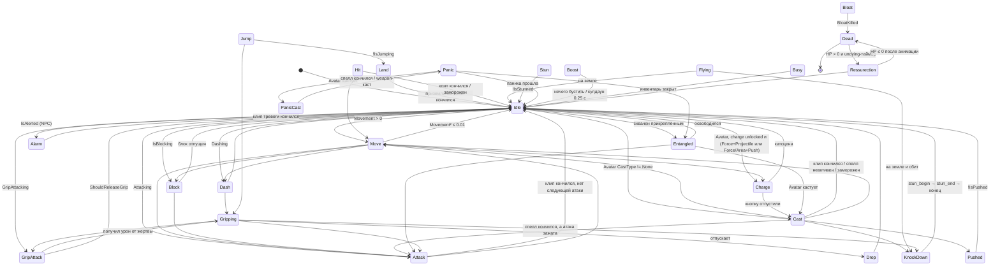
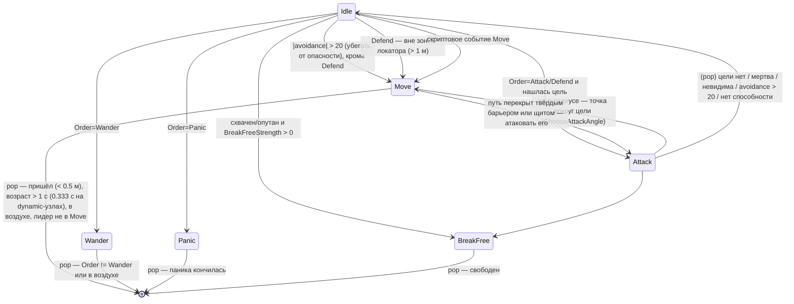

# Сущности, ИИ, навигация, сеть и игроки

Область: `Magicka.GameLogic.Entities` (+ `Abilities`, `SpecialAbilities`, `AnimationActions`,
`CharacterStates`, `Items`, `Buffs`, `Bosses`, `MoveAbilities`), `Magicka.AI` (+ `AgentStates`,
`Arithmetics`, `Messaging`), `Magicka.PathFinding`, `Magicka.Network`, `Magicka.Gamers`,
связка игрок–контроллер (`Magicka.GameLogic.Player`, `Controls`).

Источник: декомпиляция `Magicka.exe` 1.10.4.2 и данные `Content/Data`. Контекст — [`../ENGINE_ANALYSIS.md`](../ENGINE_ANALYSIS.md).

> **Clean-room.** Ниже только описание поведения: таблицы, схемы, константы и порядок полей
> форматов (это нужно для совместимости с ассетами). Кода оригинала здесь нет. Реализация
> OpenMagicka пишется заново по этому описанию.

---

## 1. Иерархия сущностей

### 1.1 Базовая модель

`Entity` — абстрактная база всего, что живёт в мире: есть физическое тело JigLibX (`Body` + `CollisionSkin`),
радиус, аудио-эмиттер, ссылка на `PlayState`.

Идентификация (это важно для сети):

| Идентификатор | Тип | Откуда | Назначение |
|---|---|---|---|
| `Handle` | `ushort` | Порядковый номер объекта в **глобальном** статическом списке всех когда-либо созданных `Entity`. Выдаётся в конструкторе | Сетевая адресация. Работает, потому что все пулы создаются заранее и в одинаковом порядке на всех машинах (см. §1.4) |
| `UniqueID` | `int` | Хеш строкового имени из скрипта уровня (`id="#Her_King"` → `GetHashCodeCustom`), 0 = безымянная | Ссылки из триггеров (`giveOrder id=…`, priority target, face target) |

Список экземпляров очищается только при смене `PlayState` (`ClearHandles`). Поэтому сущности **не создаются
во время игры**: их берут из пулов (`GetFromCache`/`GetInstance`) и инициализируют заново (`Initialize` / `Deinitialize`).

Общий контракт:
- `Update(dataChannel, dt)` — у базы только синхронизирует аудио-эмиттер с ориентацией.
- `Dead` / `Removable` — `EntityManager` удаляет `Removable` в конце кадра (на сервере ещё и рассылает `EntityRemove`).
- `Kill()`.
- Сетевые хуки: `SendsNetworkUpdate(state)` (по умолчанию «только сервер»), `IGetNetworkUpdate` / `INetworkUpdate`, `SyncWithClient`.
- `GetDanger()` — насколько сущность «опасна» для ИИ-избегания (0 по умолчанию; у снарядов, мин, луж и т.п. больше 0).
- Баллистика: `CalcImpulseVelocity(direction, elevation, massPower, distance)` — начальная скорость, чтобы под гравитацией
  долететь на заданную дистанцию под заданным углом. Дистанция гасится массой тела относительно «силы» толчка.
  Если масса слишком велика, импульса нет. Это единая основа для knockback / push / jump / throw.
- `ArcIntersect` — попадание в сектор (дальность, полуугол, допуск по высоте). Через него работают melee и area-заклинания.

Интерфейсы:

| Интерфейс | Что добавляет |
|---|---|
| `IDamageable` | HP/MaxHP, `InternalDamage(Damage | DamageCollection5, attacker, timestamp, attackPos, features)`, `SegmentIntersect`, `ArcIntersect`, `Kill`, `OverKill`, `Electrocute`, `ResistanceAgainst(element)` |
| `IStatusEffected : IDamageable` | `Volume`, статусы (`HasStatus`, `StatusMagnitude`, `GetStatusEffects`), `Damage(amount, element)` для DoT |
| `ISpellCaster : IStatusEffected` | точки каста (`CastSource`, `WeaponSource`), `CastType`, `SpellPower`, `CurrentSpell`, self-shield, пассивки предметов |

### 1.2 Дерево классов

```
Entity
├── Character (abstract)  : ISpellCaster
│   ├── Avatar             : IAI         — маг игрока
│   └── NonPlayerCharacter               — все NPC (и большинство боссов-персонажей: VladCharacter, WarlordCharacter…)
├── PhysicsEntity                        — проп из PhysicsEntityTemplate (ящики, бочки…)
│   └── DamageablePhysicsEntity          — проп с HP/статусами (MaxHitPoints > 0)
│       └── AnimatedPhysicsEntity        — проп со скелетной анимацией (spawnAnimProp)
├── MissileEntity                        — снаряды (projectile-спеллы, стрелы, гранаты), пул 128
├── Shield (64), Barrier (128), SpellMine (64), SprayEntity (48), TeslaField (32),
│   WaveEntity (16), Gib (256), Dispenser (32), ElementalEgg (128), BookOfMagick (64),
│   Fairy, FrogTongue, Snare, OtherworldlyBolt, Item/Pickable …
└── (SpecialAbilities): TornadoEntity, VortexEntity, PortalEntity, GreaseField …
```

`Entanglement` (опутывание лианами) — компонент `Character`, не отдельная сущность.

### 1.3 EntityManager

- Хранит до 512 активных сущностей, отдельно — списки `Shields` и `Barriers` (их часто опрашивают).
- **Пространственный индекс:** сетка 16×16 ячеек по 8 м. Индексы ячеек берутся **по модулю 16**,
  то есть сетка «тороидальная»: объекты на расстоянии 128 м попадают в одну ячейку. Запрос `GetEntities(center, radius)`
  после этого фильтрует по реальному расстоянию. Сетка полностью перестраивается каждый кадр после физики и ИИ.
  Списки результатов берутся из пула и возвращаются через `ReturnEntityList`.
- «Protected entities» — те, что стоят под щитом (`IsProtectedByShield`). Часть запросов их пропускает.

### 1.4 Пулы и детерминированные хэндлы

`PlayState` при создании заполняет пулы фиксированного размера и в фиксированном порядке:
снаряды 128, NPC 192, яйца 128, мины 64, щиты 64, барьеры 128, гибы 256, аватары 16 и т.д.
Поскольку `Handle` — это индекс в глобальном списке, у одинаковых пулов на сервере и клиенте совпадают хэндлы.
Аватары дополнительно получают «уникальный хэндл» на игрока (`AssignUniqueHandles`, `Player.UniqueAvatarHandle`).

**Для OpenMagicka:** делать так же неудобно и хрупко. Лучше явный сетевой ID (`NetId`), который выдаёт сервер и
передаёт в spawn-сообщениях. Пулы оставить только как оптимизацию.

### 1.5 Порядок обновления кадра (PlayState, только в игре)

1. Физика (`PhysicsManager.Update`).
2. ИИ (`AIManager.Update`). На клиенте ИИ не работает.
3. Перестроение сетки `EntityManager`.
4. Анимированные части уровня.
5. `EntityManager.Update` — у каждой сущности вызывается `Update`; у персонажей там машина состояний, статусы и анимации.
6. Бой с боссом (`BossFight.Update`).
7. Удаление `Removable`.
8. Прочее (HUD, достижения).
9. Раз в **1/30 с** — сетевые снапшоты сущностей для каждого соединения (§6.4).
10. Ввод (`ControlManager.HandleInput`) — **в конце** кадра. Значит, ввод применяется в следующем кадре.

---

## 2. Character

### 2.1 Что хранит персонаж (семантика)

- **Шаблон** `CharacterTemplate` (общий на тип) и параметры экземпляра: HP, статусы, баффы, ауры, экипировка (8 слотов-«attachments»; у аватара слот 0 — оружие, слот 1 — посох), очередь заклинаний `SpellQueue` (до 5 элементов у игрока).
- **Тело** `CharacterBody` — капсула (`Length`, `Radius`), желаемое направление `DesiredDirection`,
  вектор движения `Movement` (нормирован, до 1), `SpeedMultiplier`, флаги `AllowMove` / `AllowRotate`,
  `IsTouchingGround`, `IsJumping`, `IsPushed`, `IsInWater`, `RunBackward`, `AdditionalForce` (выставляют анимации).
- **Флаги боя:** `Attacking`, `Dashing`, `IsBlocking`, `GripAttacking`, `IsHit`, `IsKnockedDown`, `IsStunned`, `IsEntangled`,
  захват (`Gripper` / `GrippedCharacter`, `GripperAttached`, `AttachedToGripped`), `Boosts`, `Bloating`, `Overkilled`,
  `Drowning`, паника/страх/спотыкание (`IsPanicing` / `IsFeared` / `IsStumbling`, `Panic` 0..1, `FearPosition`, `WanderAngle`),
  эфирность, невидимость, левитация, очарование (`Charm`), гипноз, полиморф.
- «Следующие» анимации, которые ставит атакующий код: `NextAttackAnimation`, `NextDashAnimation`, `NextGripAttackAnimation`,
  `SpecialIdleAnimation`, `DropAnimation`, `SpawnAnimation`, `NetworkAnimation`.

### 2.2 Урон (Character.InternalDamage) — порядок обработки

Сам расчёт элементов и резистов (`Damage.ApplyResistances`) относится к системе заклинаний. Здесь — что делает персонаж с одним
экземпляром `Damage` (атрибуты: `AttackProperty` — флаги, `Element`, `Amount`, `Magnitude`).

1. Персонаж мёртв или бессмертен → ничего не происходит. Таймер невидимости сбрасывается (любое попадание снимает невидимость).
2. `Entanglement` (без горения): цель опутывается, урона нет. Если цель уже опутана, урон или огненный статус ослабляет путы.
3. Активный self-shield поглощает урон первым.
4. **Knockback**: импульс от точки атаки, угол ≈40° (0.698 рад), сила = `Amount`, дальность = `Magnitude`;
   если цель можно сбить с ног, она падает. **Pushed**: то же, угол ≈10°. **Knockdown**: падение,
   только если `Magnitude ≥ KnockdownTolerance` шаблона.
5. **Блок:** урон Earth или Lightning при поднятом блоке → `BlockDamage` (значение блока предмета, сектор перед персонажем).
   Полностью заблокированный удар → `Deflected`.
6. **Статусы** (флаг `Status`): Fire→Burning, Cold→Cold, Water→Wet, Poison→Poisoned, Life→Healing, Steam→Wet.
7. Резисты (шаблон, посох аватара, баффы, текущие статусы). `|Magnitude| ≈ 0` → `Deflected`, выход.
8. `Stun` → таймер оглушения = `StunTime` шаблона. `Bleed` → статус Bleeding с `BleedRate` шаблона.
9. Флаг `Damage`:
   - Lightning: короткий «zap»-таймер 0.1 с. По мокрой цели урон ×2.
   - Life: уменьшает величину отравления.
   - Физика (Earth/Ice) или Arcane: по замороженной цели урон **×3**; иначе брызги крови и декаль (если включены кровь и эффекты).
   - Итоговый урон = `Amount × Magnitude`. **HP уменьшает только не-клиент.**
   - Урон по тому, кто тебя держит, копится в `GripDamageAccumulation`.
   - Флаг `Hit` (и анимация попадания), если урон больше `HitTolerance` шаблона или персонаж воскресает.
10. HP ограничивается сверху значением MaxHP. Если HP ≤ 0: при заморозке **или** «оверкилле» (HP ≤ −(0.5·MaxHP + 500), только при включённой крови) → `OverKill` (гибы), иначе `Killed`.
11. Срабатывает триггер уровня `onDamage`, статистика, запоминается `LastAttacker` (держится 8 с).

`ResistanceAgainst(element)` (для ИИ-переменной `resistance`): по каждому затронутому элементу складываются
модификаторы и множители (с учётом заморозки: Earth модификатор −350; смазки: Fire множитель ×2; посоха; баффов).
Результат = 1 − clamp(сумма модификаторов/300 + сумма множителей, −1, 1).

### 2.3 Регенерация и прочие тикеры

- Регенерация `Regeneration` (HP/с, целое) работает, только когда персонаж жив, не горит и не отравлен. Раз в секунду над головой появляется число.
- Всплывающий урон копится 0.333 с. Огонь, яд, кровь и лечение суммируются за 1 с.
- `OverKilled(amount)`: порог −(0.5·MaxHP + 500) или смерть от раздувания (bloat).
- `Undying` / `UndieTime` / `UndieHitPoints`: «неумирающие» после смерти ждут таймер и воскресают (через `RessurectionState`).

### 2.4 Сложность от числа игроков

Если фракция шаблона не `FRIENDLY`, при загрузке резисты масштабируются коэффициентом
`f = 1 − (players − 1) · 0.00666`: положительные множители и модификаторы умножаются на `f`, отрицательные делятся на `f`.
При 4 игроках это примерно −2%. Эффект малый, но для совпадения цифр его стоит повторить.

---

## 3. CharacterTemplate (`Content/Data/Characters/*.xnb`, 338 шт.)

Читается `CharacterTemplateReader` и кешируется по хешу ID. Порядок полей двоичного формата (это нужно reader'у OpenMagicka):

| # | Поле | Тип | Семантика |
|---|---|---|---|
| 1 | ID | string (lowercase) | тип персонажа; его хеш — `Type` у NPC |
| 2 | DisplayID | string | ключ локализации имени |
| 3 | Faction | int32 (флаги `Factions`) | EVIL 1, WILD 2, FRIENDLY 4, DEMON 8, UNDEAD 16, HUMAN 32, WIZARD 64, NEUTRAL 0xFF, PLAYER0..3 0x100..0x800, TEAM_RED/BLUE. Враги — это фракции **без общих битов** |
| 4 | Blood | int32 | regular, green, black, wood, insect, none — эффекты крови, декали, звуки |
| 5–11 | IsEthereal, LooksEthereal, Fearless, Uncharmable, Nonslippery, HasFairy, CanSeeInvisible | bool×7 | иммунитеты и особенности |
| 12 | AttachedSounds | int32 N, затем N×(string cue, int32 bank) | постоянные звуки, не больше 4 |
| 13 | Gibs | int32 N, затем N×(ExternalRef Model, float mass, float scale) | куски для оверкилла |
| 14 | PointLights | int32 N ≤ 4, затем N×(string joint, float radius, vec3 diffuse, vec3 ambient, float specular, byte variationType, float variationAmount, float variationSpeed) | свет на костях |
| 15 | MaxHitpoints | float | |
| 16 | NumberOfHealthBars | int32 (≤0 → 1) | многослойные полоски HP у боссов и элиты |
| 17–19 | Undying, UndieTime, UndieHitPoints | bool, float, float | автоворот после смерти |
| 20 | HitTolerance | int32 | урон, ниже которого нет реакции «hit» (и порог срыва захвата) |
| 21 | KnockdownTolerance | float | минимальная `Magnitude` для сбивания с ног |
| 22–25 | ScoreValue, ExperienceValue, RewardOnKill, RewardOnOverkill | int, int, bool, bool | очки |
| 26 | Regeneration | int32 | HP/с |
| 27 | MaxPanic | float | |
| 28 | ZapModifier | float | реакция на молнию |
| 29–31 | Length, Radius, Mass | float | капсула (Length ≥ 0.01) и масса |
| 32–33 | Speed, TurnSpeed | float | |
| 34 | BleedRate | float | DPS кровотечения |
| 35 | StunTime | float | длительность оглушения |
| 36 | SummonElementBank + cue | int32, string | звук призыва |
| 37 | Resistances | int32 N, затем N×(int32 element, float multiplier, float modifier, bool statusResistance) | по умолчанию на 11 элементов множитель 1, модификатор 0 |
| 38 | Models | int32 N, затем N×(ExternalRef SkinnedModel, float scale, vec3 tint) | варианты внешности; при спавне выбирается случайный или заданный (`iRandomOverride`) |
| 39 | AnimationSkeleton | ExternalRef SkinnedModel | откуда берутся клипы и кости |
| 40 | AttachedEffects | int32 N, затем N×(string bone, string effect) | постоянные эффекты на костях (кость обязана существовать) |
| 41 | AnimationClips | **27 наборов** (по `WeaponClass`): для каждого int32 M, затем M×(string animationName, AnimationClipAction) | см. §4 |
| 42 | Equipment | int32 N, затем N×(int32 slot 0..7, Attachment) | предметы на костях |
| 43 | EventConditions | ConditionCollection | события на смерть, урон и т.д. (§8.2) |
| 44 | AlertRadius | float | радиус «замечания» врага |
| 45–49 | GroupChase, GroupSeparation, GroupCohesion, GroupAlignment, GroupWander | float | веса стаи (§5.6) |
| 50–53 | FriendlyAvoidance, EnemyAvoidance, SightAvoidance, DangerAvoidance | float | веса избегания (§5.5) |
| 54–56 | AngerWeight, DistanceWeight, HealthWeight | float | веса выбора цели (§5.4) |
| 57 | Flocking | bool | |
| 58 | BreakFreeStrength | float | сила вырывания из захвата (0 — не пытается) |
| 59 | Abilities | int32 N, затем N×Ability (§5.7) | до 16 (кулдауны хранятся массивом на 16) |
| 60 | MoveAnimations | int32 N, затем N×(byte MovementProperties, int32 K, K×string animation) | анимации прыжка, полёта, плавания. Объединение флагов = `MoveAbilities` персонажа для навмеша |
| 61 | Buffs | int32 N, затем N×BuffStorage | врождённые баффы |
| 62 | Auras | int32 N, затем N×AuraStorage (TTL ≤ 0 → бесконечно) | врождённые ауры |

После чтения по именам костей находятся служебные суставы: `Mouth`, `RightAttach`, `LeftAttach`, `RightLeg`, `LeftLeg`
и кость с индексом 1 (бёдра). К bind-pose добавляется поворот на 180° по Y.

`WeaponClass` (индекс набора анимаций): Default, Thrust/Crush/Slash/Throw × Fast/Medium/Slow, Unarmed, Handgun, Rifle,
Machinegun, Heavy, Staff, NewAnimationSet0..7 (всего 27). Если клипа нет в наборе текущего оружия, берётся набор 0.
Перечисление `Animations` содержит **231** значение; таблица клипов индексируется им напрямую.

`MovementProperties` (флаги): Default 0, Water 1, Jump 2, Fly 4, Dynamic 0x80.

---

## 4. Анимации и AnimationActions

`AnimationClipAction` = (имя клипа в скелете, скорость, время бленда, loop, список `AnimationAction`).

`AnimationAction` — команда, привязанная к нормализованному отрезку клипа `[start, end]` (доля от 0 до 1 длительности).
В кадре, где время клипа попадает в отрезок, вызывается `Execute`. Флаг «первое выполнение» позволяет сделать однократный
эффект на входе в отрезок. После выхода за `end` один раз вызывается `Kill`. Тип выбирается по строковому имени (без учёта регистра).

| Action | Параметры (после start/end) | Поведение |
|---|---|---|
| `DealDamage` | weapon slot, target byte | на входе очищает список попаданий предмета и запускает его melee-события; затем каждый кадр отрезка — удар предметом (ArcIntersect по дальности melee) |
| `SpawnMissile` | weapon, itemAligned | выстрел или бросок снаряда предмета |
| `Gunfire` | weapon, accuracy | непрерывная стрельба |
| `CastSpell` | fromStaff, source joint | каст текущей очереди (если заклинание ещё не идёт) |
| `SpecialAbility` | weapon | спец-способность предмета |
| `Block` | weapon | окно блока |
| `Grip` | type (Pickup/Ride/Hold), radius, breakFreeTolerance, finishOnGrip (+ кости) | NPC хватает текущую цель ИИ, если она рядом, видна (без стены и щита между ними) и не защищена |
| `ReleaseGrip`, `ThrowGrip`, `DamageGrip`, `OverkillGrip`, `BreakFree` | — / magnitude | управление захватом |
| `Jump` | elevation, min/max range | прыжок NPC к цели с упреждением (половина её скорости), дистанция ×1.1 с ограничением |
| `Move` | velocity (локальная) | добавочная сила тела в системе координат персонажа × скорость анимации |
| `Crouch` | radius, length | временно меняет капсулу |
| `Ethereal`, `Invisible`, `Immortal` | … | состояния |
| `PlayEffect` | bone, effect, attach | частицы на кости (при `attach` эффект следует за костью) |
| `PlaySound` | cue, bank | звук |
| `Footstep` | — | шаг (звук и эффект зависят от поверхности и воды) |
| `CameraShake` | duration, magnitude | |
| `SetItemAttach`, `DetachItem`, `WeaponVisibility` | item, velocity / visible | экипировка |
| `RemoveStatus` | — | снять статусы |
| `Tongue` | maxLength | язык лягушки (`FrogTongue`) |
| `Suicide` | overkill | самоуничтожение (бомберы) |

Пример из данных (goblin_warrior): `attack_melee0` → клип `attack_sword_doubleslash`, действия `Move`, `DealDamage`, `Move`, `DealDamage`.

---

## 5. Машина состояний персонажа (CharacterStates)

Состояния — синглтоны без данных (все данные в `Character`), интерфейс `OnEnter` / `Update → следующее состояние или null` / `OnExit`.
`ChangeState` запоминает `PreviousState` (по нему, например, `HitState` знает, что прервали заряд, и выстреливает заклинание).

### 5.1 Общие проверки (приоритет сверху вниз)

Большинство состояний сначала вызывают общие функции базы:

1. **UpdateBloatDeath:** раздувается → `Bloat`; оверкилл или HP ≤ 0 (если нет флага «умирает только явно») → `Dead`.
2. **UpdateHit:**
   - толкнули и в воздухе (не прыжок, не схвачен) → `Flying`;
   - опутан, или схвачен без прикрепления, и не атакует → `Entangled`;
   - толкнули по земле → `Pushed`;
   - сбит с ног → `KnockDown`;
   - держит кого-то, но должен отпустить (или урон от жертвы > HitTolerance) → `Drop` (на земле) либо импульс и knockdown;
   - `IsHit` → `Hit`;
   - оглушён (и ничего из выше) → `Stun`.
3. **UpdateActions:**
   - прыгает (и никого не держит) → `Jump`;
   - паника, спотыкание или страх (не опутан) → `Panic`;
   - есть «бусты» и есть что бустить (щит впереди или свой self-shield) → `Boost`;
   - держит, но не прикреплён → `Gripping`.

### 5.2 Диаграмма (основные переходы)



(Почти из любого состояния есть переходы в `Dead` / `Bloat` и по `UpdateHit` — на диаграмме они опущены.)

### 5.3 Особенности состояний

| Состояние | Вход | Поведение / выход |
|---|---|---|
| `Idle` | разрешает движение и поворот (если не опутан); анимация: сетевая → special idle → `special1` (держит) → `idle_wnd` (отравлен) → `idle_agg` (агрессивен) → `idle` | по окончании клипа заново выбирает idle. На выходе запрещает движение и сбрасывает special idle |
| `Move` | разрешает движение и поворот | анимация по нормированной скорости: ≥ 0.6 → `move_run`, < 0.4 → `move_walk`, между — оставляет текущую; отравлен → `move_wnd`. Во время zap не меняет состояние |
| `Attack` | снимает эфирность и невидимость; играет `NextAttackAnimation` (бленд 0.075) | поворот разрешён в окне бленда, при флаге `AllowAttackRotate` или в первые 0.1 с клипа. Комбо: если по окончании клипа задана следующая атака — играет её (кроме `attack_recoil`). Выход останавливает спелл и огонь оружия |
| `Cast` | анимация по паре (CastType, SpellType): Force → `cast_force_{push,spray,projectile,shield,railgun,lightning}`; Area → `cast_area_{push,blast,ground,fireworks,blast,lightning}`; Self → `cast_self`; Weapon → `cast_sword_*` (зависит от «заряженного» оружия); Magick → анимация магика (поворот запрещён) | выход: клип кончился, loop-клип (кроме Force — его держат), спелл неактивен, заморожен |
| `Charge` | `charge_force` / `charge_area`, звук заряда, TurnSpeed ×0.125, SpellPower = 0 | SpellPower растёт с долей клипа до 1, затем loop-клип. Отпустили кнопку → `Cast`. На выходе — каст «из посоха» |
| `Boost` | `boost` | каждый «буст» лечит свой self-shield на 50 (если он не «solid»), иначе +100 HP щиту впереди (луч 20 м, конус 45°, ближайший в пределах √400) |
| `Panic` / `PanicCast` | `move_panic` или `move_stumble` (спотыкание = бег назад) | случайное блуждание угла (±30°/с) плюс направление взгляда ×4. Паника смешивает ввод игрока и блуждание в пропорции `Panic`. Страх — бег от `FearPosition`. Множители скорости 0.8 / 0.6 / 0.666. На клиенте угол блуждания крутит только владелец |
| `Dead` | отпускает захваты, отключает ИИ (если не undying), роняет экипировку, `die0` / `die1`, утонул → `die_drown{,1,2}` | по окончании клипа сервер шлёт `CharacterDie`, не-клиент вызывает `Die()`. Оверкилл: гибы, `RemoveAfterDeath` |
| `KnockDown` | `hit_stun_begin` | → `hit_stun_end` → выход. Прерывание заряда выпускает спелл |
| `Flying` | `hit_fly`, отпускает захваченного | до приземления |
| `Pushed` | `hit_slide` | пока тело толкают |
| `Stun` | `stunned` или `idle_wnd`, движение запрещено | пока `IsStunned` |
| `Entangled` | `spec_entangled` | Avatar может кастовать и атаковать (вырываться) |
| `Jump` / `Land` | `move_jump_up` / `move_jump_mid` → `move_jump_down` при падении → `move_jump_end` | |
| `Alarm` | `spec_alert0` (Discover) / `spec_alert1` (Danger) | только NPC |
| `Busy` | `emote_confused0`, движение запрещено | открыт инвентарь (versus/инвентарь) |

---

## 6. Avatar (игрок)

### 6.1 Ввод → действия

Контроллер вызывает методы аватара (дискретные события):

| Функция контроллера | Метод | Суть |
|---|---|---|
| Spell_Up/Down/Left/Right | `HandleCombo(direction)` | каждый элемент — **пара направлений** (на геймпаде — жест правым стиком, см. ниже). Пара складывается во входную очередь игрока, `SpellManager.HandleCombo` распознаёт элемент |
| Q W E R A S D F (клавиатура) | `ConjureX()` | обёртка над двумя `HandleCombo`, например Water = Left+Up, Fire = Right+Down |
| Cast_Force (ПКМ) | `ForcePressed` / `ForceReleased` | только с посохом; CastType = Force. Отпускание разрешает заряд (`ChargeUnlocked`) |
| Cast_Area (Shift+ПКМ) | `AreaPressed` / `AreaReleased` | CastType = Area |
| Cast_Self (СКМ) / Special | `Special` | есть очередь → CastType Self; иначе спец-способность предмета (слот источника) |
| Attack (ЛКМ) | `Attack` | есть очередь (или оружие заряжено) → CastType Weapon; иначе melee: случайно `attack_melee0` / `attack_melee1` (у Heavy — чередование). В захвате Pickup — копит вырывание |
| Cast_Magick / Boost (Space) | `Boost` | если очередь складывается в магик → CastType Magick (мгновенные магики работают даже замороженным или сбитым); иначе в путах — вырывание; иначе буст щита |
| Interact / Action | `Action` / `Interact` | NPC-диалог → подбор предмета → интерактив (в бою разговоры недоступны) |
| Block | блок | |

Таблица «элемент → пара направлений» (`ConjureX`):

| Элемент | Пара |
|---|---|
| Earth | Down, Left |
| Water | Left, Up |
| Cold | Right, Up |
| Fire | Right, Down |
| Lightning | Left, Down |
| Arcane | Up, Right |
| Life | Up, Left |
| Shield | Down, Right |

Особые правила при добавлении элемента в очередь:
- Lightning, когда ты мокрый (без пассивки WetLightning), или Fire, когда ты в смазке, — бьёт по себе:
  self-lightning-урон с величиной ×0.5, очередь ввода очищается.
- `TryAddToQueue(…, max 5)` — комбинирование и отмена противоположных элементов в `SpellManager` (это область заклинаний).
- Пока идёт заряд, событие или полиморф, ввод элементов игнорируется.

Каждое из этих действий в сети отправляется как `CharacterAction(ActionType, Param…)` (§9.3).

### 6.2 Прочее

- Направление: мышь (проекция на плоскость), стик (с инверсией). `DesiredInputDirection` нужен состоянию паники.
- Avatar реализует `IAI`: скрипт уровня может вести аватар событиями (катсцены, `PushState` / `PopState`, `EventComplete` по сети).
- Кэш аватаров: 16 штук. Аватар привязан к `Player` и при смерти не теряется.
- Смена оружия и посоха (`ChangeWeapon` / `ChangeStaff`), подбор `Pickable`, книги магиков (`BookOfMagick`).

---

## 7. ИИ (`Magicka.AI`)

### 7.1 AIManager

- Только на хосте (на клиенте выход сразу).
- Сначала доставляет отложенные AI-сообщения (`MessageDispatcher`).
- **Квантование:** за кадр полноценно обновляются максимум **20 агентов**. Окно сдвигается по кругу на 20 каждый кадр.
  Время копится у каждого агента в `TimeSinceLastUpdate` и тратится при его обновлении. Значит, «мозг» тикает реже,
  чем раз в кадр, но с правильным dt.
- Флаг «угроза» для музыки боя: есть хотя бы один агент с текущей целью.

### 7.2 Agent: данные

Стек AI-состояний и их возраст; стек целей (`CurrentTarget` — верх стека) и их возраст; `NextAbility` и `BusyAbility`
(выполняемая сейчас); «таблица обид» `AttackedBy` (хэндл → накопленный урон, не больше 500; убывает на 25 в секунду;
пассивки посоха ReduceAggro и ZombieDeterrent для нежити режут её вдвое); `Order`, `ReactsTo`, `ReactionOrder`, `ReactionTrigger`;
приоритетная цель и приоритетная способность (из скрипта); путь (список `PathNode`); `WayPoint` (для атаки — **смещение от цели**,
для движения — абсолютная точка); лидер стаи; события скрипта (`AIEvent[]`, индекс, задержка, loop); параметры блуждания;
`AlertMode` (None / Discover / Danger); `TargetArea` (хеш триггер-зоны или локатора).

`Order`: None, Idle, Attack, Defend, Flee, Wander, Panic. `ReactTo` (флаги): Attack 1, Proximity 2.
После `Initialize` по умолчанию `Order = Attack`, `ReactTo = None`. Агрессией управляет только скрипт: спавн и `giveOrder`.

### 7.3 Цикл Agent.Update

1. Уменьшение обид, «старение» состояний, целей и лидера.
2. **Реакция:**
   - `ReactTo.Attack` — есть обидчик в таблице;
   - `ReactTo.Proximity` — в радиусе `AlertRadius` есть персонаж чужой фракции (видимый, или агент видит невидимых).
     Если реакционный приказ отличается от текущего, `AlertMode = Danger`.
   Реакция: `Order = ReactionOrder` (если задан) и запуск `ReactionTrigger` скрипта.
3. `OnExecute` верхнего AI-состояния.
4. `NextAbility.Update` — подготовка способности (например, NPC «напевает» элементы).

`HandleMessage(TakingDamage)` → `AddAttackedBy`: урон от чужой фракции добавляется в таблицу обид. Союзники той же фракции
в радиусе тревоги тоже получают обиду на атакующего. Урон от «своих» обнуляется (множитель 0).

### 7.4 Выбор цели и способности (fuzzy)

`ChooseTarget`:
- Кандидаты: сущности в радиусе 40 м, все аватары игроков, приоритетная цель. Отбрасываются мёртвые, сам агент,
  не-персонажи (кроме приоритетной цели), невидимые.
- Оценка: +1 приоритетной цели; `+ FuzzyAnger · AngerWeight`; `+ (1 − HP/MaxHP) · HealthWeight`;
  `+ FuzzyDistanceExponential(dist, AlertRadius) · DistanceWeight`; всё умножается на агро-множитель цели (баффы ReduceAgro).
- Держатся два топ-4 списка: **враги** (фракции без пересечения) и **остальные** (союзники — для лечения и баффов).
- К оценке каждого кандидата прибавляется лучшая желательность способности против него. Отдельно оценивается «цель = я сам»
  (для способностей с `Target.Self`). Победитель — максимум суммы.

`ChooseAbility(args)`: перебираются способности без кулдауна, подходящие по `Target` (Self — только на себя; Friendly — союзник,
не сам; Enemy — чужая фракция). Если в очереди NPC уже есть элементы, подходят только `CastSpell` с теми же элементами.
Желательность = значение fuzzy-выражения способности (или встроенная `Desirability`), +0.5 приоритетной способности
против приоритетной цели. Берётся максимум > 0. Если ничего не подошло, а элементы уже напеты, ставится служебная
«spell recovery»-способность, которая докастует очередь как последняя использованная.

### 7.5 Fuzzy-арифметика (`Arithmetics`) — язык выражений в шаблонах

Строка-выражение из `.xnb` разбирается в дерево:
- операторы `+ -` (приоритет 50), `* /` (100), `!` (унарное **NOT = 1 − x**, 150), `^` (степень, 200), скобки;
- уровень вложенности скобок повышает приоритет; корнем становится оператор с минимальным (уровень, приоритет);
- лист — число или переменная `[scope.]Name(args)`, где scope — `g` / `s` / `t` (Global / Self / Target, по умолчанию Global);
- пробелы и переводы строк игнорируются, имена без учёта регистра. Есть синонимы: `DistExp` = `DistanceExponential`,
  `FDensity` = `FriendlyDensity`, `Status` = `HasStatus`, `Res` = `Resistance`, `LOS` = `LineOfSight` и т.д.

Переменные:

| Переменная | Аргументы | Значение (0..1) |
|---|---|---|
| `DistanceLinear(max)` / `(min,max)` | одно число → диапазон (−max, max) | треугольная функция с пиком посередине диапазона |
| `DistanceExponential(max)` / `(min,max)` | то же | экспоненциальный колокол с центром посередине: на краях ≈ 0.1, в центре 1 |
| `Behind` | — | (dot(dir от AI к цели, forward цели) + 1)/2 — насколько AI за спиной цели |
| `Angle` | — | dot(направление на цель, взгляд AI) в плоскости XZ |
| `Danger(elements)` | имя `Elements`, `|` = или (`Offensive`, `Fire`…) | 1 − 0.25^(Σ угроз врагов в радиусе тревоги + своя опасность [+1, если бьёт молния]) |
| `Threat(elements)` | scope Target | угроза цели: угол её взгляда на AI и близость (до 20 м) × сила элементов в её очереди (в Charge/Cast — корень 4-й степени) |
| `HasStatus(status)` | имя `StatusEffects` | 0/1 |
| `Gripped`, `Gripping`, `Entangled`, `IsOnGround`, `IsCharacter`, `IsEthereal`, `IsShield`, `IsBarrier`, `Shielded` | — | 0/1 |
| `Speed`, `Health` | — | нормированные |
| `Resistance(element)` | | см. §2.2 |
| `FriendlyDensity(r=6)`, `EnemyDensity(r=6)` | радиус | 1 − 0.5^count |
| `LOS` | — | 1, если на отрезке AI→цель нет других сущностей |
| `LOSC(dx,dy,dz,len)` | смещение начала и длина | луч с коллизией уровня |
| `GripDamageAccumulation[Normalized]` | | |

Частые выражения в реальных данных: `distExp(3)`, `distExp(6)`, `(distexp(0,15)*0.75) - (s.FriendlyDensity*0.5) - Danger(Offensive)`,
`(s.status(wet)+s.status(cold)+s.status(frozen))*2` (для self-лечения или очистки), `(distExp(6,20))*LOS*!t.shielded*!t.resistance(cold)`.

> Тонкость: при равных приоритетах (`a - b - c`) порядок задаётся несортированной стабильностью `List.Sort`
> исходного .NET, так что ассоциативность формально не определена. Для OpenMagicka нужно выбрать **левую ассоциативность**
> и сверить результаты на всех выражениях из `Data/Characters` (см. открытые вопросы).

### 7.6 AI-состояния (стек)



- **Idle**. Защита от «зависания»: если цели нет, а элементы напеты дольше 2 с — очередь очищается.
  Затем обрабатываются **скриптовые события** (`giveOrder` с вложенными тегами), с задержками:
  - `Move position= speed= facingDirection= delay= trigger=` — идти к локатору (дистанция < 0.5 м), при `facingDirection` — довернуться;
  - `Animation animation= blendTime= idleanimation= delay=` (рассылается по сети как `EventAnimation`);
  - `Face target=|facingDirection= delay=` — повернуться к сущности, локатору или направлению (dot ≥ 0.99);
  - `Kill remove=`;
  - `Loop type=Loop|Reverse`.
  Задержка `NaN` означает «ждать конца анимации».
- **Attack**. Пока выполняется способность (`BusyAbility`), агент стоит и доворачивается. Способность выбирается заново, если
  текущая бесполезна или цель «старше» 1 с. В радиусе и лицом к цели → `Execute`; при успехе ставится кулдаун способности
  и цель выбирается заново (переключение). Если `ForceNavMesh`, цель должна быть ≤ 3 м от навмеша.
- **Move**. При входе: ищется **лидер** — NPC того же типа в радиусе AlertRadius/3, впереди, в Move, с той же целью или
  той же точкой. Если лидер есть, агент следует за ним стайно (`FollowGroup`), иначе считает путь A* по навмешу.
  Каждый кадр: срезает пройденные узлы; узел с `Jump` → прыжок на 60°; добавляет избегание; результат проецирует на навмеш.
  Скорость умножается на `MoveEvent.Speed`.
- **Wander**. Блуждающий угол плюс направление вперёд с проекцией на навмеш. Ограничение триггер-зоной (у края — разворот на 180°).
  Ходит 10–20 с, стоит 2–5 с, скорость `WanderSpeed`.
- **Panic**. Блуждающий угол плюс направление ±1.25 (при спотыкании — назад).
- **BreakFree**. Каждый тик вызывает `BreakFree()`.

### 7.7 Избегание и стая

`GetAvoidance` (радиус 12 м), четыре компоненты с весами шаблона:
- **Friendly** — от союзников, пропорционально их `GetDanger` и близости;
- **Enemy** — от врагов, пропорционально их опасности;
- **Sight** — уход **из линии взгляда** врага: перпендикуляр к направлению на него, сила зависит от того, смотрит ли враг на агента,
  и от дистанции (пик на 2/3 радиуса);
- **Danger** — от прочих опасных сущностей (мины, лужи, снаряды).
Длина суммы ограничивается 1e5. Порог «надо убегать» — 20.

`FollowGroup`: до 8 случайных соседей, без повторов. Separation `−r̂·w/|r|` (обратно расстоянию), Cohesion `r·w`,
Alignment — направление лидера, Wander — блуждание. Сумма нормируется до 1 и проецируется на навмеш.

### 7.8 Способности NPC (`Abilities`, 15 типов)

Общий заголовок в `.xnb`: имя типа (string), cooldown (float), target (byte: Self 1 / Enemy 2 / Friendly 3),
флаг и строка fuzzy-выражения (если флаг true), список анимаций (int32 N, затем N строк). Дальше — поля типа:

| Тип | Поля | Суть |
|---|---|---|
| `Melee` | min/max range, arc, weapons[], rotate | атака анимацией (урон наносит `DealDamage` в анимации) |
| `Ranged` | min/max range, elevation, arc, accuracy, weapons[] | снаряд или стрельба |
| `CastSpell` | min/max range, arc, chantSpeed, power, castType, elements[] | NPC напевает элементы по одному раз в `chantSpeed` (Weapon — все сразу), в пределах 1.25·maxRange; когда очередь полна — ставит SpellPower и CastType и играет анимацию каста |
| `Block` | arc, shield slot | |
| `Dash` | min/max range, arc, vector | рывок |
| `Jump` | min/max range, angle, elevation | |
| `ElementSteal` | range, angle | |
| `GripCharacterFromBehind`, `PickUpCharacter`, `ZombieGrip` | min/max range, angle, maxWeight | захваты (по массе цели) |
| `ThrowGrip` | min/max range, elevation | бросок схваченного |
| `DamageGrip`, `ConfuseGrip`, `RemoveStatus` | — | |
| `SpecialAbilityAbility` | min/max range, angle, weapon | вызывает спец-способность предмета |

Общие проверки: `InRange` (по XZ, с радиусами), `FacingTarget` (угол меньше arc), `ChooseAttackAngle` — до 3 случайных точек
на полуокружности вокруг цели на средней дистанции способности, первая без препятствий.

`MoveAbilities` (`Jump`, `Run`) — **мёртвый код**: на них нигде нет ссылок. Движение NPC задаётся `MovementProperties` + `MoveAnimations` шаблона.

### 7.9 Messaging

`MessageDispatcher` — очередь отложенных сообщений агент→агент (`TakingDamage`, `AttackingTarget`) с задержкой.
Используется только для распространения агрессии.

### 7.10 giveOrder (скрипт уровня) → ИИ

Атрибуты (встречаемость в данных): `order` (848), `delay` (771), `id` (681), `reactto`/`reactTo` (512), `area` (296),
`type` (196, `any` — все в зоне), `animation` (187), `reaction` (104), `factions` (83), `priorityTarget` (32),
`idleAnimation` (13), `trigger` (7), `explicit` (7), `targetArea` (3), `speed` (3).
Имена атрибутов **регистронезависимы**. Действие: отпустить захваты, задать `WanderSpeed`, `TargetArea`, вызвать `SetOrder`
(при смене приказа стек AI-состояний сворачивается до Idle), поставить анимации; `Panic` — сразу паника.

---

## 8. Предметы, баффы, физобъекты

### 8.1 Item (`Data/items/*.xnb`, 454 шт.)

Семантика полей (в порядке файла): имя (хеш — тип предмета), отображаемое имя и описание (ключи локализации), звуки,
`Pickable`, `Bound`, `BlockValue`, `WeaponClass`, `CooldownTime`, HideModel / HideEffect / PauseSounds, резисты (посох даёт резисты
владельцу), **пассивная способность** (byte + float): ShieldBoost, AreaLifeDrain, ZombieDeterrent, ReduceAggro, EnhanceAllyMelee,
AreaRegeneration, InverseArcaneLife, Zap, BirchSteam, WetLightning, MoveSpeed, Glow, Mjolnr, Gungner, MasterSword, DragonSlayer;
эффекты, свет (≤ 1), необязательная спец-способность (время перезарядки + `SpecialAbility`), melee (range, multiHit, conditions),
ranged (range, facing, homing, elevation в градусах, danger), огнестрел (range, clip, rate, accuracy, звук, вспышка, гильзы,
скорость трассера, conditions), модель снаряда, ranged conditions, масштаб, модель, ауры.

`ChantEffects`: при заряде оружия элементом на клинке горит эффект `swordelementeffect_<element>`.

### 8.2 События: ConditionCollection / EventCollection

До 5 групп «условие → список событий». Условие: тип (флаги: Default 1, Hit 2, Collision 4, Damaged 8, Timer 16, Death 32,
OverKill 64), порог HP, элементы, порог, время, флаг повтора. События (`EventType`): Damage, Splash, Sound, Effect, Remove,
CameraShake, Decal, Blast, Spawn, Overkill, SpawnGibs, SpawnItem, SpawnMagick, SpawnMissile, Light, CastMagick, DamageOwner, Callback.
Тот же механизм используют предметы (melee / gun / ranged), шаблоны персонажей и физобъектов.

### 8.3 Баффы и ауры

- `BuffStorage`: тип (byte), визуальная категория (None / Offensive / Defensive / Special), цвет, TTL, имя эффекта, затем данные типа:
  BoostDamage (Damage), DealDamage (Damage), Resistance (element, **modifier, затем multiplier** — порядок обратный шаблону!),
  Undying, Boost (amount), ReduceAgro (amount), ModifyHitPoints (mult, add), ModifySpellTTL (mult, add), ModifySpellRange (mult, add).
- `AuraStorage`: цель (Friendly, FriendlyButSelf, Enemy, All, AllButSelf, Self, Type, TypeButSelf, Faction, FactionButSelf),
  тип (Buff — раздаёт BuffStorage, Deflect — strength, Boost — magnitude, LifeSteal — amount, Love — radius и TTL), категория, цвет,
  эффект, TTL, радиус, тип-фильтр, фракция-фильтр. Ауры «тикают» циклом (`AuraCycleTimer`) и раздают баффы попавшим в радиус.
- Источники: шаблон персонажа, предмет (посох), магики (Haste и др.).

### 8.4 PhysicsEntityTemplate (`Data/PhysicsEntities`, 69 шт.)

Movable, Pushable, Solid, Mass, MaxHitPoints (> 0 → `DamageablePhysicsEntity`), CanHaveStatus, резисты, гибы, эффекты и звуки,
модель (или вложенная модель), необязательная коллизионная сетка (вершины и треугольники), коллизионные боксы, прикреплённые эффекты
(хеш и матрица), свет, события, ID, а дальше — необязательная скелетная часть (радиус, модели, скелет, анимации) для анимированных
пропов. Пропы уровня (из `LevelModel`) создаются при загрузке сцены; `spawnPhys` / `spawnAnimProp` — триггерами.

---

## 9. Спец-способности (`SpecialAbilities`, 114 файлов, ~106 типов)

Это реализации **магиков** и спец-способностей предметов: общий базовый класс, создание по строковому имени
(имя, анимация — по умолчанию `cast_self`, эффект, список элементов). Варианты `Execute`: от кастера, от кастера с элементами,
в точке. Для сети есть пара `GetNetworkMessage` / `NetworkMessage` через `NetworkSpellCast`, плюс `NetworkConditionsMet`:
на клиенте эффект запускает **только локальный владелец**, хост исполняет за остальных.

Грубая группировка по названиям (детали — в документе по заклинаниям):

| Группа | Типы |
|---|---|
| Атакующие (стихийные) | Arcanebolt, Firebolt, Thunderbolt, Thunderstorm, MeteorShower, Starfall, Blizzard, Rain, Conflagration, Napalm, ChillyBlast, Zap, Doom_Zap, VladZap, JudgementSpray, PoisonSpray, OtherworldlyDischarge, HomingCharge, Grenade, HolyGrenade, Fireflask, ArrowRain, EarthQuake, FloorStomp, Tornado (+TornadoEntity), Vortex (+VortexEntity), Wave (+WaveEntity), Amalgameddon, CTD, NorthPole, StarGaze, WardedExpulsion, AlucartDeathExplosion |
| Пассивный урон / модификаторы | LightningDamageAura, RadioactiveDamage, InflictBleedDamage, InflictPoisonDamage, KnockDownChance, BreakBarriers |
| Призыв | SummonDeath, SummonElemental, SummonFlamer, SummonPhoenix, SummonSpirit, SummonUndead, SummonZombie, SummonBug, SummonCross, SpawnSlime (+Overkill), RandomMine, EtherealClone |
| Контроль | Charm, CharmMetal, RandomCharm, Confuse, ConfuseWho, SelfConfuse, Fear, FearLight, Ensnare, Polymorph, MutateBeastman, TimeWarp, TimeWarpStaff, Nullify, IceCacoon, Grease / GreaseLump / GreaseSplash / GreaseTrail (GreaseField), TractorPull, TractorPush, StopCharge, Shrink, Grow, Levitate |
| Поддержка | Haste, CoffeeBoost, EpicBuff, Invisibility, Etherealize, Corporealize, DamageImmunity, DeflectionAura, FireImmunityAura, LoveAura, NonTimeSensitiveShield, StaffShield, Regenerate, HealFriendlies, HealingRain, Revive, DrainLife, DrinkBlood, Potion / PotionLeft / PotionRight, PerformanceEnchantment, ProppMagick, SmokeBomb, Votal |
| Перемещение | Teleport, RandomTeleport, RandomTeleportOther, Portal (PortalEntity), Zoom, RapidStrike, SpecialAnimation |

---

## 10. Боссы

- `IBoss` — **не** `Entity`: у босса несколько частей (`iPartIndex`) со своими HP и статусами (`BossDamageZone`, `BossCollisionZone`,
  `BossSpellCasterZone`, `BossStatusEffected`). Методы: `UpdateBoss(dt, fightStarted)`, `Damage(part, …)`, `ScriptMessage(BossMessages)`,
  сетевые `NetworkInitialize` / `NetworkUpdate`.
- `IBossState<T>` — машины состояний каждого босса (`OnEnter` / `OnUpdate` / `OnExit`), обычно enum + синглтоны.
- `BossFight` — синглтон боя: титры (`SetTitles`), freeze-time, полоска HP, старт и сброс, пересылка скриптовых сообщений,
  обёртка сетевых сообщений (`BossInitialize`, `BossUpdate` с полезной нагрузкой конкретного босса, reliable или нет).
- `BossMessages` из скриптов: OrcBipedal, GunterFight, KingTalk1/2, FafnirFight, VladMortal, CloneDone, GrimnirHurt, FutureVladDone,
  KillGrimnir, Assatur_Cut, KillAssatur, StartFight.
- `GenericBoss` (пул 16) — босс из обычного шаблона персонажа (`spawnGenericBoss`).

| Босс (`BossEnum`) | Состояния |
|---|---|
| Jormungandr | Sleep, Intro, Underground, Leap, Risen, Spit, Bite, HitRisen, HitLeap, Dead |
| Fafnir | Sleep, Intro, Idle, Decision, Tail, Wing, Confuse, Fireball, LanceHigh, LanceLow, Ceiling, EarthQuake, Defeated |
| Machine (+Warlock/King) | Idle, Drill, Broken, KillKing, Intro, PreGunter, Warlock, Final, PostFinal, KingKilled |
| Khan (`Warlord`) | Intro, Battle, Death |
| Grimnir / Grimnir2 | Action/Fade-переходы; Idle, Spirit, Magick, Spell, Heal, Die |
| Cult | Intro, Battle, Revive, Spectator, Final, Dead |
| Vlad / Vlad2 / Vlad3 | (через VladCharacter) |
| Death | Idle, SitIntro, RiseIntro, Prep, Attack, Move, Hit, Defeat, DefeatPreSit, WarpTime, RaiseDead, MultiDeath, PreMultiDeath, Appear |
| Assatur | Battle, MagickMissiles, Vortex, MeteorShower, Lightning, Life, Blizzard, Water, TimeWarp, ArcaneBlade, Shield, StaffBeam, Nullify, Barrier, Intro, Dead |
| Parker (паук) | Intro, Battle, LeaveCave, EnterCave, Swipe, Bite, Rush, Backup, Stun, Web, Spawn, CallMinions, Defend, Rotate, MoveToBattle, MoveToCave, Cave, Dead |
| Cthulhu (+Tentacle) | Idle, Emerge, Submerge, Devour, DevourHit, Lightning, Mist, Call_of_Cthulhu, Lesser_Call_of_Cthulhu, Timewarp, Hypnotize, NewStage, OtherworldlyBolt, Death |
| CountryDefense | (DLC) |

Код боссов большой (до 4300 строк на босса) и полностью захардкожен. Это отдельный этап реимплементации: для каждого босса
нужно описание поведения по наблюдению и по коду.

---

## 11. Навигация (`Magicka.PathFinding`)

### 11.1 Откуда навмеш

- **Статический навмеш** хранится внутри `LevelModel` (`.xnb` геометрии сцены, `LevelModelReader`). Его готовит редактор и
  сериализует целиком — в рантайме он не строится.
- **Анимированные навмеши** — у `AnimatedLevelPart` (лифты, мосты, платформы), каждый со своей матрицей transform / invTransform.
- Флаг сцены `ForceNavMesh` (атрибут XML сцены) и флаг спавна `ForceNavMesh` / `ForceCamera` заставляют ИИ не отходить от навмеша
  и камеры.

Формат блока навмеша: uint16 число вершин, затем вершины (vec3); uint16 число треугольников, затем для каждого:
вершины A, B, C (uint16), соседи по рёбрам AB, BC, CA (uint16, 0xFFFF — нет соседа), стоимости переходов CostAB, CostBC, CostCA (float),
`MovementProperties` (byte).

Индексы uint16 → не больше 65535 треугольников на меш. Треугольник с `Dynamic` — граничный: он может стыковаться с
анимированными мешами.

### 11.2 Поиск ближайшей точки

Октодерево по треугольникам (`NavMeshOctree`). Обход с отсечением узлов по расстоянию до AABB и фильтром по свойствам:
треугольник проходим, если его свойства `Default` **или** пересекаются с возможностями персонажа. Анимированные меши проверяются
в своей локальной системе, результат переводится в мир.

### 11.3 A*

- Узел = треугольник, ключ = (меш << 16 | треугольник); меш 0xFFFF = статический.
- Открытый список — бинарная куча (`TriangleHeap`, по `TotalCost`), закрытый — словарь, плюс словарь лучших стоимостей.
- Старт и финиш — ближайшие к позициям треугольники.
- Возможности персонажа всегда дополняются `Dynamic` и `Water`. Водный треугольник проходим, только если под ним реально есть
  жидкость (луч вниз по жидкостям уровня, лёд игнорируется) — так учитывается замерзание и высыхание воды.
- Стоимость шага: для первого шага — расстояние от стартовой точки до середины ребра; дальше — заранее посчитанная стоимость
  «ребро входа → ребро выхода» из данных (`GetCostFrom`); переход между мешами стоит 0.5. На финишном треугольнике добавляется
  расстояние до финишной точки.
- Эвристика: **|dx| + 1.75·|dz|** (анизотропная, не admissible — путь не гарантированно оптимален).
- Динамические соседи (статический ↔ анимированный ↔ анимированный) пересчитываются **при каждом поиске**: треугольники с
  `Dynamic`, расстояние между треугольниками ≤ 0.25 м (квадрат 0.0625), AABB с запасом 0.25. Стоимость = расстояние между центрами.
- Путь не найден → путь строится до узла с минимальной `TotalCost` (частичный путь «как можно ближе»).

### 11.4 Сглаживание

`StraightenPath` — алгоритм «funnel» (string pulling) по порталам (рёбрам) между треугольниками. Между мешами порталом служит
центр треугольника. На выходе — список `PathNode(Position, Properties)`; свойство узла используется в `AIStateMove`
(Jump → прыжок, Dynamic → перепланирование каждые 0.333 с вместо 1 с).

---

## 12. Сеть (`Magicka.Network`) — для проектирования своего протокола

### 12.1 Архитектура

- Транспорт: **Steam P2P** (`SteamGameServerNetworking` / `SteamNetworking.SendP2PPacket`), режимы Reliable,
  ReliableWithBuffering (по умолчанию), UnreliableNoDelay. Обнаружение — лобби и game server Steam, NAT-traversal средствами Steam.
  Для OpenMagicka всё это заменяется: свой UDP + надёжный канал (например, ENet / LiteNetLib / Steamworks.NET как опция).
- Роли (`NetworkState`): Offline, Server (хост — это тоже игрок), Client, HotJoinClient. До **4 игроков** (хост открыт, пока клиентов ≤ 3).
- Топология **гибридная**:
  - надёжные игровые сообщения идут по **звезде** через хост (хост ретранслирует, например, `GamerJoin` и спавн игрока остальным);
  - после `ClientConnected` клиенты открывают **прямые P2P-соединения друг с другом**, и ненадёжные снапшоты своего аватара
    рассылаются **всем соединениям** (mesh).
- Пакет: 1 байт `PacketType`, затем тело. Бит 0x80 = «запрос» (клиент → хост: Ping, Connect, Authenticate, JoinSession,
  AvatarRequest, Damage, SpawnShield/Barrier/Mine/Wave-запросы…). Unreliable-сообщения **батчатся** в один датаграм до ~1100 байт.
  Буфер соединения 4400 байт.
- Подключение: Connect → ConnectReply (ID сервера, VAC, имя) → Authenticate (версия игры должна совпасть, Steam-тикет) → лобби
  → GamerJoin. Пинг раз в 1 с; 10 пропущенных пингов (> 5 с каждый) → разрыв.
- **Sync points** (`EnterSync` / `LeaveSync`): блокирующий барьер при загрузке и смене сцены — хост ждёт, пока все клиенты дойдут
  до точки, с таймаутом 60 с (кто не дошёл — kick). Пока игрок в состоянии Sync, «кешируемые» сообщения складываются в его
  очередь и досылаются потом. Hot-join: `WorldSyncRequest` → хост сериализует мир (`WorldSync`: триггер-действия спавна,
  нужные шаблоны).

### 12.2 Авторитетность (кто что решает)

| Данные | Авторитет |
|---|---|
| ИИ, NPC, пропы, боссы, триггеры уровня, HP и статусы всех | хост |
| **Позиция, направление и движение своего аватара** | **владелец-клиент** (client-authoritative). Хост, пересылая аватар удалённого игрока, вырезает Position / Direction / Movement / Ethereal |
| HP, статусы и self-shield аватара | хост (клиент их не шлёт) |
| **Попадания**, нанесённые своим аватаром | клиент-владелец: локально проигрывает knockback / notify / effects и шлёт `DamageRequest` (attacker, target, урон, позиция атаки относительно цели, timestamp). Хост применяет урон (Damage + Notify + Knockback) |
| Ввод и действия аватара | событиями `CharacterAction` (см. ниже); у других участников аватар воспроизводит действие |
| Спавн щитов, барьеров, мин, волн | клиент шлёт *Request*, хост создаёт сущность и рассылает `Spawn*` с хэндлом |
| Магики | `NetworkSpellCast` |

Это «доверие клиенту» по движению и попаданиям: для кооператива с друзьями это нормально, для публичного versus — уязвимо.

### 12.3 Снапшоты сущностей (`EntityUpdate`)

- Частота: **30 Гц** (`NETWORK_UPDATE_PERIOD = 1/30`) на каждое соединение. Прогноз = половина RTT этого соединения:
  хост **экстраполирует позицию вперёд** на `RTT/2` (с гравитацией, если персонаж в воздухе) перед отправкой.
- Канал unreliable. Порядок контролируется 16-битным `UDPStamp` на (сущность, отправитель) с учётом переполнения:
  устаревшие пакеты отбрасываются.
- Состав определяется битовой маской `EntityFeatures` (ushort). Квантование:

| Поле | Кодирование |
|---|---|
| Handle, UDPStamp, Features | uint16 ×3 |
| Position | 3×float32 |
| Direction (yaw) | uint16 (угол в [−π, π] → 0..65535) |
| Velocity | 3×half |
| Orientation | кватернион 4×half |
| HitPoints | float32 |
| StatusEffects | int16-маска, затем по каждому активному статусу (их 9): magnitude half + DPS half |
| GenericBool / Int / UShort / Float | bool / int32 / uint16 / half |
| WanderAngle | byte (угол → 0..255) |
| SelfShield | byte тип + half HP |
| Etherealized | bool |

- Персонаж в покое (`RestingMovement` / `RestingHealth`) не шлёт неизменившиеся части.
- На приёме — `Extrapolator` (сглаживание позиций по времени пакетов с оценкой задержки и интервала скользящим средним 1/8)
  для удалённых аватаров.

### 12.4 Типы сообщений (`PacketType`)

| Группа | Сообщения |
|---|---|
| Соединение | Ping(0), Connect(1), Authenticate(2), ClientConnected(4), ConnectionClosed(5), GameFull(20), AvailabilityStateChanged(7) |
| Лобби и меню | LobbyInfo(3), GameInfo(21), VersusOptions(22), PackOptions(23), ChatMessage(24), GamerJoin(25), GamerChanged(26), GamerLeave(27), GamerReady(28), LevelList(29), MenuSelection(31), GameChanged(32), PlayingStateChanged(6), JoinSessionRequest(8) |
| Загрузка и синхронизация | CheckpointRequest(9), Checkpoint(65), SaveData(30), GameBeginSceneChange(33), GameEndLoad(34), GameEnd(35), GameRestart(36), EnterSync(63), LeaveSync(64), WorldSync(14), LevelFlagsSync(17), StatsManagerSync(15), PauseGame(16), ForceSyncPlayersMessage(66), RequestForcedPlayerStatusSync(67) |
| Игроки | AvatarRequest(10), AvatarHandleInfo(11), CreatePlayer(12), PlayerGameState(13), SpawnPlayer(50), PlayerUpdate(45), AvatarCheat(19) |
| Мир | EntityUpdate(44), GameUpdate(43), AnimatedLevelPartUpdate(47), EntityRemove(59), TriggerAction(37), DialogAdvance(42), RulesetUpdate(41), Threat(62) |
| Бой | CharacterAction(46), Damage(58), CharacterDie(60), NetworkSpellCast(18), SpawnMissile(51), MissileEntity(61), SpawnShield(52), SpawnBarrier(53), SpawnWave(54), SpawnMine(55), SpawnVortex(56), SpawnPortal(57) |
| Боссы | BossUpdate(48), BossInitialize(49) |
| Статистика | ScoreAdded(38), StatisticsUpdate(39), LeaderboardEntry(40) |

`CharacterAction` = (ActionType, Handle, TargetHandle, Param0I / Param1F / Param2I…, TimeStamp). `ActionType`: ConjureElement, CastSpell
(Param0 = CastType, 0 — отпустил), Attack, Block, PickUp, PickUpRequest, Interact, Boost, BreakFree, Grip, GripAttack, Entangle, Release,
Dash, Jump, ItemSpecial, Magick, SelfShield, EventAnimation, EventComplete.

`TriggerActionMessage` — универсальный «скрипт сделал X»: тип действия, хэндл, шаблон, сцена, аргумент, ID, позиция, направление,
ориентация, время, цвет, spell, splash. Через него проходят спавны NPC из триггеров, смена сцен и т.п.

### 12.5 Рекомендации для протокола OpenMagicka

- Сохранить модель «хост-авторитет + владение своим аватаром» (она проверена геймплеем и терпима к лагу при касте), но:
  - явные NetId вместо порядковых хэндлов;
  - попадания аватара проверять на хосте хотя бы грубо (дистанция и тип атаки);
  - звезда для всего (без mesh): проще NAT и безопасность, +1 хоп для движения других игроков;
  - 30 Гц снапшотов с дельта-маской по образцу `EntityFeatures` и квантованием (half, yaw16) — хорошая отправная точка;
  - события ввода (`CharacterAction`) — reliable ordered канал, снапшоты — unreliable sequenced;
  - детерминизм не требуется (оригинал не lockstep).

---

## 13. Игроки и локальный кооп (`Gamers`, `Player`, `Controls`)

- `Gamer` — «профиль»: тег, цвет (byte), аватар (`PlayableAvatar`: тип мага, миниатюра, портрет) и счётчики (kills, deaths, overkills,
  healing done / received, damage done / received, suicides, team kills, versus wins / defeats / streak). Сериализуется в сети.
  `NetworkGamer` — удалённый (SteamID клиента). `Gamer.INVALID_GAMER` — пустой.
- `Player` — **слот** (всего 4, `Game.Instance.Players[0..3]`): ID, Gamer, Controller, слабая ссылка на Avatar, входная очередь
  направлений (для комбо), колесо заклинаний (только для геймпада), разблокированные магики (битовая маска ulong), команда (versus),
  состояние: None → InLobby → Loading → Sync → Playing.
  Фракция аватара — `PLAYERn` (для friendly fire и versus).
- **Назначение ввода:**
  - Контроллеры: один `KeyboardMouseController` (он же контроллер меню), XInput-геймпады (до 4), DirectInput-геймпады и джойстики
    (не-XInput, подхватываются в рантайме `FindNewGamePads`).
  - Игрок «вступает», когда на устройстве нажата кнопка подтверждения в меню (`SetPlayerActive(sender)` из главного меню, выбора
    сохранения, DLC или хоста): устройство занимает **первый свободный слот** (или свой прежний), берётся профиль последнего игрока
    (если он свободен) или пустой Gamer. Связь двусторонняя: `Controller.Player` ↔ `Player.Controller`; при перепривязке старая
    связь рвётся. На клиенте вступление — запрос хосту (`GamerJoinRequest`), слот выдаёт хост.
  - `ControllerFunction`: Move_*, Menu_Select / Back, Spell_* (4 направления), Magick_Next / Prev, Attack, Special, Block, Interact,
    Boost, Cast_Force, Cast_Area, Cast_Self, Cast_Magick, Pause, Inventory, Spell_Wheel. Есть блокировка ввода на игрока
    (`LockPlayerInput`) и глобальная (`LimitInput`, например во время диалога).
  - Геймпад: элемент задаётся **жестом из двух направлений** правым стиком (от первого направления ко второму), с подсказкой
    колесом (`SpellWheel`).
- Выход игрока (`Leave`): аватар убивается, связи с контроллером рвутся, в сети — `GamerLeave`.

---

## 14. Что из этого понадобится OpenMagicka (кратко)

1. Reader'ы: `CharacterTemplate`, `Item`, `PhysicsEntityTemplate`, `Ability` (15 типов), `AnimationAction` (28 типов),
   `ConditionCollection`, `BuffStorage` / `AuraStorage`, `SpecialAbility` (заголовок), навмеш в `LevelModel` / `AnimatedLevelPart`.
2. Парсер и интерпретатор fuzzy-выражений (§7.5) плюс тест: прогнать все выражения из `Data/Characters` и убедиться, что они разбираются.
3. FSM персонажа (27 состояний) с тем же приоритетом проверок — от него зависит «ощущение» игры.
4. AI-стек (6 состояний), выбор цели и способности, избегание, стая, квант 20 агентов на кадр.
5. Навмеш: октодерево, A* с теми же стоимостями и эвристикой, funnel, динамические стыковки.
6. Свой сетевой протокол по мотивам §12.

---

## 15. Открытые вопросы

1. **Ассоциативность fuzzy-выражений.** В оригинале при равных приоритетах результат зависит от нестабильной сортировки .NET 3.5.
   Нужно эмпирически воспроизвести поведение `List<T>.Sort` (introsort CLR 2.0) на реальных строках или убедиться, что в данных нет
   цепочек `a - b - c` и `a / b / c`, где это важно (в данных такие есть: `x*0.75 - y*0.5 - Danger(...)`).
2. Точные формулы `Damage.ApplyResistances` и `StatusEffect` (DPS, длительности, взаимодействия Wet / Cold / Frozen / Burning / Steamed) —
   задача документа по заклинаниям. Здесь описан только порядок вызовов в персонаже.
3. Полный двоичный макет `Attachment`, `AnimationClipAction` вложенных типов (`Grip` с костями, `PlayEffect`), `EventCollection` и
   каждого `EventType` — сделать вместе с reader'ами и проверить на всех 338 и 454 файлах.
4. Как `SpellManager.HandleCombo` толкует входную очередь направлений (пары, отмена) и как работает колесо на геймпаде — проверить
   в UI и Controls.
5. Где именно рассчитываются `IsHit` → анимация `hit` для аватара и есть ли i-frames (у `Character` есть `SetImmortalTime`;
   неясно, кто его вызывает).
6. Источник `CannotDieWithoutExplicitKill` и `Undying`-логики в скриптах (флаги спавна?).
7. Поведение `Flee` (`Order.Flee`): отдельного AI-состояния нет — вероятно, не используется или сводится к избеганию. Проверить данные уровней.
8. Боссы: код на ~30 тыс. строк. Нужно решить, реимплементировать ли каждого вручную (вероятно, да), и собрать видео-референсы поведения.
9. Сеть: удалённые клиенты получают позицию **чужого** удалённого аватара (хост её вырезает), судя по всему, только из прямых
   P2P-снапшотов владельца (mesh). Косвенно это подтверждают две вещи: клиент принимает `EntityUpdate` от любого отправителя, а
   `UDPStamp` хранится отдельно для каждого отправителя. Осталось проверить поведение, когда прямое соединение клиент–клиент не
   установилось (NAT): есть ли откат на ретрансляцию через хост.
10. Hot-join: полный состав `WorldSync` (какие сущности сериализуются, восстанавливаются ли AI-состояния и таблицы обид).
11. Точная семантика `HitTolerance` (int) против дробного урона и `GripDamageAccumulation`; `ZapModifier`, `MaxPanic` — где применяются.
12. Совпадают ли индексы `Animations` (231) между версиями игры и DLC — от этого зависит чтение шаблонов DLC.
